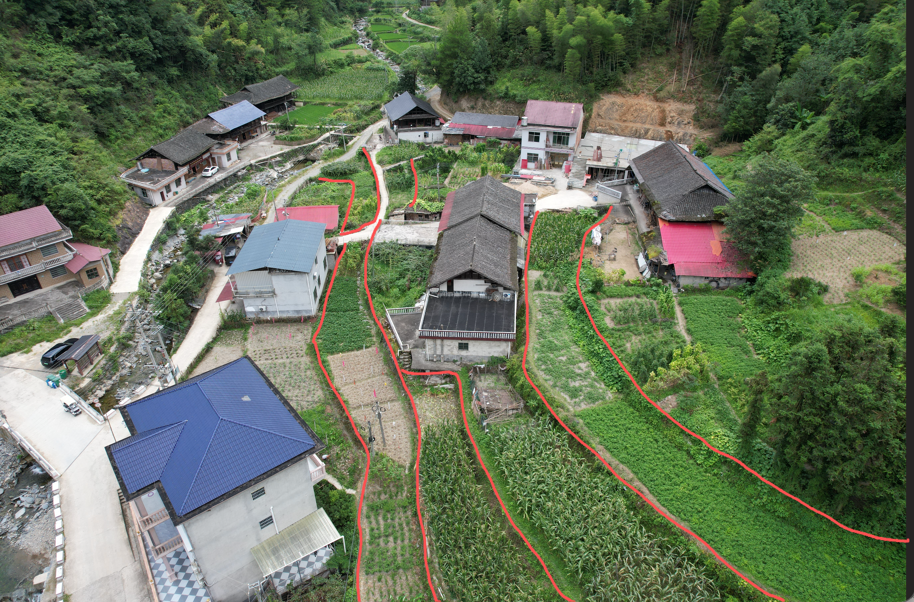

# 实景别墅模型交接

更新日期：2026-10-29。本文区分“已存在于源码的实现”“用户最新要求”和“仍待补测的事实”，供没有完整聊天记录的 agent 接续工作。

**长度单位（2026-10-18 起）：方案数据、界面与图纸长度一律为毫米（mm，整数、图上不带单位后缀；界面按需说明「单位 mm」）；面积仍为 ㎡；Three.js 场景仍用米，由 `viewer.ts` 的 `mmRoot`（scale 0.001）把 mm 几何缩到世界米。换算工具在 `src/units.ts`（`toM`／`areaM2`／`formatMm`）；旧米制 JSON 载入时自动迁移（`migrateVillaParamsToMm` 等）。** 下文「前轮」历史段落里的米制数字保持原样，读时 ×1000。

**接手先读本节「当前真相」。** 下文按日堆叠的「最新／前轮」是变更史；凡与本节或 `src/villa-params.ts` 的 `DEFAULT_VILLA_PARAMS` 冲突的数字与存储说明，一律以本节为准。

## 当前真相（2026-10-29）

### 挑空侧窗允许由普通窗改为通高窗（2026-10-29）

修改外窗高度／窗台时，若当前为普通窗，先用候选尺寸调用共用立面派生规则识别通高窗，再应用对应的跨层高度上限。新增1800高侧窗可以改为5500；仍要求整段窗宽对应挑空、上下墙面一致、上层无冲突洞口，普通房间及超出上层墙顶继续拒绝。实体上下层洞口、通高玻璃和立面沿用同一派生数据，不修改已保存户型JSON。

新增2项回归覆盖改高、退回单层、上下层洞口、保存回读、撤销重做、部分挑空／无挑空／上层门洞冲突拒绝。专项通过；类型检查与构建通过，全量599／601通过，失败仍为已记录的门厅门材质与背窗窗台断言。内置浏览器18888最终静态页可进入编辑，但SVG西墙自动选择未成功，未完成页面内改高及视觉验收。

### 西侧及地下室下方田坎航拍校准（2026-10-29）

对照西面 `原始资料/参考航拍图/dji_fly_20260816_135142_753_1786859586944_photo.jpg` 与东面 `原始资料/参考航拍图/IMG_5116.JPG`，`surroundings.ts` 分别调整三条近景轮廓：辅楼西侧上田去掉近屋反弯；西侧未开挖田改为向远田渐弯，替代旧的近屋8米横直段及西端凹口；地下室下方第一田的外沿延长转弯过渡，消除主楼前方急促的 S 弯，并保留前方砖房屋后400的接点。靠屋仍连接现有院坪西端与辅楼通道，田面标高沿用原值。上述形状来自照片估算，尚非实测轮廓，外观待用户核对。

田面、作物、田坎立面和 `groundHeight()` 共用更新后的曲线；重算场地联动时也刷新下方外沿，尺寸标注改为说明上田「靠屋前伸」，不再称整条田坎平移。新增曲线不反折、不交叉及坎两侧田面唯一／高度同源检查，场地与尺寸专项31项通过；类型检查、构建通过，全量597／599通过，失败仍是下节已记录的门厅门材质与背窗窗台断言。内置浏览器1280×720桌面、18888最终静态页已核对东侧鸟瞰及旋转至西侧的三道田坎，无应用控制台错误／警告。`villa-3d/` 已通过构建更新，本轮未执行提交、推送或保存方案／户型。

### 场地渲染性能（2026-10-29）

`render-geometry.ts` 新增 `batchScene()`：在各楼层及原独立开关范围内合并家具几何，并共用参数完全一致的家具表面；共面裁切仍以单件家具为界。纹理、PBR、深度、混合、阴影、绘制顺序及图层参与分组，自定义着色器材质不按参数合并。编辑模型继续使用 `batchStatic()`，保留家具及门窗逐件拾取、显隐与拖动；没有跨楼层或邻房开关合并。`VillaViewer` 首次直接构建已载入户型及官帽，取消默认户型构建后再替换的重复工作；后续尺寸、户型及屋面更新沿用同一场地合批入口。

本机内置浏览器PC，1434×926窗口、三维画布2218×1652、默认鸟瞰、阴影缓存已生成，同条件连续18次绘制（丢弃前3次，每次等待GPU完成）：每帧绘制1755→1022次，耗时中位数21.5→约12ms；追加三组中位数为11.9／10.9／10.5ms。可见网格854→486，材质732→366，可见三角形仍为1117719；包含玻璃透射预绘制的每帧三角形仍为2217306。同机位三维画布截图逐像素一致。该测量是本机单帧绘制样本，不等同于全流程交互帧率或跨设备承诺；首次加载的重复构建已从代码移除，未测整页加载时间收益。

新增2项合批回归；类型检查、构建通过，全量597项595通过。两项失败已用修改前 `render-geometry.ts` 复跑确认均存在：`door-model.test.ts:122` 仍按恢复造型前的咖色铸铝门材质筛选门厅正门实体，以及 `window-height.test.ts:254` 背窗窗台900／450断言。18888最终静态页PC已核对屋顶与蓝顶邻房显隐、夜景、旋转缩放、地库车辆定位、户型三维一二层及家具点选／拖动／撤销；沙发9535／300→8985／684→撤销恢复9535／300，未见应用控制台错误／警告。测试未保存方案或户型版本，源JSON保留。源码及 `villa-3d/` 构建产物已更新，未提交或推送。

### 门厅正大门恢复原造型（2026-10-28）

门厅通高入口的大门恢复门模型优化前的深色门板、装饰线和成对执手；场地及户型三维共用，其他门保持现状。类型检查和构建通过，门厅及通高窗专项11项通过；尚未做本轮浏览器视觉验收。


### 主辅楼屋面参数独立（2026-10-28，最新）

尺寸设置取消独立「屋面」页签，原参数分配到「主楼」「辅楼」。两栋楼分别控制四坡分水、顶檐挑出、天沟净宽／外反坎高／内反坎高／顶宽／找坡／瓦檐间距／探入量／压顶坡度，以及梁托长度／间距／转角间距和三眼皮至下沿线。二楼前檐、官帽造型及悬浮官帽落脊仅在主楼；悬浮仍是新建默认，普通官帽可选。右侧分水快捷控件仅调主楼。

保留原平铺字段作为主楼参数，辅楼新增 `annexRoofFenShui`、`annexGutter*`、`annexCorbel*`、`annexEyelidToFasciaGap`，并恢复 `annexEave` 独立生效。旧毫米／米制方案、尺寸版本、localStorage迁移和会议快照缺少辅楼字段时，从旧共用值补齐；旧 `annexEave` 曾被覆盖，按当时实际生效的 `thirdEave` 恢复。新文件独立值完整保存。保存的JSON文件未批量改写。

三维天沟／三眼皮／梁托／下沿线／灯带按所属楼选择构造，屋顶坡面、烟囱出口及四向立面／屋顶图同步；烟囱出口标高包含辅楼瓦檐抬高，保持相对本楼瓦面的出顶高度。天沟净半跨和找坡约束改为分别使用本楼跨度，修改一栋不再受另一栋天沟宽度限制。新增7项屋面回归包含每个辅楼字段单独改变真实网格、双向独立性、四向立面、两种官帽、换位、旧稿迁移和保存回读。类型检查与构建通过，全量595项594通过，唯一既有失败仍为 `window-height.test.ts:254` 背窗窗台900／450。

PC内置浏览器验证分别应用主楼／辅楼坡度、出檐、天沟宽度，另一栋参数保留；18888最终静态页已核对分组与官帽归属。未执行方案或户型保存，测试值已随刷新恢复保存稿。

### 北立面与院坪视角（2026-10-28）

调整两处预设机位及取景中心，画面包含左侧邻居房屋，让主楼靠近画面中央；随后按用户要求将两处机位拉近，并提高院坪机位以增强俯视效果。不改变模型坐标或邻居显示开关。构建通过，内置浏览器PC静态页核对两个视角。

### 门厅中轴对称4500＋4600＋4500（2026-10-28，最新）

用户要求把门头控制档改为两翼各4500、中间4600，并使一、二、三楼门厅处于主楼中轴。现默认与当前方案 `porticoWidth=4600`，`porticoWestOffset()` 等分两翼余宽；13600宽主楼默认X为6600，门厅柱心X为11100／15700，中轴13400。两种主辅楼位置及改主楼宽度时继续居中。门厅编辑的「开间居中」改为主楼中央控制区，不再追随偏心的室内堂屋。

三套保存户型的门厅X／宽度均同步；各自出挑保留（东侧楼梯稿1800，其余2000）。一楼中央入户门、二楼上窗和三楼中央露台门同时居中，宽高、开向和纹样保留。室内各层墙、房间、家具、楼梯、挑空及辅楼数据经与修改前副本逐项比较保持一致，版本标题和时间保留。柱间横梁／台阶、三楼短柱、官帽柱及分隔墙、中央露台、檐口／栏杆、两种官帽和各图纸依共用参数联动；默认门厅9.2㎡，首层含门厅177.2㎡。普通官帽默认外宽7100、有效瓦面5350，悬浮官帽宽5640；它们均以主楼中轴居中。

新增中轴、改宽／换位、编辑居中及三版本三楼层中央门窗与尺寸链回归，原尺寸／面积断言同步新方案。类型检查与构建通过，全量588项中587项通过，唯一既有失败仍是 `window-height.test.ts:254` 背窗窗台900／450。内置浏览器18888最终静态页PC复核三层4500／4600／4500、切换三套保存户型、两种官帽图纸及正面三维；柱心11100／15700、官帽及中央门窗居中，无控制台错误／警告。源码数据和静态构建已更新，未提交或推送。

### 官帽柱后方分隔墙同步补全（2026-10-28，最新）

用户继续指出三楼官帽柱后方黑色分隔墙仍错位150；这两段是 `facades()` 派生的露台分隔墙，上轮只统一了柱、露台及标注，遗漏了该处。现平面绘制、墙体接角与栏杆边界均向 `facades()` 传入当前户型的立面定位，分隔墙与官帽柱同轴；主辅楼换位时避免已为世界坐标的柱心再次反射。室内隔墙及保存户型未改。

已有回归补充实际SVG墙体位置断言，修复前可复现失败，修复后通过，含保存稿、改宽／出挑、凹凸门厅及换位。类型检查与构建通过；全量585／586通过，唯一既有背窗窗台900／450断言仍失败。内置浏览器18888最终静态页三楼核对，两墙及官帽柱X均为11350／15850，红框处同轴，无控制台错误／警告。未执行方案或户型保存。

### 平面柱位、露台与门厅尺寸统一当前户型（2026-10-28，最新）

二、三楼平面原混用草稿门厅与全局立面参数：南侧楼梯稿中央露台短柱横向偏150，东侧楼梯稿门厅出挑差200；门厅尺寸链也仍标全局控制线。现 `building-variants.ts` 的 `porticoElevation()` 统一派生当前户型的柱心、中央短柱、官帽柱、露台折线及边界，平面与三维／立面上下文共用；凹入门厅改进深时，官帽柱及露台后缘随墙位同步。尺寸链采用当前稿门厅两端柱心，引线从同一柱心起画。门厅平面／总图含饰线截面双向统一，不再横向900、纵向800。原雕花和保存JSON保留，不把柱子强行移到室内隔墙轴线。

33项平面尺寸／门厅专项、类型检查与构建通过；全量586项中585项通过，唯一既有失败仍为 `window-height.test.ts:254` 的背窗窗台900／450断言。内置浏览器18888静态页PC实测切换二、三层，南侧楼梯稿柱心X均为11350／15850，门厅柱及中央短柱Z为-2400，尺寸链同步为4750＋4500＋4350（世界X顺序）；三楼前后两组柱同轴、露台边线相接，无应用控制台错误／警告。未执行方案或户型保存，构建已更新至 `villa-3d/`。

### 挑空旁虚拟墙4199无法对齐4200（2026-10-28，最新）

虚拟墙距挑空边缘1毫米时，`syncRoomsToMovedWalls()`的邻接容差已将其识别为共墙，随后误套实体挑空共墙的禁止移动规则。现虚拟线仍同步普通房间，但不隐式改写挑空几何；原墙及候选墙均为虚拟线时跳过该共墙拒绝。实体墙保护、普通房不能新增侵入楼梯／挑空的后续校验保留，不放宽全局容差。

新增横竖双向4199→4200、退回4100、侵入4300被后续校验拒绝及洞口不变回归；布局对齐专项22项通过，类型检查与构建通过。全量584项中583项通过，唯一既有失败为`window-height.test.ts:254`的背窗窗台900／450旧断言。内置浏览器在18888静态页、PC二层西侧楼梯保存稿直接选中虚拟墙，将「距东侧墙线」输入4200，实际墙线X更新至11500，房间标签更新为4200×4500，无应用控制台错误或警告。只在临时标签页验证，未保存方案或户型版本，用户保存JSON未由本轮修改。

### 门廊横梁及下挂托角沿柱截面居中（2026-10-28，最新）

用户指出两柱之间下挂门廊偏向柱外侧。原定位为柱北侧面加65，800深柱对应横梁中心外偏85，阶梯／竖向托角中心外偏105／110。现以两柱共同的 `porticoColumnZ` 为实体横梁及下挂托角的进深中心；`PORTICO_BEAM_DEPTH` 共用500，阶梯托角430、竖向托角380分别居中留边。原雕花、宽度与高度保留；四向立面同步以柱心定位横梁，改柱截面、门厅凹凸或主辅楼换位仍居中。未保存方案或户型版本。

类型检查、构建通过；全量583项中582项通过，唯一原有失败仍为 `window-height.test.ts:254`（保存稿背窗窗台900、旧断言450）。既有门厅定位检查补充了横梁及托角中心核对，内置浏览器PC静态页已复核侧下方近景和旋转缩放，无应用控制台错误／警告。构建已更新到 `villa-3d/`，外观仍待用户查看。

### 梁托参数排布、侧墙根部与官帽平底收口（2026-10-28，前轮）

用户反馈梁托过密、二楼左右侧梁托根部被挡、悬浮官帽边缘白条及两侧斜腋不合适，本轮已修复：

- `facade-details.ts` 的实际渲染与公开排布工具统一使用同一个净跨排布函数，比较相邻数量对应的实际中距，选择更接近 `corbelSpacing` 的方案，不再一律向上取整挤入更多梁托。普通阳角仍按 `corbelCornerSpacing / 2` 内收；阴角仍避让完整的 `corbelLength + corbelWidth / 2 + 40`。保存稿长1730的门厅短返段在500／700／600参数下，由三件、中心距405改为两件、中心距810；端部避让不变。
- 二楼左右侧梁托与背梁原先以内收180的露台边线定位，根部落入240厚外墙。现在统一贴实际墙外皮，仅嵌入8消除接缝，下沿线随该墙皮外挑100；南端与瓦檐末端仍齐平。完整梁托长度保留；当侧面有效檐宽不足时，只把对应侧瓦檐板延到足以容纳完整出挑，默认500／800组合外檐边界不变。三维与立面共用 `apronSupportOutline()` 的墙皮、背梁及檐板边界。
- 官帽外露白条来自前轮为宽转接梁补出的浅色檐底细条，已删除。转接梁收至柱身宽度，落在最低层深色线脚内；柱冠原有外展和雕花保留。
- 两侧斜块是前轮转接梁后段斜腋，已删除，改为水平底面的封闭矩形转接梁。四向立面与三维同步，灯带沿调整后的外表面接续。下层门厅柱花纹未改。

本轮类型检查、构建通过；全量583项中582项通过，唯一失败仍为 `window-height.test.ts:254`（保存稿背窗窗台900、旧断言450）。新增实际渲染回归覆盖间距／拐角距／长度变化，以及左右侧竖脚可见性和长梁托／小出檐包络；既有柱饰、檐口、灯光及屋面立面检查通过。内置浏览器PC最终静态页已复核两侧梁托根部、官帽两侧近景和夜景灯带。构建已更新到 `villa-3d/`，未保存方案、尺寸或户型版本。外观仍待用户查看确认。

### 三楼四柱同系列雕花与悬浮官帽两端封闭收口（2026-10-28，前轮）

用户要求三楼中间两根官帽柱及两侧包角柱参考二楼包角柱优化，且消除悬浮官帽两侧柱顶的空档和零散构件交叉。已完成：

- 三楼四柱共用 `upperColumnFace()`：团寿浅浮雕、深底方折回纹、单黑线柱身及下段回折卷草。柱冠花纹按0.72的比例保留，主要缩短柱身；中央两柱删除大块空白框板，饰面连续转过侧面。下层通高门厅柱原雕花保留。
- `column-profiles.ts` 统一三楼柱冠线脚，深咖压顶下为团寿斜腹、黑箍、齿饰和回纹带；普通／悬浮官帽仍随各自檐高调整柱高。
- `hat-junctions.ts` 提供两端封闭转接梁的共用棱柱轮廓，前部承接柱冠及官帽檐底，后段斜腋接入正屋墙顶。原侧承托梁由该实体替换，中间承托梁及下沿线在其内皮结束；梁托只在中央净跨布置。正屋旧檐与下沿线准确截到转接梁外皮，取消越过端头的额外100伸出。
- 檐底仅补三眼皮内侧净空及转接梁外侧的小条，避免原整块底板与三眼皮重复共面。灯带移至新转接梁外表面，前侧接角，侧段仍按正屋坡面的遮挡位置截断。瓦面、天沟槽及屋面斜接未改。
- 四向立面使用同一转接梁轮廓，按当前立面模型的柱位数据投影，支持户型草稿变化。梁和斜腋在此仅表达外观构造关系，不构成结构节点设计。

本轮57项柱饰／檐口／灯光／屋面与立面专项全部通过，类型检查及构建通过；全量581项中580项通过，唯一失败仍为 `window-height.test.ts:254`（保存稿背窗窗台900、旧断言450）。内置浏览器PC最终静态页已复核左右斜视近景、旋转缩放及夜景灯带，无应用控制台错误／警告。构建已更新到 `villa-3d/`，未保存方案、尺寸或户型版本。外观效果仍待用户查看确认；下节三楼“小团寿／细回纹空白框板”为前轮状态，已由本节取代。

### 参考视频的柱头外展、侧下沿线与三楼包角（2026-10-28，前轮）

已抽帧查看 `原始资料/新中式参考图/新中式外观参考.MP4`（约52秒），重点参考约6秒整体、16秒门厅内凹柱身／檐下交接、36及41秒官帽柱与包角。只借鉴内收柱身、上展斜肩、连续檐线的层次，沿用自家浅石色、英国棕、团寿与回纹体系；不复制视频中的栏杆、门头字样或纹样。

- 门厅原雕花柱帽仍在下沿线底下180；该空档新增同高的外展斜肩，每侧由50增至110，斜肩顶止于下沿线底，梁托区保持连续。中段柱芯浅退32，原团寿、双心、卷草垂花和花板形状保留。
- 二楼左右包角柱删除退进柱颈，改为同系列L形外展斜肩。侧下沿线原先按内收180的露台边定位，埋入240厚侧墙，现改为实际侧墙外皮再挑100；南端采用同一瓦檐末端Z，不另缩短。
- 三楼官帽柱采用浅凹柱身、竖向细线、单道细回纹和上展深咖压顶；普通／悬浮共用，柱冠顶止于各自下沿线底。两侧新增轻量L形包角，随三楼前墙退距和包角突出量联动，使用缩小团寿、回纹、单黑线和同系列斜肩。
- `column-profiles.ts` 为三维与四向立面共用柱冠／斜肩轮廓；立面同步新增三楼包角及斜肩投影。现有屋顶瓦面及斜接轮廓保留。上述细部尺寸是造型建议，不是视频实测尺寸。

本轮相关专项49项通过；全量580项中579项通过，唯一失败仍为 `window-height.test.ts:254`（保存稿背窗窗台900、旧断言450）。类型检查、构建通过，内置浏览器PC静态页已复核正面、两侧近景、旋转缩放及两种官帽切换，无应用控制台错误／警告。未写入方案、尺寸或户型版本；外观仍待用户查看确认。下节“包角柱退进柱颈仍保留”为前轮状态，已由本节取代。

### 飘檐折角连续梁托与柱帽下收（2026-10-28，续）

用户指出门厅柱顶（红框）仍把飘檐两侧隔断。处理：删掉接到下沿线底的「门厅柱退进承托柱颈」，雕花柱帽停在 `columnTopY`（下沿线底再下 `cornerCapitalDrop`＝180）；折角梁托不再按柱位挖空，下沿线与背梁连续绕折角，柱只在下方承托。柱位承台只封瓦板切口到楼面，不伸进梁托／下沿线高度。平面折角仍落柱心（`centerFront`＝`porticoColumnZ`）。立面同步去掉该柱颈投影。包角柱退进柱颈仍保留。

类型检查、构建及门厅／檐口相关专项通过。未保存方案或户型。

### 飘檐折角落门厅柱心（2026-10-28，续）

按用户示意：二楼飘檐由上至下为墙板→梁托→下沿线，下沿线以上为整段，门厅柱只在下方承托。飘檐两侧直角折角的平面位置与门厅柱顶中心重合：`centerFront`＝`porticoColumnZ`＝柱心 Z，柱心 X 仍为门厅外包两端。露台北缘、挡墙、挑檐轮廓与立面同步。柱帽高度见上节「下收」。

类型检查、构建及门厅／布局／檐口相关专项曾记通过。未保存方案或户型。

### 删除二楼飘檐封檐竖板（2026-10-28，续）

用户指出二楼飘檐外缘多出一道竖向遮罩墙，遮住梁托。已删除三维「挑檐封檐竖板」及立面中对应投影；柱位实心贯通与主辅楼分图保留。外缘仍只见薄檐板、下沿线与梁托。

类型检查、构建及立面／檐口相关专项通过。未保存方案或户型。

### 立面挑檐交界闭合与分楼出图（2026-10-28，续完）

承接前轮「主辅楼分楼出图」：用户指出三层楼面附近挑檐仍呈空心悬浮，根因是下沿线顶到檐板底（`fasciaDrop`）在挑出区只有梁托、柱颈又为灯带挖空，立面投影出现通缝。曾加外缘封檐竖板闭合通缝；用户反馈该竖板在三维中为错误遮罩，已由上节删除。柱位承台仍实心贯通到楼面／檐板，线脚高度仅外圈让出连续下沿线；柱间近墙灯带上洗保留。主楼／辅楼仍分别出图、标注与下载。图中承托仅为造型，非结构节点。

类型检查与构建通过；立面／檐口／灯光相关专项曾记通过。效果仍待用户查看。未保存方案或户型。

### 立面分楼与柱位投影补全（2026-10-28，后续）

按用户反馈，四向立面分别显示主楼、辅楼，独立标注各自外皮尺寸、标高并分别下载 SVG；会议图册也分别出图。挑檐立面原先漏画线脚与檐板之间的三维承托梁和柱位填充，现按三维共用轮廓投影并消隐。对四处短柱所在位置的几何射线及东西侧图纸覆盖做了检查。下文「续完」已修正柱颈挖空造成的立面悬浮通缝；结构传力、偏心、配筋和基础仍需结构设计师核算，详见下方结构待核说明。

### 柱位、檐口灯带和立面图（2026-10-28）

两侧露台短柱外侧收至下层包角装饰柱外皮，并随包角突出量联动；中央两柱保持与门厅柱同轴。悬浮及普通官帽柱顶收至对应下沿线底；立面概括同步。立面以参考图为方向改为白底黑灰线与示意瓦纹，仍为模型正投影而非施工图。

二楼飘檐的线脚与背梁沿折线连续；柱间近墙灯带上洗保留，柱位本身实心贯通（见上节续完）。悬浮官帽三面灯带的侧段单独按下沿线与主屋坡面交接收口，不再按更短的梁托避让长度截断；前面及两侧转角接续。图中承托构件只是造型，非结构设计。

类型检查、构建、檐口灯光及立面等专项曾记43项通过；全量检查573／574通过，唯一失败仍是 `window-height.test.ts:254` 西侧楼梯保存稿背窗窗台实际900、旧断言450；未修改用户户型。效果仍待用户查看。未保存方案或户型。

**结构待专业核算：**短柱与包角柱外皮对齐仅是外观调整，模型中柱、承台、墙体无实际配筋及基础数据；不代表构造柱轴线吻合、传力路径成立或结构安全。门厅柱、墙角、栏杆短柱、官帽以及露台梁板和基础均须结构专业结合现场、结构体系和荷载设计核算。模型中既有承台命名只表示几何，不是结构承台设计。

## 当前真相（2026-10-27）

以源码默认为准，不是聊天记忆或下文过时段落。

### 墙端吸附与长度口径（2026-10-27）

按用户确认：实体内墙接外墙时端点到该外墙远侧外皮；接实体内墙时到对方中心线。画墙、拖端点及靠侧对齐采用此口径，墙长属性读取实际端点；截图中的一层次卧承重墙从3880显示为4000，与该房间4000的墙线轮廓进深一致。虚拟墙不扩出墙厚，真正留缝、共线分段和自由端不被旧稿自动接管；若缩短墙端会裁到已有门洞，则保留该端原位。旧户型和当前方案在应用当前尺寸并载入时自动处理实际接触的主辅楼实体墙，保留洞口世界位置、房间轮廓和已保存原文件；手动保存户型后才写入调整后的端点。旧矩形房扣墙逻辑也考虑真实补角，避免端点归一化改变净空参考。

四个保存户型的墙端重复载入幂等、门洞世界位置、房间净空和自动成房边界专项通过；反向端序、四方向、虚拟墙、真实空隙、门洞保护及拖端点回归通过。类型检查与构建通过；全量检查567项中566项通过，唯一失败为 `window-height.test.ts:254`：当前楼梯西侧保存稿一楼部分背窗窗台900，测试仍要求450。本轮未修改窗或覆盖用户户型；工作期间用户另行保存的最新户型已纳入最终构建。内置浏览器PC验证开发页画墙／撤销及18888静态页选中次卧墙均显示4000，静态页无控制台警告或错误。

### 虚拟墙外圈定位（2026-10-27）

虚拟墙接触主楼或辅楼外墙时，其接点参与对应侧外圈尺寸链；贯通两侧则两侧均标，完全位于房内的虚拟墙不投到外圈。沿用实体墙外皮／内皮接触判断，虚拟墙仍不生成实体墙。原“虚拟墙不参与外圈墙距”的旧记录作废。

### 淋浴房单面玻璃与贴墙（2026-10-27）

新家具库及旧户型淋浴房共用单面玻璃、底盘与花洒；选中淋浴房可在属性中设置玻璃门在花洒对面或局部左右侧，平面及三维同步，随旋转、撤销和户型保存生效。旧稿默认仍为对面，不自动改写。拖动时淋浴房以零留缝吸附实体墙内皮，其他家具仍留20毫米；实际卫浴排水与构造仍待设计。

### 房间尺寸与面积标注（2026-10-27）

分层户型二维编辑画布与三维标签在房间名下显示建筑参考和套内参考的宽深及面积，随草稿房间与墙体重算。建筑参考为模型墙线轮廓面积，套内参考为扣模型墙厚的净空面积，未扣柱梁、装修及设备；不是法定面积。凹形空间的宽深注明包络，面积按实际轮廓，开敞区和失去围合另有提示。二维缩放保持标注行距；三维总览房间密集时标签可能互相遮挡，可放大或旋转查看。

标注不写面积类别文字：上行黑色粗体为建筑参考，下行灰色为套内参考，均采用较小字号。

### 漫游操作提示（2026-10-27，后续）

户型三维点击「漫游」后先显示居中操作说明卡，可开始或取消；开始后画面上方持续显示快捷键，退出时恢复普通提示。提示按实际支持的 WASD／方向键、拖动转向、Shift 快走和 Esc 退出编写；尚无 E 开关门或 Esc 暂停。切换楼层或离开三维会收起开始提示。类型检查、构建与漫游专项2项通过；内置浏览器PC检查开发页和18888构建页的提示、开始、取消和退出，未运行全量测试。

### 户型三维漫游与夜景（2026-10-27，后续）

「分层户型 → 3D场景」增加漫游和夜景：可先选房间作为漫游起点；拖动画面转向，WASD／方向键移动、Shift快走，Esc或按钮退出。漫游临时使用全高墙，退出后恢复原相机和剖切设置；按墙体几何阻挡并可沿墙滑动、通过洞口。当前只在所选楼层水平移动，切楼层会退出；未实现爬楼、家具及门扇碰撞或开门动画。夜景按本层房间布置示意暖光，与漫游可同时使用；退出户型三维后恢复场地／日照原光照，夜景不写入方案数据。

方向、斜向速度、墙前阻挡、沿墙滑动及门洞专项2项通过；既有三维场景／编辑工作台专项16项通过，类型检查和构建通过。全量检查553／554通过，唯一失败为既有 tests/window-height.test.ts:280 保存稿背窗数量断言（实际11、预期12）。Codex内置浏览器PC复核开发页与18888静态页的夜景、移动、转向、Esc退出；开发页另检查切换楼层与返回场地的光照，控制台无错误或警告。未执行方案／版本保存，7份保存源JSON与开工哈希一致。

### 默认灯色改为日落橙（2026-10-28）

夜景洗墙灯默认颜色改为日落橙（#ff7030），快捷选项默认选中日落橙；原始暖光仍可手动选择，默认亮度保持150%。

### 梁托受光柔化（2026-10-28）

降低梁托光亮强度，并按距下沿高度和表面朝向衰减，使灯带附近和朝下的面更亮；仍随夜景、颜色和亮度联动。这是受光示意，不是物理配光。构建及灯光专项测试通过，尚未做浏览器视觉验收。

### 梁托洗墙效果增强（2026-10-28）

加强向上渐隐的洗墙光晕，并为梁托添加随夜景开关、灯色和亮度联动的发光示意；亮度为零或关闭夜景时恢复。该效果是模型示意，并非灯具配光计算。类型检查、构建和灯光专项测试通过，未做浏览器视觉验收。

### 洗墙灯暖色快捷预设（2026-10-28）

快捷灯色调整为更饱满的暖色系列：保留原始暖光，提供三档暖白、金色、琥珀、日落橙和玫瑰暖光；自定义颜色和亮度调节不变。色温名称仅为屏幕近似。

### 夜景入口与默认亮度（2026-10-27，后续）

「模型显示」首项为夜景开关；仅开启时展开快捷灯色、自定义颜色及亮度。洗墙灯初始亮度由100%提高到150%，默认仍是原始暖光；同一页面内关闭再开启保留手动颜色和亮度，刷新恢复默认。内置浏览器PC核对关闭时收起、开启时展开及150%默认值，并验证冰蓝75%在关闭再开启后保留；无应用控制台错误或警告。类型检查及构建通过；本轮未重跑全量测试。

### 洗墙灯快捷颜色（2026-10-27，后续）

「模型显示」在自定义颜色选择器旁新增8个快捷灯色：原始暖光、2700K／3000K暖白、4000K自然白、5000K冷白、琥珀、冰蓝及柔紫。点击即更新灯光和颜色选择器，保留当前亮度；自定义颜色与预设匹配时高亮相应按钮，否则取消高亮。默认仍是原始暖光。色温只是屏幕近似示意，不对应实测灯具配光。白光规格参考 [Philips UNIstrip G3](https://www.assets.signify.com/is/content/PhilipsLighting/comf6970795-pss-en_hk) 的2700K／3000K／4000K，以及 [Philips UniBar Compact](https://www.signify.com/global/prof/outdoor-luminaires/architectural-floodlighting/direct-view-lighting/philips-unibar-compact/LP_CF_243059635_EU/family/page/2) 的5000K及RGB选项。

类型检查与构建通过，灯光专项3／3通过；内置浏览器PC检查白光、冰蓝、自定义颜色、亮度保持、恢复原始暖光和选中状态，无应用控制台错误或警告。本轮未重跑全量测试，也未保存方案。

### 恢复最初的默认暖光（2026-10-27，后续）

默认灯管保持最初的暖白 `#ffd99a`，默认洗墙光恢复最初的暖琥珀色；自选颜色和亮度仍可调整。新增专项验证默认灯管和光晕颜色，以及自选颜色／亮度；灯光专项3／3通过、类型检查及构建通过，内置浏览器PC近景确认默认效果，无应用控制台警告或错误。本轮未重跑全量测试。

### 洗墙灯转角连续与颜色亮度（2026-10-27，后续）

二楼折线挑檐、三楼屋檐及辅楼灯带与光晕按相邻檐线的偏移交点接续，处理阳角与阴角，并与普通官帽和墙面交接对齐；悬浮官帽与主屋檐口存在实际标高差，各自跟随所在檐线。场地模型「模型显示」可选择洗墙灯颜色、调整0%～200%亮度，0%熄灭；切换夜景及重建屋面保留本次页面选择，刷新恢复默认暖白100%，不写方案文件。

新增专项核对辅楼四角、二楼折线阴阳角灯带和光晕端点闭合，颜色／亮度应用及零亮度。类型检查与构建通过；全量检查556／557通过，唯一失败仍为既有保存稿背窗数量断言（实际11、预期12）。内置浏览器PC检查侧墙转角、颜色、0%和150%亮度、屋面分水变更后的灯光设置，无应用控制台警告或错误；未保存方案。

### 洗墙灯移至下沿线顶面（2026-10-27，后续）

按用户近景标注，将二楼飘檐、三楼主屋及官帽、辅楼屋檐的灯带由下沿线下方移至线脚上表面边缘，暖光从线脚顶向上渐隐至檐底，不再向下覆盖窗墙。线脚标高和光晕高度分别跟随对应檐口参数；两种官帽、折线挑檐及辅楼共用，夜景开关保持原行为。灯光仍为视觉示意。

灯带及外观专项34／34通过，类型检查与构建、`git diff --check`通过；内置浏览器桌面端近景确认位置和光晕方向，无应用控制台警告或错误。本轮未重跑全量测试或保存方案。

### 场地夜景与檐下洗墙灯（2026-10-27，后续）

「场地模型 → 模型显示」新增夜景模式，开启时调暗场景并自动点亮暖白灯带与渐隐洗墙光；关闭恢复日间照明。二楼折线飘檐、三楼正屋及两种官帽、辅楼屋檐按实际梁托与下沿线逐边生成，跟随屋檐尺寸、屋顶重建及主辅楼／屋顶可见性；切到日照分析等视图恢复原照明，回到场地保留本次开关状态。灯光是便于观察的贴面视觉示意，不是灯具配光、照度或电气设计；场景刷新默认关闭，不写入方案文件。

新增 `eave-lighting.ts`，光晕支持对数深度与遮挡，透明灯光不参与缩放碰撞。专项2项通过；构建与类型检查通过；全量检查555／556通过，唯一失败为此前交接已记录的保存稿背窗数量断言（实际11、预期12）。内置浏览器桌面端检查北立面、屋顶显示、夜景开关和日照切换；暖色光晕与日间恢复正常，未保存方案。

### 辅楼圆桌拉椅圈随当前草稿联动（2026-10-27，后续）

用户指出餐桌已经移动、外侧棕色虚线圈却停在原地。该圈为圆桌桌缘外550毫米的拉椅讨论留位；原`plan.ts`读取全局已发布家具，桌子本身读取编辑草稿，导致两套位置脱节。现圆桌与虚线圈统一使用当前`PlanSource.annexFurniture`，移动、改直径、删除、撤销重做和三维回写二维均同步。兼容旧`roundTable`及家具库`fp-roundtable`，多张圆桌各画自己的圈，没有圆桌时不生成占位圈；关闭「餐厅拉椅范围」、日常收起和非首层不画圈。显示按钮补充范围说明；旧餐厅提示改为读取当前草稿的实际示意余量，移除固定座数和“两桌必相交”的旧结论。此圈不代表房间边界或已核定的通行净距。

辅楼家具原已与主楼共用`LayoutEditor`、`snapFurnitureDuringDrag()`及旋转占地避让；本次未另建辅楼吸附算法。新增集成回归确认主辅楼均支持真实墙面留位、房间净空中线吸附、家具接边及前沿对齐、旋转碰撞避让、关闭／暂停吸附和撤销重做。圆桌及吸附／家具库专项26项通过；4项拉椅圈新回归在修复前副本全部失败、修复后通过。类型检查与构建通过，静态产物仅经构建更新。最终全量`npm run check -- --test-concurrency=2`为**551／552通过**；唯一失败为`window-height.test.ts:280`保存稿背窗数量断言（实际11、预期12），修复前副本也以11／12失败。

Codex内置浏览器PC 1280×720复核18888静态页：复现旧圈停在Z=4000而餐桌已到5000；修复后数值改位、指针拖动、改直径、删除及撤销重做同步，三维属性改位回二维同心，无应用控制台错误或警告。最终构建再次核对改位／撤销与圈桌同心，截图在本聊天visualizations目录。本轮未执行方案或版本保存；期间用户外部保存的户型及索引已保留并纳入构建，其余6份保存源JSON保持开工哈希。

### 扶手转角圆润化（2026-10-27，后续）

用户近景指出坡段转平台仍有尖锐三角折面。前轮斜切拼接虽无缝，但不能提供圆润弯头；现新增`railing-handrail.ts`，沿整条相连扶手中心线作局部C2光顺，再扫掠圆角矩形截面。相邻转弯、坡度变化及截图同规格三跑的70毫米短平台一起处理，避免逐短段弯曲产生扭折或翻面。木、玻璃、钢制及大理石共用；石材下沿线随同一路径，接缝位置、切线及法线一致。转角仍只生成一根实体主柱，柱脚、梯段、平台、楼梯通口及保存格式保留。

`railing-network.ts`按全楼连接关系派生路径，单层来梯、完整房屋和编辑三维同源；增量缓存签名包含曲线路径。原下横档、竖栏与玻璃填片继续沿各自直段生成。下文前轮关于顶扶手采用斜接端面的实现由本节取代。

栏杆／挑空／三跑专项**36／36通过**，涵盖四种造型与旧`brick`别名的正反坡、单柱、实际扫掠网格接缝及短平台无翻面；类型检查、构建和`git diff --check`通过。最新全量`npm run check -- --test-concurrency=2`为**545／546通过**，唯一失败仍为`window-height.test.ts:280`保存稿背窗数量旧断言（实际11、预期12），本轮未修改该门窗逻辑。

Codex内置浏览器PC 1280×720复核18888最终静态页：二楼三跑坡段／平台近景、四种造型切换均正常，原尖角消除，无应用控制台错误或警告。木与大理石效果图保存在本聊天的visualizations目录。未执行方案或版本保存；8份保存源JSON相对开工哈希全部不变，静态产物仅经构建更新。

### 剖切墙保留整门与把手比例（2026-10-27，后续）

用户截图指出木门把手靠在门顶。原因是户型三维将2200高的门扇随墙体裁到1200，而执手仍在原离地约1050处；前轮只核对五金不移位，遗漏了半截门的视觉误导。现`editor-model.ts`的「剖切墙」保留完整门扇及门框，普通内外门和玻璃推拉门共用；门按实际墙体全高及梯下净高限制，窗和无门洞继续遵循原剖切。入口一体门头保留下层整门及门顶横框，上层玻璃仍剖切。门模型底层的显式裁切API保留，完整房屋、洞口尺寸、开向和五金离地标高不变。

4份保存户型回归增加剖切／全高的合批后实际门实体高度对照、木门执手实体及相对完整门高的比例检查；临时载入本轮修复前的编辑模型时，该回归以1650／2691的门顶标高差失败，修复后通过。门模型／编辑／比例专项21项通过，一体入口的凸凹门厅、主辅楼互换及上下层剖切回归按新表达更新并通过；类型检查和构建通过。最新全量**543／545通过**，剩余失败为同期栏杆斜接端面回归和保存稿背窗数量断言（11／12），本轮未修改这两处逻辑。

Codex内置浏览器PC 1280×720在18888静态页复现旧门截短，更新后近景可见完整门扇与位于中部的执手；「剖切墙／全高墙」切换正常，无应用控制台错误或警告。对照图在`/tmp/villa-door-handle-20261027/`。未执行方案或版本保存，7份保存源JSON开工哈希全部不变；同期栏杆源码及外部构建保留。前轮关于户型门扇随1200墙体一起剖切的表达由本节取代。

### 全屋门实体精修（2026-10-27，后续）

用户要求门的造型更真实。新增`door-model.ts`，完整房屋、户型三维及一体门头共用：入户咖色铸铝双门采用厚门扇、凹入门芯、倒角压线、古铜长拉手及中缝密封；室内浅胡桃木门增加竖向木纹、双面门套、门框止口、分节铰链、横执手与锁孔；玻璃推拉门增加错层双扇、独立框玻璃、双轨和密封压条，交叠内侧使用嵌入扣手，外侧弯管拉手避开邻扇。门套包覆实际墙厚，原洞口尺寸、位置、单双扇、开向和保存格式保留；一体门头上窗、装饰板及连续外框沿用。剖切只截原位构件，不把上横档或五金下移至切口。尺寸及材质为造型表达。

新增5项回归覆盖单／双开四种方向、多墙厚、滑门错层及拉手避让、剖切、铜门中缝及4份保存户型的完整／编辑三维同源；同步调整旧测试对门套外包络的断言。门模型、编辑工作台与比例专项**21／21通过**，类型检查和构建通过；最新全量`npm run check -- --test-concurrency=2`为**544／545通过**，唯一失败仍为`window-height.test.ts:280`保存稿背窗数量断言（实际11、预期12），不是门尺寸或门模型回归。

Codex内置浏览器PC 1280×720复核18888最终静态页：场地北立面入户门近景、分层户型的室内门、辅楼玻璃推拉门及剖切／全高墙正常，无应用控制台错误或警告；截图保存在`/tmp/villa-door-refinement-20261026/evidence/`。未执行方案或版本保存，期间外部保存的西侧楼梯户型及索引已保留并纳入构建，其余5份保存源JSON保持开工哈希；同期墙角及栏杆改动保留，不计作本轮门造型实现。

### 全屋三维墙体直角补齐（2026-10-27，后续）

用户指出户型三维的相交墙在外角缺一小块。原因是二维描边及净空已用`physicalWallJoinExtensions()`补齐墙皮，编辑三维盒子和完整房屋挤出墙仍在各自端点截断。现`partition-geometry.ts`统一生成实体内外墙邻接关系和派生端点，编辑三维剖切／全高墙、完整房屋、三层主楼及辅楼共用同一接触规则；L角按相邻墙厚补齐，T形／十字交叉及不同墙厚沿用同源规则。虚拟分界不生成实体补角，真实2毫米空隙不吸合。完整房屋保留隔墙端头埋入外墙的处理，门窗定位按沿墙轴的有符号位移补偿，正反墙向均保持原洞口位置；源墙线和保存格式不修改。

新增回归覆盖八种L角方向、承重墙／隔墙、三层及辅楼的剖切／全高／完整房屋、门洞不漂移、自由端／共线／T接／虚拟墙／真实空隙，逐份读取4份保存户型核对100处补角采样。临时对照中移除三维补角接入，合成与真实保存稿的缺角回归均失败；修复后墙角／描边／门洞／渲染专项19项全通过，类型检查和构建通过。最新全量`npm run check -- --test-concurrency=2`为**544／545通过**；唯一失败为`window-height.test.ts`保存稿背窗数量旧断言（实际11、断言12），移除本轮补角的对照同样失败，不属于补角新增回归。早期另有门模型断言失败，外部同期更新后最新全量已通过该项。

Codex内置浏览器PC 1280×720复核18888静态构建：一二三层与辅楼剖切、二层全高、环绕／俯视和放大近景，截图标出的墙角已闭合，页面有正常内容、无错误遮罩，无应用控制台错误或警告。未执行方案或版本保存；期间另有户型源文件及索引的外部保存，已保留。其他保存源JSON相对本轮备份不变，静态产物仅经构建更新。本次未验证PC之外的终端，也不涉及结构节点设计。

### 栏杆选择移至楼梯与挑空对象属性（2026-10-27，后续）

用户要求取消尺寸面板中的栏杆配置入口。现于「分层户型」点击楼梯或二楼客厅挑空，在右侧对象属性的「栏杆造型」选择玻璃、实木、大理石栏杆、钢制，直接更新二维与三维，无需「应用参数」。楼梯选择同步各层梯段、平台与洞口护栏；挑空选择只影响挑空临空边。两者使用同一编辑草稿与撤销／重做记录。

新选择分别写入`stairLayout.railingStyle`和`livingVoid.railingStyle`，随户型版本、完整方案及会议快照保存；范围调整、楼梯类型切换和JSON回读保留。对象缺省时读取旧方案参数`stairRailingStyle`／`livingRailingStyle`，再使用默认楼梯实木、挑空玻璃；旧`brick`仍按大理石显示，不改写用户保存的旧JSON。下文「尺寸设置 → 室内栏杆」是历史入口，由本节取代。

栏杆、挑空与三跑专项**35／35通过**，类型检查、构建及`git diff --check`通过。最新全量检查**540项中537通过、3项失败**：编辑双开门包络、模型门窗高度、保存稿背窗数量；这些门窗逻辑未在本次栏杆入口迁移中修改，不能将全量检查记为通过。Codex内置浏览器PC 1280×720核对18888静态页：点击楼梯／挑空显示各自选项，玻璃楼梯与大理石挑空独立更新、撤销／重做生效、跨楼层与2D／3D切换保留选择；尺寸设置不再有栏杆页或旧控件，无应用控制台错误／警告。

本次未执行方案或版本保存；期间户型版本及索引有新的外部保存，均保留并纳入最新构建，其他5份保存源JSON保持开工哈希。浏览器验收在临时内置标签页进行，未改变用户原标签页的未保存编辑。

### 室内栏杆连续转角与共用立柱（2026-10-26，后续）

用户指出楼梯扶手在拐角处断开，挑空转角并排出现两根柱子。现由`stair-railing.ts`描述斜段、休息平台及楼面交接路径，`interior-railing.ts`先计算全楼拓扑，`railing-network.ts`统一连接标高、斜接截面和主柱归属。玻璃、实木、大理石与钢制四种造型及旧`brick`别名共用；转角只生成一根主柱，直线上的分段接缝不重复加端柱，扶手两侧的接缝网格顶点重合，不依靠柱子遮住空隙。

梯井口横段只在边侧接到两条梯段的内扶手轴线，不横封起步或到达通口。梯段在平台／楼面交接处连续过渡标高；柱脚按实际踏步或平台落地。楼层交接柱由楼层护栏持有，下层来梯副本使用同一组接缝，单层剖看、完整房屋和编辑三维不叠加第二根柱子。二维端点同步，楼层增量缓存包含相邻接缝的签名；原踏步、平台、洞口和保存格式保留。此前逐段独立端柱的描述由本节取代。

新增回归核对四种造型及旧别名的水平／正反斜段实际斜接网格与单根实体主柱，覆盖两跑／三跑、双轴、正反向与起步侧共16种摆放的连续路径及跨楼层主柱归属。栏杆和楼梯专项30项、全量`npm run check -- --test-concurrency=2` **535／535通过**，类型检查、构建及`git diff --check`通过。Codex内置浏览器PC 1429×926复核18888最终静态页，切换四种造型检查挑空与楼梯接缝，并核对三楼来梯／平台及二维通口；无应用控制台错误／警告，栏杆选择已恢复用户原实木／实木。效果为几何模型表达，未开展承载或连接节点设计。

本轮未执行方案或版本保存；期间户型版本与索引有新的外部保存，已保留并重新构建，其他5份保存源JSON保持开工哈希。最终验证以纳入新保存稿的重跑结果为准；静态产物仅经构建更新。

### 统一为大理石栏杆（2026-10-26，后续）

用户最终明确中间不要红砖，名称改为「大理石栏杆」。现移除砖柱选项及全部红砖材质、水平灰缝和错缝几何，主柱、花瓶小柱、柱脚、柱头和连续线脚扶手统一浅色大理石纹理。菜单仅有玻璃、实木、大理石栏杆、钢制四种；旧稿`brick`由`canonicalRailingStyle()`作为`marble`兼容别名读取，面板、平面图、完整房屋及编辑三维均显示新名称与石材效果，不覆盖保存JSON。挑空边缘、楼梯斜段／平台和洞口护栏共用；柱身竖直落在实际踏步上，柱头贴扶手坡度。用户随后指出方主柱过粗，现取消直段中间每1800的方墩，仅两端保留110宽小主柱，柱头最大150；花瓶柱最大直径由120缩至84，曲线平滑；扶手由240缩到140宽、主体厚50并作小倒角，下沿线厚18；水平下横梁高45、宽110。柱间保持通透，二、三楼起步与到达通口继续保留。此前“砖柱与大理石两种选择”及粗柱方案已取消。

造型比例参考[Marblebee在售白色大理石栏杆](https://marblebee.com/products/marble-balusters)的连续花瓶柱、细颈与线脚扶手，主柱可选的组合另参照[Jiamei石材栏杆系统](https://www.jiameistone.com/balustrade.html)。具体尺寸与材质纹理为模型表达；栏杆最大厚度由280减到150，同步参与二维线宽、楼板承托、实体墙避让与梯段内收。挑空和楼梯共用，不改各自高度。

更新栏杆回归，覆盖四种造型及旧`brick`兼容、柱间射线通透、水平及正反斜梯的柱脚标高、JSON和面板选项；特别断言旧砖柱不再生成砖色、砖缝或砖柱名称，所有石材构件统一使用大理石纹理，菜单不再出现重复的砖柱选项。新增长5000的水平及正反斜段回归，确认主柱仅在两端、所有实体厚度落在150占地内。栏杆与楼梯专项28项、全量`npm run check -- --test-concurrency=2` **533／533通过**，类型检查、构建和`git diff --check`通过。Codex内置浏览器PC 1429×926复核18888最终静态页，二楼挑空及二、三楼大理石楼梯近景中，连续细瓶柱、扶手和梯口正常；三楼二维栏杆厚150与三维同源，无应用控制台错误／警告。预览最终保留挑空大理石、楼梯恢复用户原实木选择。7份保存源JSON哈希不变，未执行方案或版本保存。

### 二、三楼楼梯通口栏杆修正（2026-10-26，后续）

用户指出西侧三跑楼梯的起步口被自动栏杆封住。此前洞口规则只给上跑到达端留口，遗漏下跑起步端；现由`stairOpeningRails()`同时扣除两条梯段的整宽通口，保留中间梯井及其余临空边护栏。正反向、双轴和起步侧切换沿用同一规则，二维、完整房屋及编辑三维同步更新，四种造型均生效，保存户型与方案JSON不改写。

入口回归在修复前失败，修复后覆盖两跑／三跑、双轴、正反向、两种起步侧共16种布局与四种造型，同时检查起步、到达通口及中间梯井防护。楼梯与栏杆专项27项、全量`npm run check -- --test-concurrency=2` **532／532通过**，类型检查、构建及`git diff --check`通过。Codex内置浏览器PC 1429×926复核18888最终静态页「户型-楼梯在西侧」的二、三楼平面和三维：两侧通口畅通，横杆仅留在梯井端部，无应用控制台错误／警告。未执行版本或方案保存；静态产物仅经构建更新。

### 普通官帽比例修正与悬浮默认（2026-10-26，后续）

用户确认改造普通官帽，并将悬浮官帽作为默认方案。`roof-options.ts`统一定义`DEFAULT_ROOF_STYLE="floating"`，新建／恢复默认／尺寸版本、场景与屋顶图首次进入均使用悬浮；按钮顺序为「悬浮官帽／普通官帽」，原「原有官帽」改称「普通官帽」。`public/scheme/current.json`仅将`roofStyle`从`joined`改成`floating`，其他字段不变。历史文件明确保存的选择继续回读；缺少该字段的旧方案、尺寸版本与会议快照仍按历史普通官帽解释，不批量改写旧版本。

窄尖的原因是普通官帽外宽仍按门厅宽＋1040计算，天沟加宽后瓦边内收从早期280扩大至875，默认有效瓦宽被压至3790，前部起脊点又按总宽的42%固定，前坡约53.3°。现由`joinedHatLayout()`单独计算普通官帽：目标有效瓦宽＝门厅宽＋750，天沟宽度向外补足；默认外宽7000、有效瓦宽5250，前部起脊点按有效瓦面半跨后移，前／侧等坡约36.6°。保持与正屋同檐同脊，纵脊仍接主脊；偏移门厅或较窄主楼时限制外包络、保留两翼及接脊长度。750与两翼预留1000均为模型造型建议，不是施工控制尺寸。

3D瓦面、天沟及檐口、承托梁回纹、屋顶图和四向立面共用新几何；悬浮官帽原宽、落脊与柱高逻辑保留。载入尺寸／完整方案时，非屋顶层平面视图同步当前官帽选项，避免图纸保留上一种帽型。

本轮新增4项回归覆盖默认／历史选择、有效瓦宽不被天沟挤压、草稿门厅及主辅换位／退台／凹入组合、偏移时两翼限制；原屋面接缝、瓦垄连续与梁托收口测试按实际新几何复查。`npm run check`全量**532／532通过**，类型检查、`npm run build`及`git diff --check`通过；统计含工作区并行的室内栏杆改造。Vite配置兼容与500kB包体提示仍在。

Codex内置浏览器PC 1280×720核对18888最终静态页：刷新后悬浮默认、普通切换、旋转／缩放近景、屋顶图与北立面切换均正常，无应用控制台错误或警告；预览已恢复悬浮，未点击方案或版本保存。相对本轮备份，另外7份保存源JSON哈希一致，当前稿仅官帽选项变化，构建产物已同步。外观待用户审美复核；未开展结构／排水节点验算。

### 挑空自动栏杆与楼梯造型（2026-10-26，后续）

「尺寸设置 → 室内栏杆」新增挑空和楼梯两个独立选项：玻璃（金属立柱＋分片玻璃＋连续扶手）、实木（木柱／柱头＋木扶手＋竖栏）、大理石栏杆（浅色石纹主柱＋花瓶柱＋线脚扶手）、钢制（深灰方柱＋细竖杆）。选后点「应用参数」；默认挑空玻璃、楼梯实木。`livingRailingStyle`／`stairRailingStyle`写入方案参数，随尺寸版本、完整方案和会议快照保存；旧稿补默认值，非法造型拒绝。没有批量改写保存的户型／尺寸JSON。

`interior-guards.ts`按二楼当前`livingVoid`推导临空边，在楼板侧内收栏杆半厚加20，按实际交点裁分，避开外墙、实体承重／隔墙、其他挑空、楼梯洞口与按真实弧度旋转的手动栏杆；虚拟分界不遮挡。挑空改位／宽深、跟随一楼、撤销重做与删除后直接重建；首层客厅没有高差，不沿其地面额外围一圈。楼梯楼层洞口同时保留下跑起步与上跑到达的整跑宽通口，已有墙体处不重复放栏杆。

`railing-model.ts`共用水平／斜段造型，挑空与楼层洞口高1100、梯段高950；模型默认值仅为造型表达。两跑／三跑、双轴、正反向及起步侧保留原踏步几何，各材质立柱落到实际踏面。完整房屋与户型编辑三维共用造型和边线；二维显示自动栏杆轮廓，切造型会使楼层增量缓存失效。手动家具栏杆、院坪与三楼室外露台沿用原有模型。

造型参考：[Viewrail立柱玻璃系统](https://www.viewrail.com/system/posts)、[木／金属扶手](https://shop.viewrail.com/handrail/)、[Haddonstone柱式栏杆](https://www.haddonstone.com/wp-content/uploads/2022/05/BALUSTRADING.pdf)。采用其构件组合进行概念表达，不套用厂家承载或连接设计。

新增11项栏杆回归通过，覆盖四种造型、墙与手动栏杆避让、挑空编辑／删除、正反向双轴两跑／三跑、洞口入口、阶梯支承、旧稿／JSON、主辅楼换位／凹入门厅、二维与两种三维及增量缓存。最终全量`npm run check -- --test-concurrency=2` **531／531通过**，类型检查、构建与`git diff --check`通过；此前并行检查的官帽旧断言及测试进程SIGKILL，分别重跑通过后由本次全量覆盖。同期屋面及用户保存改动保留，未把这些改动记作本轮栏杆实现。静态产物只经构建更新，既有包体提示保留。

Codex内置浏览器PC 1429×926复核18888静态页，实测分别选择挑空钢制／楼梯玻璃、挑空实木／楼梯钢制、双砖砌，面板应用、二楼三维与压顶／竖杆／玻璃效果正常，无应用控制台错误／警告。未执行版本或方案保存。模型不包含栏杆承载、锚固、玻璃选型或施工节点验收。

### 二楼客厅挑空联动与独立编辑（2026-10-26，后续）

二楼客厅挑空不再使用普通房间的禁止编辑分支。选中后，属性可切换「跟随一楼客厅／自定义范围」，并选择一楼对应房间；旧稿按实际轮廓交集识别来源，不依赖“客厅”名称或固定ID。同一开间的旧挑空默认与一楼对齐，历史跨开间自定义范围保留；无法安全对齐时保留原范围并标为自定义。西侧楼梯稿在内存中跟随一楼房间3，范围由4600×5500对齐到4600×4514，未覆盖保存文件。

跟随模式响应一楼来源房间的位置、宽深及边墙修改；二楼可直接拖动区域、拉四角、方向键微移或输入X／Z／宽／进深，主动修改即切成自定义，支持一间半、两间等实际尺寸。切回跟随后重新对齐来源。超出主楼包络、宽深不足1000或新增覆盖二楼房间／楼梯时拒绝并保留原状态；跟随扩大冲突时一楼整次编辑回滚。1000为保存格式和概念模型的编辑下限，不是结构设计标准。凹形来源暂需自定义矩形挑空，保留现有墙房约束，不自动删墙或搬动家具。

`livingVoid.mode`／`sourceRoomId`为可选兼容字段，随JSON、版本、撤销重做及主辅楼换位／缩放保存。二维分区与真实洞口一并修改，删除挑空同时封板；挑空不支持复制为普通房间。完整三维二楼楼板与编辑三维共用正交扣洞几何，支持跨开间、任意位置、贴外墙、凹入门厅及主辅楼换位，不再把洞口锁在原西北角。

新增10项回归覆盖旧稿识别、一楼尺寸／位置／边墙联动、自定义范围、跨开间宽度、冲突回滚、来源切换／删除、挑空删除、JSON与缩放，以及完整／编辑三维射线扣洞。`npm run check` **517／517通过**，类型检查、构建及 `git diff --check`通过；静态产物只经构建更新，原Vite兼容及500kB包体提示保留。

Codex内置浏览器PC 1429×926验证5173开发页及18888最终静态页：数字输入4000进深、原生拉角缩到3893×3366、切回跟随恢复4600×4514、一楼Z从−400改为−200并同步二楼、扩大至6900时提示覆盖二楼房间并回显、二维／三维切换及撤销重做通过，无应用控制台错误／警告。验证结束已恢复跟随原范围，未点击版本／方案保存。过程中15:25的西侧楼梯户型与索引有新保存，已保留并纳入构建；此后7份保存源JSON哈希复核一致，不把开工哈希不一致误报为全程未改动。

### 户型尺寸链去重与楼梯局部标注（2026-10-26，后续）

用户指出三楼门头侧出现两套相同的4500／4500／4600标线，屋后则叠加墙线定位和整栋楼梯模型边框定位链。现按《房屋建筑制图统一标准》GB/T 50001-2017第11.3节的由近向远排列尺寸原则，保留有不同定位意义的墙线、面宽控制和最外层总尺寸；同侧墙线与面宽控制的全部整数毫米端点一致时合并，保留面宽控制链。仅去重完全相同的端点，不按距离阈值吞掉真实偏移，墙线与开间控制不一致时继续分别显示。

取消楼梯常驻的整栋宽度定位链及「楼梯定位（模型边框）」文字。浏览与普通图纸仅保留实体墙定位；编辑选中楼梯时补两条仅覆盖梯间边框的宽／深局部尺寸，进深放在楼梯较近的建筑外侧，选中与取消选中不改变外圈墙线链和图纸坐标系。楼梯位置、宽深等仍由属性面板查看和编辑。尺寸显隐继续统一控制这些标线，保存户型载入后自动采用新画法，不改动墙、楼梯、门窗或版本数据。此前关于楼梯常驻独立外侧整栋定位链的描述被本节取代。

标准原文参考：[GB/T 50001-2017第11.3节](https://yuedu.ocsyun.com/ocsyuedu/188a8d0d95ef4adfbc395aa2e9392d37/2a273abd09dd42ecac1cf1bdb23fa71c)。本轮调整尺寸标注层级与重复显示，不表示概念模型已具有完整施工图设计深度。

尺寸及编辑专项36项、全量 `npm run check` **507／507项**、类型检查、`npm run build` 和 `git diff --check`通过。新增回归覆盖相同端点合并、一毫米真实偏移保留、三层楼梯仅选中时显示局部宽深，以及选中前后外圈尺寸与坐标系不变；已有楼梯改宽回归同步为仅检查局部标注更新。

Codex内置浏览器在18888最终静态页、PC 1428×926复核「户型-楼梯在西侧」三层：门头侧重复分档合并、屋后只留实体墙链；选中楼梯出现2664宽与4000深的局部尺寸，取消选中即消失，尺寸图层统一隐藏／恢复。一层主辅楼及二层排布正常，三层最终图无框架错误或应用控制台错误／警告。同步修正楼梯属性面板的旧说明。7份保存源JSON哈希与开工一致，未操作版本／方案保存；静态产物仅经构建更新，原Vite兼容与500kB包体提示保留。

### 屋顶四角墙面条纹（2026-10-26，后续）

用户近景指出屋顶四角仍有竖向条带，带内呈水平细纹。定位到 `wallWithOpenings()` 把墙体所有三角面的贴图坐标统一设为XY：墙厚端面的X恒定，导致白麻贴图压成一列再横向拉伸；墙顶和门窗洞口横面的Y恒定，也存在同类问题。现按实际面朝向采用XY／ZY／XZ毫米投影，保持贴图颗粒的二维尺寸。主辅楼、各层墙角和门窗洞口共用此修正，外包络、洞口、墙厚、原有分缝及保存方案不变；不增加遮盖墙角的装饰柱。

新增回归遍历主辅楼四向立面全部墙体三角面，比较实际表面与贴图面积；修复前端面面积比为0，修复后全部为1。渲染专项6项、全量 `npm run check` **505／505项**、类型检查、`npm run build` 及 `git diff --check`通过。

Codex内置浏览器在18888最终静态页、PC 1428×926复核正面墙角修复前后近景及背面两角，旋转／缩放后条纹带消除、麻点纹理正常，无应用控制台错误／警告。已恢复周边环境显示。7份保存源JSON哈希与开工一致，未操作保存；静态产物只经构建更新，原Vite配置兼容与500kB包体提示保留。

### 梁托墙角避让与官帽柱顶收口（2026-10-26，后续）

用户明确墙角不应设置梁托。现取消统一排布中的45度转角梁托及其承托块，覆盖主辅楼屋檐、三楼栏杆下挑檐和两种官帽；直墙梁托保留，阳角内收，阴角按整件出挑留位，各净段重新均分。另发现官帽侧梁托穿入两根柱身，现按共用柱盖尺寸及原40间隙避让；旧文“空置直角由斜向梁托承接”不再适用。

原有／悬浮官帽的两根柱顶改为贴实际三眼皮底面，不再用檐高减130而伸进叠层檐板；默认柱顶降低220。柱身止于120厚柱盖的底面，取消柱身顶面与柱盖顶面的内部重叠。两种官帽仍共用柱身和正面装饰，尺寸与保存方案JSON不改写。

开工502项检查通过；新增2项回归在修复前均失败，修复后全量 `npm run check` **504／504通过**，类型检查、`npm run build` 及 `git diff --check`通过。新回归覆盖两种官帽×三楼内退／不内退×凸出／凹入门厅共8种组合的全屋斜托、梁托穿柱，以及两根柱身／柱盖／檐底标高。已有阴角梁托不互撞、承托背梁和柱位留空检查继续通过。

Codex内置浏览器在18888最终静态页、PC 1428×926复核正面及两侧近景，旋转和缩放后未再见柱顶闪线，墙角无斜向梁托；即时切换悬浮官帽正常，已恢复原有官帽。页面无应用控制台错误／警告。7份保存源JSON哈希与开工一致，未操作保存；静态产物只经构建更新，原Vite配置兼容与500kB包体提示保留。

### 窄窗单扇（2026-10-26，后续）

用户明确窄窗只设计一扇开启窗。原规则按扣外框后的净宽780判断，导致1000洞宽仍生成两列窄扇。现按洞口总宽判断：1000及以下仅一列、一个开启扇，不设中央竖梃；单列可开启框格宽上限900，多列仍850。高度较大时沿用必要的上下固定玻璃，开启扇高度仍控制在1500以内；纯固定上窗不新增开启功能。普通窗及通高窗、完整房屋／户型三维／立面共用此规则，四份保存户型中的8扇1000宽窗自动更新，洞口宽高、窗台、位置及源JSON均保留。

新增窄窗边界与高窗回归在修复前因1000窗被分两列失败，修复后通过。开工501／501通过，修改后 `npm run check` 502／502通过；类型检查、构建及 `git diff --check`通过。内置浏览器复核18888最终静态页、西侧楼梯方案背面窄窗单扇效果，无应用控制台错误／警告。8份保存源JSON哈希与开工一致，未执行方案或版本保存。

### 全面排查与软件修复（2026-10-26）

本轮保留开工已有改动，未改写保存的尺寸、户型或当前方案 JSON。默认仍按10月25日的门厅4500×2000、首层177㎡、世界X分档4600＋4500＋4500；没有为了通过旧测试恢复历史尺寸。

- 布局多选删除覆盖主辅楼墙、内门窗、外窗，以及楼梯与家具混选；各列表倒序删除，一次操作可以整体撤销／重做。
- 编辑提交前检查保存格式能否回读。超尺寸或超数量变更整体回滚，保留原草稿与已有重做记录；撤销／重做先成功解析再移动历史栈。拖动预览不运行完整解析。
- 当前方案保存遇到真实接口错误明确失败，不再转成下载成功；静态服务无写入接口仍下载。开发保存接口先验证完整文档、附带当前稿及版本目录，拒绝非法路径／编号及损坏内容后才允许写入。写入回归全部使用隔离临时目录。
- 设计沟通的房间表、门窗表和图册平面读取当前户型，房间内侧参考使用当前隔墙与嵌套房间；餐厅说明取消过时的固定18座断言。
- 院坪快照列表与对比支持楼层−1，道路标高统一显示mm；恢复快照等待方案和场景更新，失败不提示成功。取消切回户型时排队的自动取景后才恢复快照镜头，避免被旧机位覆盖；异常方案尺寸在导入／恢复前拒绝。
- 日照探针随当前南窗位置、宽高、窗台、删除及房名更新；主辅楼镜像时沿实际墙向定位，修复探针落到房外的问题。默认探针保持原坐标与名称。
- 天沟压顶坡度补齐类型与有限数校验，拒绝曾可进入几何并生成NaN坐标的非法输入。

开工478项中463通过、15失败。15项为旧面宽／面积、强求不等宽两翼整体镜像及公共棱线射线重复命中的断言；现按最新事实修正，并保留不同高度重复面、局部净段与玻璃穿框等检查。另将一项人为关闭挑空的测试夹具改为宽深同时为0，符合既有JSON格式。新增23项回归后，`npm run check` **501／501通过**，类型检查、`npm run build`、`git diff --check`通过；静态产物由构建更新。Vite配置未来原生加载兼容提示及500kB包体提示仍存在。

内置浏览器PC 1428×926复核5173开发页及18888最终静态页；最终静态页七个主导航、三层户型三维、日照计算及房间临时改名→设计沟通表同步→撤销恢复通过，无应用控制台错误／警告。未执行浏览器版本／方案保存或新建会议快照；快照错误与恢复顺序由专项测试和交叉源码复核覆盖。7份保存源JSON哈希与开工一致。车辆通行、结构、排水、界址和审批等现场及专业设计未决项仍保留，不属于本轮软件验收结论。

### 全屋窗型按尺寸重绘（2026-10-25，后续）

用户要求窗内分割符合真实窗型且覆盖整个别墅。此前普通“villa”窗固定在窄侧扇的22%／62%／90%加横杆，中央再在28%处横分；通高窗所有宽度强制九宫，入口上窗强制六列五行密花格。现统一为 `window-design.ts` 毫米分格＋`window-model.ts` 实体表达：小窗单扇、常规窗双扇或固定配开启、宽窗中间固定配两侧开启；高窗侧扇分固定下／上亮子，中央固定片在适合尺寸内保持完整。通高窗下部开启、上部按高度分固定片，适合宽度保留三列中宽，窄窗单列、超宽增加固定列。入口门及层间装饰保留，上窗改按尺寸固定分片。竖梃连续到外框，横梃端头接主梃；每格独立玻璃、开启扇框、密封条、压条、铰链和室内侧执手，主辅楼镜像后仍朝室内。普通内窗、外窗、户型三维和立面同源；剖切只裁完整窗，不重新排格或补出假横框。

官方资料来源： [Schüco AWS 65](https://www.schueco.com/de-en/architects/products/windows/aluminium/aws-65)（侧悬／内倒内开、固定／开启组合和中横梃）及 [Reynaers MasterLine 8](https://www.reynaers.com/products/windows/masterline-8/technical-info)（框／扇可视宽53／37、深77／87等）。模型实际采用60外框、80主梃、37扇框、3接缝、12压条、77／87框扇深、24玻璃厚；通高外框70。活动扇控制约350～850宽和1500以内高，固定片模型阈值1500宽及2400～2700高；阈值属于本项目造型选择，不是厂家规格、承载上限或施工选型。沿用原Low-E色调和户型编辑材质。

全部既有户型载入时直接重建新窗，不需重拖或改写版本；洞口尺寸、窗台、位置及选择身份保留。四份保存户型逐一验证完整房屋和户型三维的窗规格一致，8份保存源JSON的哈希与开工相同。新增6项测试覆盖尺寸矩阵、框／玻璃不重叠及正尺寸、框槽接缝双向射线、剖切、保存稿和增量改宽。旧测试中单片玻璃包络、固定九宫／密花格及依赖首个子节点的断言，改为新的真实框扇尺寸和明确玻璃节点。全量478项463通过、15失败，与开工472项的15个失败名完全一致；类型检查、构建通过，无新增依赖。

内置浏览器PC 1280×720复核5173开发页和18888静态页的正面、背面以及西侧楼梯方案的全高户型三维；真实键盘改背窗宽1800→2200，分格由两列变三列，窗高1800／窗台900保持，已恢复原宽且未操作保存。静态页无应用控制台错误／警告；主辅楼和通高／入口均已在模型中显示新窗型。静态产物只由构建更新，原Vite兼容与500kB包体提示仍在。

2026-10-26最终复核：39项窗户专项全部通过，最终静态构建及 `git diff --check` 通过；内置浏览器重新载入18888最终资源复核正背立面，无应用控制台错误／警告。8份保存源JSON仍与开工哈希一致。

### 背窗规格稳定与西侧楼梯方案修正（2026-10-25，后续）

旧稿多数外窗只保存位置、宽度，竖向参数每次按最近的同类立面模板推断：二楼背面中窗会继承原公卫的1200高／1200窗台，三楼背面也会混用不同规格。`LayoutEditor` 首次接管／载入时，先将普通外窗当前实际窗高和完成面以上窗台补入内存草稿；以后移动、改宽、居中及保存重载均保留本窗规格。默认正立面比较改为比较有效尺寸，补齐等值参数不会取消原有细部；通高客厅和入口一体门窗继续走专用规格。新放入的普通外窗默认高1800、窗台900，三楼檐下先降低默认窗台以保留1800窗高；内窗仍默认1500／900。普通窗恢复预设后也记录实际数值，避免后续改宽又换窗型。属性「长度」明确改为「窗宽」或「洞口宽度」。

用户明确要求修复 `户型-20261023-210731.json`（户型-楼梯在西侧）：主楼背面12扇窗补齐明确参数，窗高均1800；各层窗台相对完成面分别450／900／700，同层上下对齐。首层保留原实际标高；三楼上沿仍为本层2500，避开原檐下限高。各窗宽度、位置、家具及房间不改。期间用户20:50保存产生的新时间及索引已保留，修复在该最新内容上完成；其他版本和当前方案文件未覆盖。静态数据只经构建同步。

类型检查、构建及窗高专项10项通过；新增4项覆盖旧窗移动／改宽／居中／JSON、新窗默认、接管旧稿不改外观，以及这12扇窗的实际墙洞、窗框／玻璃包络、分层模型与立面。3个问题场景在开工副本均失败，修复后通过。全量472项457通过、15失败，与开工468项的15个失败名完全相同。内置浏览器PC 1280×720复核5173开发页和18888最终静态页的完整背立面；静态页真实键盘改宽1800→2100保持窗高1800，再改窗高1500看到实体同步，最终恢复1800×1800／窗台900，未执行版本保存接口。控制台无应用错误／警告，`git diff --check`通过。

### 窗高与窗台高度（2026-10-25，后续）

「分层户型 → 编辑布局 → 选中窗户」属性新增「窗高」「窗台高度」和「恢复默认高度」。单位mm，窗台相对本层完成地面，首层／辅楼外窗自动换算原立面的入口高差；不再把结构层底标高当作室内地面。内窗默认高1500、窗台900；外窗保留原立面规格，常见高1800，楼梯及厨房等仍沿用各自预设。面板显示当前实际值及默认值。窗高至少200，窗台不低于完成地面，超出墙顶、梯下净高或三楼屋檐限高时整次拒绝并回显。改变窗宽不改窗高。切成门／纯门洞会清除窗的竖向自定义值，切回窗按默认值恢复。

`WallOpening.height`／`sill`为可选毫米字段，分别保存窗洞高度及完成面以上窗台高。旧户型缺项由原规格派生，不批量改写版本文件。主辅楼三层的户型三维、完整房屋、玻璃／框及四向立面共用最终洞口规格；剖切只裁展示。挑空通高窗任一层被选中时都显示整窗高度和下层窗台，编辑落在下层源洞口，避免上下段不一致；入口二楼窗编辑上段高度和窗台，同步一体门窗的上段玻璃及层间装饰。支持JSON／户型版本载入、撤销重做及恢复默认，沿用既有保存流程。

类型检查、构建及新增6项回归通过。全量468项中453通过、15失败，与本轮开工462项中的15个失败名完全一致，无新增失败。新增测试覆盖旧稿／默认值、自定义JSON、异常值、三层主辅楼、完成面、剖切与实体包络、普通外窗及立面、通高整窗与入口一体窗。开工源码副本与当前源码对照，默认及4份保存户型的最终门窗几何一致（排除新增的选择来源标记）。内置浏览器PC复查5173开发页及18888最终静态页：真实键盘把普通窗高1800／窗台450改为1250／700，全高模型同步；9999被拒绝回显，恢复默认回到1800／450。静态页1280×720，无应用控制台错误／警告。7份保存源JSON（含4份户型）与开工哈希一致，验证未执行保存接口；静态产物仅由构建更新，仍有原Vite配置兼容及500kB包体提示。

### 门厅柱心对齐前沿两角（2026-10-25）

用户按平面截图明确：两根门厅柱的中心必须落在门厅区域画面下方的两个直角顶点（世界坐标北沿两角）。`frontage-geometry.ts` 的柱心只取门厅左右边线，不再按柱外包宽度内收。默认柱心从X＝11650／15250改为11200／15700，Z仍为−2400；柱心距4500，柱身800、含饰线外包900。改柱截面不移动柱轴。门头从画面左到右仍为4500＋4500＋4600，总宽13600；门厅投影仍4500×2000＝9㎡，凸出式首层合计177㎡，凹入式168㎡。

一二层平面、连续编辑画布、院坪总图、完整三维、门厅草稿临时上下文和立面共用角点柱位。三楼中央短柱同轴，边界上的短柱仍沿用900外包限宽；立面柱盖同步。横梁按新柱心距伸长，台阶、柱前垫高及侧坡道随实际柱内外皮重算；栏杆、檐口柱脚切口与承台读取更新后的柱位。尺寸面板改为「堂屋／门厅面宽（柱心距）」，净宽校验改为柱心距减一个含饰线柱外包宽度，事实说明同步。现有尺寸／户型／当前方案JSON不需迁移或改写，历史版本载入后同样按角点生成柱位。下方2026-10-24“柱外缘对齐、柱心距3600”规则已被本节替代。

类型检查、构建及3项新回归通过：覆盖凸凹两种门厅、主辅楼换位、两种官帽、改宽深／截面、草稿偏移、二维／总图／三维／立面同轴、横梁与台阶相接、临时上下文恢复及净宽下限。开工全量459项中443通过、16失败；修改后462项中447通过、15失败，无新增失败，原“三楼短柱与门厅柱、包角柱同轴”恢复通过，其余为既有失败。内置浏览器PC复查5173开发页及18888最终静态页：一二层柱心准确落角，尺寸面板显示4500，真实输入柱截面800→900→800后柱轴保持不动；北立面图及完整房屋北向显示正常，未见应用控制台错误／警告。静态产物只经构建更新，保留原Vite配置兼容和500kB包体提示；未操作版本／方案保存。

### 全屋 Low-E 玻璃色调（2026-10-24，后续）

主辅楼普通窗、室内／室外玻璃门及推拉门、客厅通高窗、入口玻璃和露台栏板统一使用原有 Low-E 淡绿镀膜材质（基本色 `#d7ebe4`），`materials()` 的 `glass` 与 `lowE` 共用同一实例。户型三维玻璃从该材质读取颜色，保留编辑视图原有透明度；淋浴房从同一玻璃材质克隆，由家具模型独立持有并释放。玻璃分格、门扇交错、框料、尺寸和保存稿不改。

类型检查和构建通过；全量459项中443通过、16失败，与本轮开工基线失败名相同，无新增失败。内置浏览器PC 1280×720复查18888静态页北立面及户型三维剖切／全高切换，普通窗、通高窗和栏板不再使用原深蓝绿色，未见应用控制台错误／警告。本轮未执行保存接口；期间首项户型210731及索引有外部保存，保留并纳入最终构建，其余6份保存源JSON与开工哈希一致。静态产物仅由构建更新。色调与反射为模型表现。

### 门洞（无门）（2026-10-24，后续）

「分层户型 → 门窗」新增「门洞（无门）」，可点击墙体或拖入主辅楼隔墙／外墙，默认洞宽1200；也可在原门窗的「类型」中切换，沿用原宽度与沿墙偏移。仅在墙上开洞，保留两侧墙垛与洞口上方墙体，不生成门扇、门框、玻璃或开向弧线。内墙洞高沿用普通门口径2200，外墙沿用外部门洞标高规则；剖切只裁显示。属性可调整宽度与偏移，纯洞口不显示铰链及扇叶开向。二维、户型三维、完整房屋和四向立面共用 `passage` 类型，外墙纯洞口不会重新拼成通高入口门窗。空洞用编辑包络支持三维点选及定位，不加透明挡板，支持撤销重做和JSON保存／载入。

类型检查、构建及新增5项回归通过；覆盖主辅楼放置、改宽／偏移、原门转换、撤销／JSON、内外墙四向射线贯通与墙垛／墙顶保留、三层剖切／全高及空洞点选遮挡、外墙入口和立面。全量459项中443通过、16失败，与开工基线失败名相同，无新增失败。内置浏览器PC复查5173开发页的放置、真实键盘改宽1200→1500及2D／3D同步，18888最终静态页的门窗库、实际放置、全高墙、三维重新点选和定位；未见应用控制台错误／警告。8份保存源JSON与本轮开工哈希一致，临时验证草稿未保存到版本文件，静态产物只经构建更新。

### 全对象尺寸比例（2026-10-24，后续）

户型平面、户型三维与完整房屋继续共用毫米尺寸，三维仅在 `mmRoot` 换算一次。家具先按目录原型生成，再按完整实体包络校正中心与保存的宽深；60款现用家具及21种旧类型均覆盖，修正床、柜、电视、座椅等超出、未填满或偏心的形体。梳妆台不再暗带超出450进深的凳子，需要时另放座椅。平面符号与三维实体按相同宽深缩放，3000宽家具在5000宽房间中占60%，不会因模型内部固定细节改变该比例。

`partition-geometry.ts` 与 `interiorOpeningProfile()` 统一主辅楼内墙厚度、完成面以上净高、梯下墙高和洞口规格；修复二层梯下墙误减绝对楼层标高，以及辅楼承重墙被画成薄隔墙。户型三维与完整房屋共用内门窗实体，补齐完整房屋原先缺失的内窗和推拉门。普通外窗框收进洞口，玻璃接入框槽，外包宽高与洞口一致；外门把手随门底标高定位。二维窗与推拉门符号随实际墙厚绘制，取消超过薄隔墙的固定厚度。房间净空轮廓、双跑／三跑踏步与平台及画布缩放亦已核对，保留原有同源几何。

已有4份户型共130件家具在载入或重建时自动采用修正后的比例，保存的自定义尺寸、摆位及朝向不变，不需要重拖。8份保存源JSON与开工哈希一致，本轮未覆盖版本或当前方案文件。

新增全对象比例回归7项，家具专项9项全部通过；其中7个场景在开工源码隔离副本失败，修复后通过。类型检查、构建和差异空白检查通过；全量454项中438通过、16失败，失败名与开工基线相同，仍涉及此前门厅面宽／柱位／屋檐等变更。内置浏览器复核开发页和18888最终静态页：60款素材实际SVG包络与标称宽深一致；墙、窗、门、家具、楼梯和房间轮廓随放大按钮同步变为1.2倍；4份户型载入、三层三维及全高／剖切展示正常，未见应用控制台错误或警告。静态产物仅由构建更新，仍有既有500kB包体提示。

### 户型墙体同线吸附与精确墙距（2026-10-24，后续）

针对二层过道左右墙距1514／1501、分段错位7／13的问题：墙体拖动只取同栋其它墙线，不再混入自身旧坐标；墙轴按准确毫米保留，优先吸附真实同向墙线。拖近120以内可水平／垂直吸附并显示贯通引导线，Shift或顶栏关闭吸附仍可自由调整。吸附／显式定位时，相接同排墙及墙端按共同坐标校正，不再把毫米级旧偏差一直带着移动；普通微移、长度编辑仍保留原接点偏移。未连接的分段可分别拖近同一目标线或使用同线按钮，不会在载入旧稿时自动改写。

选中墙后，属性新增「墙线 X／Z 定位」「距北／南／西／东侧墙线」及「与附近横墙水平对齐／与附近竖墙垂直对齐」。墙距参考投影重叠的最近平行墙，与图上墙线定位尺寸同口径，不是扣墙厚后的净宽。用户这份二层可先选过道上排中间墙并水平对齐，再选下排长墙，把「距南侧墙线」输入1500并回车；相接下排分段同步，左右两端都成为1500。房间、门洞及三维继续读取同一草稿；越界、墙体塌缩、洞口或受保护房间冲突时整次拒绝并回显原值，支持撤销重做。

本轮新增8项回归通过，相关墙体／布局检查合计60项通过；类型检查和构建通过。全量447项中431通过、16失败；在临时副本还原本轮开工前5个源码文件后，原439项中同样16项失败、423通过，失败名完全一致，涉及先前门厅面宽／柱位／屋檐等变更，本轮未修改对应断言或扩大修复范围。内置浏览器PC 1430×926复查18888最终静态页：横墙拖动5607→5600吸附、同线按钮、真实键盘输入墙距1500及左右两端均1500；关闭吸附后竖墙15700→15651自由移动，重新开启后拖近恢复15700；撤销重做后回到1500墙距视图，未见应用控制台错误／警告。7份保存源JSON与开工哈希一致，本轮不覆盖用户户型版本。静态产物仅由构建更新，仍有既有500kB包体提示。

### 门头分档与门厅柱外缘（2026-10-24，后续）

本节柱位与面宽参数说明已由上方2026-10-25「门厅柱心对齐前沿两角」更新；保留此处作为变更史，客厅／堂屋面宽分档继续沿用。

用户按两张平面截图要求：客厅侧面宽4600、堂屋4500，另一翼4500，总宽仍13600。默认主楼在东时，面对门头从画面左到右为4500＋4500＋4600（世界X从西到东则为4600＋4500＋4500）；换位时随主楼镜像。`frontage-geometry.ts`统一分档偏置与柱位，`porticoWidth`现在表示堂屋／门厅外包面宽4500，不再表示柱心距。主楼西界6600时，堂屋两端为11200、15700，贴前墙的三楼官帽柱心落在这两条分档线上。

外伸门厅柱另向开间内收，含柱脚／柱头每边50饰线后的900外包边缘对齐堂屋边线；默认柱心为11650、15250，柱心距3600，柱身800。中央露台短柱保持与下方门厅柱同轴，柱盖横向收口在同一外包内，侧挡墙及栏杆继续沿堂屋边线接到后方官帽柱；横梁按实际柱心距重算。二维、三维、立面、参数面板与面积事实同步。门厅4500×2000＝9㎡，默认凸出式首层合计177㎡＝136＋32＋9；凹入式仍为168㎡＝127＋32＋9。旧段落中177.2㎡、柱心距4600及4500＋4600＋4500属于历史口径。

当前方案`public/scheme/current.json`门厅宽改4500；当前首项户型210731只同步门厅边界，以及一二层前排客厅／堂屋分界与挑空宽度，保留其它楼层、房间和楼梯的现有编辑。历史户型、尺寸版本不批量改写。按用户要求仅直接Vite构建静态产物，未运行测试、类型检查或浏览器验证；下方各轮验证记录不代表本次验收。

### 三楼可切换不内退（2026-10-24）

「尺寸设置 → 主楼 → 三楼模式」提供「北向内退／不内退」，点击即时应用，也会应用面板中已填写的其它尺寸。新增 `VillaParams.thirdFloorMode`（`setback`／`flush`），随完整方案、尺寸版本和会议快照保存；旧文件缺项仍为北向内退。默认继续内退1200。不内退时 `effectiveThirdSetback()` 为0，`thirdSetback` 保留原配置并在面板禁用；切回时恢复该退距。

不内退时三楼两翼前墙与二楼齐平，主楼默认三楼外包络为13600×10000；凹入式中央门厅仍保留自己的凹口。墙体、楼板、两种官帽及屋顶坡面随实际前缘重算，取消两侧露台铺地、玻璃栏杆及两根侧短柱，只保留中央门厅露台、中央两根短柱及三段栏杆。二楼无天沟瓦挑檐继续保留，侧向收口收到当前三楼前墙。两侧原露台推拉门派生为窗，中央入口保留；不覆盖保存稿里的原门窗类型，切回内退时恢复源推拉门。

当前户型的接北墙房间、真实轮廓及隔墙端点伸缩到新前缘，后排房间和贯通楼梯保持原位；隔墙上的门洞尽量保持原世界位置。平面、户型三维、屋顶图、四向立面、场地尺寸、资料与沟通图册统一使用实际退距，切换显示不自动保存版本。独立实景合成图仍不自动同步。

本轮类型检查、436项测试（新增8项回归）、构建通过。回归覆盖模式校验、保存／旧文件兼容、会议快照、北侧房墙伸缩及往返不叠乘、源稿保护、门窗派生、露台显隐和两种门厅×两种位置×两种官帽的有限几何与图纸。内置浏览器PC 1430×926复查18888静态页：1200→1800后即时切不内退、禁用回显、切回1800、三楼二维10000进深、三维全高墙、两种屋顶图以及不内退＋凹入门厅＋主楼换位＋悬浮官帽的场地正面；未见应用控制台错误／警告。未操作保存接口。同期户型210731及索引有外部保存，已保留并重新构建纳入，其余6份保存源JSON与开工哈希一致。仍有原Vite配置兼容及500kB包体提示；上述为概念模型联动验证，不是施工验收。

### U形三跑楼梯（2026-10-23，同日后续）

同日尺寸调整补修：原三跑按原踏面进深封顶，放大定位框时实体没有填满；宽深共用踏面进深又让单轴调整受另一轴限制。现两侧梯段按沿向净长度均分，中间横跑按跨向净长度单独均分，拖四角和输入楼梯间宽深都会改变实体包络。属性分别显示「两侧踏面进深」「中跑踏面进深」，可独立修改并联动相应轴尺寸；新增可选 `middleTread` 随JSON保存，旧稿缺项仍用原踏面进深。二维踏步、三维踏板／踢面／扶手和梯下板底同步读取各跑进深。遵照用户要求，本次只直接构建静态产物，未运行测试、类型检查或浏览器验证；下面428项记录属于前轮，不能作为本次补修验收。

房间素材库分为「双跑楼梯」「三跑楼梯」，属性增加「楼梯模型」切换；仍是一套贯穿三层的楼梯，拖入另一类型会替换／移动当前整套楼梯，不新增第二套。旧稿缺少 `model` 时维持双跑。`three-flight-stair.ts` 派生U形三跑：两侧平行直梯、中间横跑及两个独立90°平台；默认梯段宽1100、踏面深280、平台深1200，总踢面数按最大实际层间升高／175向上取整。默认层高下21级、7＋7＋7，实体占位4080×2880（轴向切换时对调；不含外加墙厚）；首层实际每级150、二层至三层约171.4，均为概念模型取值。平台尺寸参考[楼梯设计条文6.8.4](https://gf.cabr-fire.com/m/article-30062.htm)，实际净宽、结构与通行仍待专业核定。

三跑共用双跑的四向上行和两种起步侧；二维、三维、平台、板底及上层楼板洞口同步。首层横跑／返跑与第二个平台显示上方投影，留出梯下点选；顶层箭头向下。规格编辑联动宽深，手动缩框后按实际显示尺寸继续调整；墙间放不下的模型切换、规格或换向整次拒绝，下拉框回显实际方向。支持主辅楼换位镜像、撤销重做、完整方案与户型JSON往返，删除同步三层。

本轮类型检查、428项测试、构建及差异空白检查通过，含9项三跑回归：八种摆放、实体板底射线、两平台与完整层高、出入口避栏杆、三层平面、规格／缩框、JSON／撤销、空间不足回滚及主辅楼镜像。内置浏览器PC 1430×926复核18888静态页素材卡片、默认尺寸、反向／起步侧、墙间不足换向拒绝及回显、二层平面与三维；控制台无应用错误／警告。未执行户型／方案保存；同期外部更新的210731户型及索引保留，并重新构建纳入静态产物。原有包体大于500kB提示仍在。上述为模型与交互检查，不构成施工或法定验收，也不替代其它同期任务的视觉验收。

### 入口一门到顶的一体门窗（2026-10-23，同日后续）

用户参考图要求一楼大门、层间装饰段和二楼入口玻璃上下同宽、共用连续外框。`entry-assembly.ts` 统一生成双开门、深色层间装饰板（浅人字纹及压线）、上部中式回字花格玻璃和两侧通高边框；不再用分层普通门窗与白墙拼接。装饰板位于楼板端头前，遮住层间白色板边。入口按当前户型洞口定位，不因客厅或茶室外窗调整而消失；上窗已删除、换成门或来源不明确时不强行补窗。

旧稿二楼入口窗窄于大门时，以一楼门宽及偏移派生对齐，不覆盖保存版本JSON；在编辑器主动修改任一层对应洞口时，宽度和偏移双向同步，可撤销。场地立体、户型三维全高／剖切／分离、平面图、北立面及图册共用该入口解释，随门厅凸凹、主辅楼位置和尺寸更新。客厅仍为此前的九宫格与下方左右开启窗。花格、框料和门饰为参考图的概念表达，非施工详图。

实施中曾完成类型检查和425项测试；随后补充装饰板浅人字纹。用户明确要求“做完不要验证，我自己验证”，因此后续停止测试、类型检查和浏览器检查，仅直接执行Vite构建生成18888静态页。最终装饰纹及页面效果待用户自行查看，不将此前测试记录视为最终视觉验收。

### 客厅大玻璃九宫格及可开启窗（2026-10-23，同日后续）

用户最终明确：大玻璃为九宫格，中间一列加宽，最下方左右两格为可开启窗。`continuous-glazing.ts` 的 `continuousGlazingGrid()` 固定三行三列，净分格列宽按1∶1.5∶1，行高均分；九格均为独立玻璃板块，取消背后整块通高玻璃。下方两侧增加独立开启扇框、外侧铰链及内侧执手，其余七格为固定玻璃；模型显示关闭状态，立面补开启虚线。框料在交点端面相接，不重复叠料。

场地模型、户型三维全高／剖切／分离、四向立面和离线图册共用同一九宫格；随窗宽、层高、门厅造型和主辅楼镜像更新。剖切只裁原有分格；整体窗洞仍通过源外窗点选修改，不把板块拆成独立编辑洞口，不回写已有版本JSON。普通外窗及门厅通高门不改。边框70、竖梃60、横梃100、开启扇框40及玻璃显示厚20为概念造型取值，不作为型材选型或玻璃安全验算结果；玻璃品种、实际厚度、荷载、限位及锚固须专业核定。本节覆盖下文“一面连续玻璃”以及本轮早先自动按尺寸划分的尝试。

类型检查、415项测试、构建及差异空白检查通过；回归覆盖九块独立玻璃、中列比例、下方两扇开启窗、框玻璃无重叠、改宽、剖切不重排及源窗点选身份。内置浏览器PC 1440×900复核18888最终静态页的场地近景与北立面，立面DOM确认九格玻璃、两处开启标记，控制台无错误／警告。未保存临时浏览状态或覆盖版本JSON，构建仍有原Vite兼容与包体提示。

### 门厅凸凹切换与主辅楼换位（2026-10-23，同日后续）

同日追加：用户要求凹入式门厅取消左右两侧过道，现取消对应的两条侧坡道及防滑条，只保留正面柱间三步、门前平台和柱脚垫高。凸出式继续保留原侧坡道；主辅楼两种位置均适用。立面图取消凹入式侧坡道并将门前平台接到凹入墙，设计沟通图册S04同步说明。类型检查、414项测试及构建通过；新增回归覆盖两种位置下坡道／防滑条显隐、台阶保留及图册说明。

「尺寸设置 → 门厅」新增凸出式／凹入式；「尺寸设置 → 总图分配」新增主楼东·辅楼西／主楼西·辅楼东。点击选项立即应用，同时应用面板内已填写的尺寸。`VillaParams.porticoStyle` 与 `buildingPlacement` 随完整方案、尺寸版本和会议快照保存，旧文件缺项仍按凸出式、主东辅西载入，源码默认尺寸与默认造型不变。

凹入式以主楼前沿为柱线，入户墙向内退当前门厅深度，各层轮廓、楼板、房间铺色／净空、隔墙、门窗、门厅台阶、中央露台和官帽相应退入；三层继续保留原北向退台。与凹口相交的原房间和隔墙仅派生裁切，家具按包络后移避开凹口，不改写保存稿；切回凸出式恢复源布局。凹角附近的宽门窗按开间收口，二维与三维同宽，仍保留源洞口点选身份；中央凹墙与两翼可新增门窗，两道新增返墙暂不提供独立开洞入口。默认凹入式首层面积为主楼扣凹口后126.8＋辅楼32＋门厅9.2＝168㎡；凸出式仍为136＋32＋9.2＝177.2㎡，两种均只计门厅一次。

主辅楼换位按各自建筑内部镜像，三层户型、辅楼、家具朝向、门窗开向、楼梯四向／起步侧、挑空、后阳台和烟囱同步。总图尺寸链按实际东西次序排列，换位后再改宽深仍按新位置校验院坪余量；场地东缘及南墙为尺寸锚点，道路、邻房和梯田不跟随建筑镜像。平面连续画布、院坪、两种屋顶、四向立面及离线设计沟通图册使用当前布局；独立实景合成图片仍不自动重建。

类型检查、413项测试与构建通过，新增9项覆盖换位往返、旋转／门窗／楼梯、凹口多片区及源稿保护、面积、旧文件兼容、尺寸再调、门窗收口／新增及两种门厅×两种位置×两种官帽的有限几何与图纸。内置浏览器PC 1430×926检查18888静态页的即时切换、主楼面宽13600→13000→13600、面积／余量、二维三层户型、三维全高墙、屋顶与北立面、悬浮官帽，控制台未见应用错误／警告。验证未执行版本或方案保存；这里是概念模型联动验证，不构成结构、通行或报建面积验收。原有Vite兼容及500kB包体提示仍在。

### 家具贴墙避让及墙体显示层级（2026-10-23，同日后续）

开启「吸附对齐」后，家具拖动按实际承重／隔墙厚度与20完成面留位吸附墙面；未成房区域也不再退回墙中线或墙尖。`furniture-placement.ts` 按旋转后的矩形占地检查实体墙和同层家具，逐一解开碰撞后复查其它障碍，保留并排接边及前沿对齐；虚拟分界不阻挡。先退出墙带再判断房间归属，旧稿已有压墙时也按拖前所在侧退出，避免越过中线即被邻房拉到墙另一侧。主辅楼外墙均纳入约束，多件家具一起拖动保持相对位置，碰撞时回到上一有效位置。

二维拖动与三维实时预览／松手提交共用同一吸附逻辑，预览不写草稿和撤销栈；关闭吸附或按Shift保留手动摆放。主辅楼平面先画非承重墙，再画承重墙，外墙仍在内墙之上；排序只改变显示顺序，保留原墙索引、门窗及选中手柄身份。已有保存版本不会自动批量重排家具，压墙旧件拖动时执行避让。

类型检查、404项测试及构建通过；新增11项中9项在开工源码隔离副本失败，覆盖未成房区域、真实墙厚／原侧退出、并排对齐、旋转占地、墙角多障碍、虚拟线、主辅楼外墙、三维预览不写草稿、撤销重做及墙体索引。内置浏览器PC 1280×720检查18888最终静态页：旧压墙件拖动、洗衣机／浴室柜避让与接边、三维移开再贴墙、二维同步、隔墙点选和交叠层级；无应用控制台错误／警告、错误遮罩或横向溢出。验证中未执行户型保存；外部同期更新的233620户型及索引已保留并纳入构建，其余5份保存源JSON哈希不变。原有Vite兼容及500kB包体提示仍在。

### 挑空客厅按一面通高玻璃渲染（2026-10-23，同日后续）

`facade-layout.ts` 从当前挑空轮廓与外墙位置关联上下层洞口，通高玻璃沿用下层窗的偏移／宽度、下沿和上层窗顶参数；上下层墙体各自开洞，`continuous-glazing.ts` 只生成一面连续玻璃与一圈外框，不在层间重复封框。取消挑空恢复普通外窗；普通房间、辅楼及与挑空不相接的窗维持原参数，退台不同墙面或上层真实门洞不强行合并。派生数据不写回已存户型JSON。

场地模型、户型三维全高／剖切及立面图共用同一洞口解释。编辑器单层与全楼视图只保留一个通高构件，剖切按当前显示高度裁剪；三维点选外框仍可改源外窗宽度。删除旧固定坐标的客厅玻璃及上下层重复窗套，保留门厅通高门与茶室原细节。这里的整面玻璃是模型表达，不是对实际玻璃分片、连接或结构的施工认定。

类型检查、393项测试及构建通过；新增6项中5项在开工源码隔离副本失败，覆盖编辑后整面几何／层间无重复框墙、取消挑空、侧面识别及门洞保护、编辑全高与剖切、增量更新及立面统一。旧标高测试改为检查玻璃世界坐标，原“上层无洞口”的立面断言按通高要求改为同宽派生洞口。内置浏览器PC 1280×720检查18888静态页：三维全高窗点选、宽3627→3000、立面同一3000×5950通高窗及场地正面近景；没有保存这些临时编辑。外部同期保存的233620户型及索引已保留，其余5份保存源JSON哈希不变；构建保留原Vite兼容及500kB包体提示。

### 改尺寸保留靠墙位置（2026-10-23，同日后续）

墙长、楼梯和家具尺寸编辑统一通过 `resize-anchor.ts` 保留原位置附近的靠墙边：贴墙时向内伸缩，无靠墙关系时保留中心或拖动固定角；新占位越过建筑范围或原两侧实体墙时先平移回可用空间，确实放不下则整次恢复原规格，输入框立即回显实际值。家具按旋转后的实际占地包络、墙内皮及20完成面留位处理；虚拟分界不阻挡，原有室外家具仍留在室外。显式修改X／Z仍表示用户主动摆位，不借尺寸约束改写其意图。

家具数字宽深、旋转及拖角共用约束，修复原来把中心坐标当左上角扣半尺寸差的问题。楼梯间宽深、踏步规格与拖角保持原靠墙边，换轴同样检查，三层梯段／洞口沿用专用联动；墙长保留靠墙端和端点顺序，仍执行既有接点、门洞和房间保护事务，不绕过拓扑冲突。

类型检查、387项测试与构建通过；新增7项回归中6项在开工源码隔离副本失败，覆盖主辅楼、旋转家具、四侧锚定、墙长与洞口、三层楼梯、撤销重做、超限回滚、室外家具及虚拟线。内置浏览器PC 1600×1000复查18888最终静态页：衣柜改宽放大／缩小、超限拒绝及回显、拖角、旋转后改深，楼梯间超限拒绝及踏步改宽，墙长合法缩短／撤销及保护冲突回滚，二维／三维同步；页面非空、无框架错误遮罩、应用控制台错误／警告或横向溢出。本轮未操作户型保存；外部同期保存的233620户型及索引保留并纳入构建，其余4份保存源JSON哈希不变。原有Vite配置兼容及500kB包体提示仍在。

### 自动成房、尺寸链与四向楼梯（2026-10-23）

自动开敞房间补墙后，旧投影边界可能失效并跨过新墙，旧色块又挡住新的闭合区。`room-subdivision.ts` 现结合稳定墙边界、实际轮廓相交及完整覆盖关系，重建互不重叠的闭合／开敞子区；保留原房间身份，不改无关联的手工区及楼梯／挑空。旧稿执行「自动成房 → 生成／更新主楼房间」即可更新，重复执行不新增重复房间。真正缺少分界的区域仍保留待处理提示，不把开敞区冒充闭合房间。

连续画布中主辅楼之间分别保留各自墙线定位，标出「主楼西侧」「辅楼东侧」，数字朝所属建筑；辅楼总进深移到外侧，消除与主楼分段链叠线。楼梯新增独立的「楼梯定位（模型边框）」外侧尺寸链，显示梯间框宽及距主楼外皮的位置，不混入实体墙定位链。

楼梯属性支持西→东、东→西、北→南、南→北四种下跑上行方向，并保留两种起步侧；平面箭头、实体踏板、平台、板底净高和楼板洞口栏杆同步换向，入口留在上跑到达端。`stair-geometry.ts` 只对实际接触梯间边的墙扣除半墙厚，避免其它层近墙误挤梯段；二维选框贴实际踏步／平台包络，拖角按起拖点增量换算定位框，保留墙皮偏差而不跳动。旧稿缺少 `direction` 时保持原正向。

属性新增踏步高、总踢面数，明确踏步宽（梯段宽）和踏面进深（踏步深）；改宽深会联动梯间尺寸。目标踏步高按当前层实际升高换算为整数踢面数，再均分实际高度，界面显示实际每级高度，其它层按各自升高均分；方向与规格可撤销及JSON往返。这里验证模型几何一致性，不构成楼梯结构或通行验收。

类型检查、380项测试与构建通过。新增7项回归中6项在修复前隔离副本失败，手工区保护项在前后均通过；覆盖旧开敞区重建、四向与起步侧组合、板底／出入口、真实包络、宽深高输入、JSON往返、撤销和尺寸链。内置浏览器PC 1600×1000复查18888最终静态页：成房与重复执行、撤销／重做、四向与起步侧、踏步宽1100／深280／高175（首层18级）、选择框、外圈标线及三层2D／3D切换；最终补修后再次检查成房、楼梯拖角（20像素对应宽深约469／468毫米增量）、撤销和反向，无应用控制台错误／警告或页面横向溢出。测试未执行户型保存；期间外部保存更新了233620户型及索引，已保留并纳入构建，其余4份保存源JSON哈希未变。原有Vite配置兼容与500kB包体提示仍在。

### 官帽两侧檐底闪动修复（2026-10-23）

官帽承托梁与下沿线原有8mm实体重叠，底面、端面完全共面；原有官帽接正屋两翼横檐时，下沿线端头另有重复底面。现将官帽下沿线收到梁外皮，正屋两翼下沿线收到官帽侧线外皮，左右对称端面相接，保留连续承托与梁托排布。

类型检查、373项测试与构建通过。新增射线回归检查两种官帽左右底面及原有官帽两处横檐交接，修复前失败、修复后通过。内置浏览器1280×800检查18888最终静态页，两种官帽左右近景旋转、缩放未见原闪纹或空缝，无应用控制台错误／警告。本轮未编辑保存的户型、尺寸和方案JSON。

### 梁托排布、柱冠比例与栏杆轴线（2026-10-23，同日后续）

本节覆盖下节关于正面包角柱冠顶标高及栏杆交会的旧口径。`facade-details.ts` 改为先扣除柱位包络，再在每个有效净段内均分梁托，避免先等距排布、删除撞柱构件后留下跳档。未被柱位占据的直角补45°梁托及小承托块，相邻常规梁托按实际包络留位；辅楼四个阳角及二楼挑檐的两个门厅阴角均有实体转角梁托，柱位本身承托处不额外塞梁托。成品轮廓仍为500×200×160，二楼仍为无天沟瓦挑檐。

三楼正面不再生成水包砂横槽，清除两侧窗旁残留的短横线；其余立面和下层原有墙面分缝保留。两侧通高包角柱冠较门厅主柱下收180，默认顶6570，经退进20的L形实体柱颈接到6750承台底；没有增加空气缝，门厅柱梁标高沿用原实现。四根露台短柱保持原轴线及8500顶标高，盖板改80厚、单侧出挑60，保留完整落地柱座。

七段玻璃栏杆共用轴线及左右镜像分格，先锁定门厅侧栏杆与两翼前栏杆的T形交会，再按不大于1400的跨度均分。交会处仅保留一根立框，玻璃端与框侧留3净距，扶手以75宽侧面相接；避免扶手接在整片玻璃中部或重复立框。立框继续落在挡墙实体上，端头避让短柱；立面图同步包角柱冠、退进柱颈及短柱盖板。这些尺寸为外观模型造型取值。

类型检查、372项测试及构建通过。3项新回归在本轮修复前的隔离副本中均失败，覆盖净段均分／镜像／直角覆盖、正面残线清理及实体柱颈、玻璃与立框不相交／扶手不重叠／交会单立框；既有四柱承托、屋面两种官帽及1／4.5／10分水的几何检查继续通过。内置浏览器PC 1280×720复查18888最终静态页正面、两侧凹角檐底、辅楼直角、露台内侧及近景栏杆，切换两种官帽并检查正／东立面图，未见所检查部位的空档、残线、悬空或穿插；控制台无应用错误／警告，无横向溢出，最后恢复屋顶显示及原有官帽并停在正面。

本轮没有操作方案／户型保存。工作期间外部新保存了 `户型-20261017-233620.json` 及户型索引（2026-10-23 11:16:07），保留其新增外窗与时间戳，最终构建包含这次保存；其余5份保存源JSON哈希与开工一致。不得将本轮数据差异回滚，或误称全部7份源JSON均未变化。已通过构建更新 `villa-3d/`，保留原有Vite兼容及500kB包体提示。

### 柱位承托节点重构（2026-10-23，同日再次补修）

用户最新[柱位近景](references/floating-column-junction-2026-10-23.png)确认，上轮仍漏掉短柱座悬空、转角线脚跨柱的问题；本节覆盖此前这些节点“未见悬空／穿插”的结论。

四根露台短柱的整块柱座向下连续落到露台标高，默认7200至7830；下方增加柱位承台及柱颈，与通高门厅柱／正面包角柱的柱帽相接。默认承台底6750、整圈收边厚100、柱颈顶7200，正面包角柱不再留原100装饰空缝。柱座宽仍为柱身宽＋80，短柱盖板顶标高不变；这些是模型造型取值。瓦、坡面垫层和檐底板按同一柱座边界收口，切口由实体柱颈和柱座封闭；下沿线和背梁在承台处收口，梁托避开柱颈完整包络，消除旧背梁前脸8毫米透缝。

近景同时发现旧栏杆收到柱心，金属框会露在柱面。七段栏板改用 `frontTerraceRailRuns()`，沿280厚挡墙中线布置，端框避开柱座、柱身及柱帽；立框底落在挡墙顶。中间露台返段补连续挡墙接到后方官帽柱，立框下有实际实体承托。立面图共用栏杆段线，并同步承台、柱座和栏杆标高。二楼仍为无天沟瓦挑檐。

类型检查、369项测试及构建通过。新增3项回归覆盖柱座整面9点接触、柱帽至承台逐层贴合及构件碰撞、七段栏杆避柱与立框底面5点实际承托；在隔离的本轮修复前源码中3项均失败。内置浏览器桌面926×926复查18888最终静态页的四处柱位正面／斜向近景、门厅两柱檐底及露台内侧；检查视角中原截图的悬空柱座、悬空收边和穿柱栏杆已消除，页面无应用控制台错误／警告、无横向溢出。临时关闭主屋顶检查内侧后已恢复显示，官帽保持原有造型；未保存浏览器临时状态，7份保存源JSON哈希不变。已构建更新 `villa-3d/`，仍有原有Vite配置兼容及500kB包体提示。本次为外观模型节点修正。

### 门厅檐下近景穿插补修（2026-10-23，同日后续）

用户提供的放大仰视截图确认，上一轮远景检查仍漏掉门厅柱帽、梁托、下沿线和花饰的交接问题。本节覆盖下文此前“未见穿插”的门厅局部结论。二楼继续采用无天沟瓦挑檐。

`architecture.ts` 将两根门厅柱顶与雕花横梁顶统一对到 `frontApronSection().porticoTopY`（下沿线底，默认6750），去掉旧柱顶约7040与横梁顶6600的不一致；柱帽不再穿入上方梁托排布区。`entrance-carvings.ts` 的梁体只覆盖柱间净跨并嵌接8，端部饰面为柱帽外挑留出净距；八瓣团花和柱身垂花先把轮廓转成毫米再倒角，消除归一化轮廓倒角随缩放放大成大片的错误。立面图同步门厅柱梁标高和范围。

`facade-details.ts` 增加连续承托梁，让梁托背面与下沿线接到实体；挑檐分为120厚连续底板和上部坡面垫层，短柱脚只切瓦及上部垫层，仰视不再出现贯穿底板的方洞。瓦外缘、露台轮廓、建筑主尺寸及保存的户型／方案不改。

类型检查、366项测试及构建通过；新增3项覆盖花饰实际包络、柱梁檐交接和柱脚处连续檐底，在隔离的修复前源码副本中均失败。内置浏览器PC 1280×720检查开发页与18888最终静态页的正面／左右斜向仰视近景及俯看，另检查两种官帽切换；上述检查视角未见原截图中的穿插、贯穿方洞或膨胀花饰，静态页无应用控制台错误／警告。7份保存源JSON哈希不变，临时显隐与官帽切换未保存，最终恢复原有官帽。已构建更新 `villa-3d/`，保留原有Vite配置兼容及500kB包体提示。

### 二楼顶部改为无天沟瓦挑檐（2026-10-23）

用户明确：二楼顶部（三楼栏杆下）的飘檐没有天沟，不能套用屋顶檐口。`tiledApron()` 已删除天沟槽底、内外反坎、压顶及屋顶三眼皮；七段瓦面覆盖完整出挑，延伸到檐边，保留柱脚精确切口。瓦下改为上表面贴瓦底、底面水平的连续薄檐板，梁托顶面贴住檐底，阴阳角保持净距。外缘檐板厚120、下沿线距檐底300为本轮模型造型建议，不是施工结构尺寸。下沿线、正面包角柱顶及门厅横梁装饰随独立断面对齐，建筑主尺寸、户型和保存JSON不改。

`roof-options.ts` 的 `apronEaveDesign`／`frontApronSection()` 单独管理此处断面，不再受屋顶天沟宽高、瓦至内挡顶间距及屋顶三眼皮至下沿线间距影响；仅梁托长度与排布间距继续共用。主辅楼屋顶、两种官帽的天沟和三眼皮沿用原方案。尺寸面板、资料事实和立面图同步此口径。下节2026-10-22的“窄檐天沟占出挑45%”是前轮尝试，已按本次用户要求废弃。

本轮类型检查、363项测试和构建通过，新增瓦面完整覆盖、檐板与梁托贴合、外缘薄收边及屋顶天沟参数不影响二楼挑檐的回归。内置浏览器PC 1280×720检查开发页与18888最终静态页的俯看、檐底仰视、两侧转角及原有／悬浮官帽，检查视角未见明显穿插、漏面或梁托悬空；最终静态页未见新增应用控制台错误／警告或横向溢出。7份保存源JSON哈希与开工前一致，临时显隐与官帽切换未保存，最后恢复原有官帽。已更新 `villa-3d/`，保留原有Vite配置兼容及500kB包体提示；本轮为外观模型检查。

### 外立面屋顶与三楼飘檐修正（2026-10-22）

本轮按内置浏览器当前模型多角度截图排查后修改 `facade-details.ts`、`architecture.ts` 等源码：两种官帽补连续承托梁与下沿线，梁托背面贴梁、端头收到最下层檐板内，阴角按实际出挑留位；回纹缩入实际前梁下沿线。悬浮官帽覆盖开间的正屋旧檐口、天沟及檐下装饰裁去，切口藏到两侧柱身范围，消除柱间重复深色横档；低坡时后端以真实正屋前檐为界，不向前反折。三楼栏杆下折线飘檐改为连续下沿线、靠墙沟槽封口，恢复七段实际坡瓦。墨蓝瓦降低清漆反光，保留原配色。

**前轮窄飘檐天沟尝试（2026-10-23已废弃）：** 整屋天沟默认横向总宽955，大于800出挑，原算法把窄飘檐坡瓦压成零宽面；2026-10-22曾尝试把窄檐天沟横向总宽收至出挑45%。用户现已明确二楼飘檐无天沟，以文首最新实现为准。

类型检查与361项测试通过，包含新增的背梁实体／梁托端头包络／转角碰撞／七段坡瓦覆盖／悬浮重复横檐回归，并补强原瓦檐测试，防止零面积空跑通过。

已构建更新 `villa-3d/`。内置浏览器PC 1280×720、1429×921核对原有／悬浮官帽的正面斜俯视、檐底仰视、两侧与后部，检查转角、瓦檐覆盖、梁托及下沿线端头；本轮检查视角未再见明显穿插或缺面。悬浮官帽前檐裁切同步屋顶图与立面图，最终18888静态页已复查两图及模型，无应用控制台错误／警告、横向溢出。7份保存源JSON哈希与开工前一致；浏览器临时显隐与官帽切换未保存，最后恢复原有官帽。构建保留原有Vite配置兼容及500kB包体提示。截图为临时隐藏周边后的建筑细部检查，不代表场地或结构施工验收。

### 编辑器接入 P2 修复（2026-10-22）

本次修复审查确认的4项问题：JSON导入与恢复正式数据统一走 `LayoutEditor.loadDraft()`，通知场地模型刷新并重置撤销栈；2D／3D及多选共用 `selectionKey()`，外门窗以全局洞口编号识别，不再受辅楼标记差异影响；单层三维补入从下层通来的楼梯，已包含下层的全楼／分离模型不重复生成；家具讨论留位按目录类型识别新型号，保留原600毫米范围、旋转与图层开关。选中包络合并同一楼梯的上下梯段，家具拖动继续使用独立模型根节点。墙房计算与保存文件格式沿用原实现。

新增4项回归在修复前均失败，修复后类型检查、358项测试及构建全部通过。内置浏览器PC 1280×720实测开发页的新床留位生成／关闭及撤销、辅楼外窗跨视图高亮与定位、导入空家具草稿→场地清空→恢复正式数据→场地家具恢复；18888最终静态页核对外窗定位、二层上下梯段合并定位、三层来梯、全高墙／楼层分离、三维床拖动和撤销（8867／2750→8210／2470→8867／2750），未见应用控制台错误或警告、横向溢出。测试临时修改未保存，7份源户型／尺寸／当前方案JSON哈希不变。构建仍有原有Vite配置兼容及500kB包体提示。以下为此前实现及验证记录。

### 新版 2D 连续画布与 3D 剖切编辑（2026-10-22）

用户进一步要求参考上游编辑器的设计模式，结合本项目自动成房、墙房联动等计算能力，改造中间编辑区。当前普通楼层已改为**一张连续毫米画布**：主楼与辅楼按真实坐标、间距和同一比例显示，不再左右分纸；保持南↑西→。深灰承重墙、浅灰隔墙、虚线分界配合简化的房间名／净空面积，外圈尺寸和墙厚开关仍可用。`src/plan-canvas.ts` 管理滚轮围绕光标缩放、空白／空格／中键拖动平移、按层保留观看位置、适应窗口、毫米比例尺和两点临时测距；V／H／M／F 分别为选择／平移／测距／适应，测距 Shift 锁定水平或竖直，Esc 退出。观看和测距均不写入方案。

`src/editor-model.ts` 从同一份 `LayoutDraft` 派生三维编辑模型：白墙深色顶面、房间底色、恒定屏幕字号标签、真实家具与楼梯。默认1200高剖切墙，可切全高墙；门种类、宽度与开向沿用草稿，外窗高程沿用立面模板，楼板按真实正交轮廓扣除挑空和楼梯洞。正常模式只构造当前层和需要的一层辅楼，楼层分离才构造全部楼层。该表达与场地完整外观分开，切换主导航恢复原模型、光照和背景。

两种画布共用属性、选中对象、素材库、保存与撤销记录；底部选中工具条提供定位、单件家具旋转、可复制对象的复制、删除和完成。自动成房从画布右上菜单进入主楼／辅楼。`LayoutEditor` 的墙房求解、净空计算、真实凹形轮廓、吸附、冲突回滚、跨层楼梯／挑空保护和版本存储继续作为唯一编辑规则；上游仅提供设计模式与已移植家具。本轮还修正原图纸对凹形房间把包络宽深写成面积等式的问题，改为明确标出轮廓面积与包络尺寸。院坪、屋顶、立面和导出图册继续使用原独立图纸表达。

下列三节是此前各轮记录；其分图、中间模型表达及旧失败测试记录以本节为准。本次未修改已存户型、尺寸、当前方案或建筑默认参数。三维仍只支持单件家具直接拖动；精细墙端、虚拟墙和房间轮廓在二维编辑，三维可通过共用属性调整。

本轮类型检查、354项测试与构建全部通过；新增8项覆盖连续画布锚点、测距、统一主辅楼与原图纸输出、凹形楼板和内环扣洞、剖切／全高模型数据不变、资源释放、双开／推拉门与开向、镜头包络排除屏幕标签和隐藏层。旧面积文案失败已通过修正实际源码消除，没有放宽断言。内置浏览器开发页及18888静态页实测1600×1000和1280×800：画布平移／缩放、测距退出、图层、自动成房与重复执行、一次撤销恢复、主楼家具HTML5拖入、辅楼点击放置、三维家具原生拖动回写二维、跨视图保持选中属性、三层／全高墙／楼层分离及场地往返通过，无横向溢出，最终静态页未见应用控制台错误或警告。墙体实拖使尊亲房／内卫净空从11.81／3.59变化为12.47／2.96，再撤销恢复。选中线1.7px、控制点9px／描边1.5px按实际计算样式核对；修正旧样式覆盖。正常层显示房间标签，分离模式仅显示楼层名；镜头适应仅依据实体，恒定字号标签不撑大取景。7份保存源JSON哈希与开工前一致；临时修改已撤销或重新载入清除。未覆盖开发保存接口，辅楼HTML5拖入未作为通过项；未做移动端验证。仍有原有Vite配置兼容及500kB包体提示。

### 户型设计工作台（2026-10-22）

用户要求学习 [wy51ai/floorplan-3d](https://github.com/wy51ai/floorplan-3d)，将户型设计页按其设计方式改造。已通过 GitHub 插件读取仓库 `index.html` 与 `README.md`，并实际打开[演示页](https://wy51ai.github.io/floorplan-3d/)核对。借鉴暖白纸面、陶土强调色、紧凑工具分组和左右停靠布局，在本项目源码实现；第一轮未迁入参考编辑器的几何算法、材料估价或全部模型；随后已按用户追加要求移植完整家具库（见下节）。设计概念图中的示例房型和尺寸不作为项目事实。

`src/plan-designer.ts` 生成工作台结构、素材预览与房间清单，`src/plan-designer.css` 作用于 2D／3D 户型工作区；顶栏样式已统一到 `src/style.css`，`src/main.ts` 连接原编辑和保存流程；`plan.ts` 导出共用家具符号与房间色表供预览复用。顶部为视图、楼层、户型版本与文件菜单；左侧支持搜索、家具分类及墙体／房间／门窗／家具拖放；右侧默认停靠属性，可切浮动拖动，并按当前轮廓显示房间净空面积。底栏保留方向、mm、三层联动及暂存状态。房间名／家具可独立显隐；尺寸、墙厚与讨论留位仅作用于二维图纸，在三维禁用；缩放按钮适应当前画布。

原尺寸约束、真实 SVG 图纸、三层联动与版本存储沿用。素材库在浏览状态也显示，点工具、点房间或拖入对象会进入编辑；无变化重绘复用素材与属性输入节点。院坪、屋顶、立面隐藏左右库和属性，保留各自图纸。2D 切到 3D 时仍集中更新最新草稿。PC 为本次实现与验收范围，未做手机适配。本次未改保存的户型、尺寸、当前方案或建筑几何。

第一轮类型检查与构建成功，全量335项中334通过；唯一失败仍为开工前已复现的 `room-geometry.test.ts`「墙线20.00㎡」旧断言。独立无头 Chromium 检查1600×1000及1280×800：素材搜索／分类／拖放、图层、属性改名及撤销重做、浮动拖动与停靠、两点画墙及撤销、Shift组合多选、楼梯对象和键盘选房、三层／2D／3D／院坪／屋顶／立面切换、撑满编辑区通过，无页面横向溢出；无变化重绘保留输入值与焦点。18888静态页验证保存下载、导出及导入往返；静态保存接口返回501后按原流程回退下载，非JS运行异常。开发页未见应用控制台错误，静态页无JS运行异常。保存的源JSON与开工前一致；未测试开发保存接口的实际覆盖写入。内置浏览器连接两次超时后采用独立会话，未控制用户Chrome。构建保留原有Vite配置兼容及500 kB包体提示。

### 追加：统一顶栏与完整家具库（2026-10-22）

`src/style.css` 用 `--app-header-height: 58px` 统一七个主导航页面的顶栏高度、字体、品牌字号、背景和边框，工作区、尺寸悬浮面板随同一变量定位；取消宽屏单独放大顶栏。`src/floorplan-catalog.ts` 保留上游完整60款、6分类的名称、尺寸和配色，每款有稳定的 `fp-*` ID；素材库不再展示旧的21项目录。`src/vendor/floorplan-furniture.js` 移植上游 `furnSVG`、`buildFurniture` 及其工具，`src/floorplan-furniture.ts` 适配毫米、朝向和真实图形点选；平面预览、图纸与立体使用同一目录。来源为2026-10-22的master/index.html，Git blob SHA `4c5d17f6eb1633ac27724b25d8f666c0f03737c0`；MIT许可见 `THIRD_PARTY_NOTICES.md` 与随构建发布的 `public/licenses/floorplan-3d.txt`。

旧户型仍可读取，既有名称、位置、尺寸与旋转不改写；可对应的旧模型改用上游形体，旧床仍按原占地组合床与两个独立床头柜。旧神案、神龛、柴火灶、蹲便、栏杆只保留兼容渲染，不出现在新库中。新床本体不自动带床头柜。电视默认深度80的创建、属性编辑、拉角及JSON导入不再受旧100／300下限误改；新圆桌宽深保持相同。新型号随方案外壳变化保持成品规格，只平移。

追加改造类型检查与构建成功，340项中339通过，唯一失败仍为前述已存在的面积文案断言。新增5项覆盖60款独立规格与配色、全目录JSON往返、全部平面符号、全部立体模型有限坐标与毫米尺度／材质生命周期、薄电视和圆桌拉角。内置浏览器实测1600×1000和1280×800，七页顶栏58px，分类数量12／14／11／8／9／6与搜索正确；新电视与转角沙发点选放置、旋转、真实键盘改宽、撤销重做、2D／3D联动、静态JSON导出和新类型导入通过，最终构建未见新控制台错误。内置原生拖动未生成放置结果，本次未把拖放算作通过；未覆盖开发保存接口。保存的三份户型、尺寸索引和current.json哈希不变，测试临时家具在刷新后清除。静态产物已更新。

### 追加：2D／3D 共用工作台（2026-10-22）

用户要求两种模式只改变中间区域。现在切换保留左侧家具库、分类／搜索、顶部编辑工具、右侧属性／面积、选中对象及同一份撤销记录；属性浮窗的位置也保留。`#viewport` 在场地页与工作台中间宿主之间移动，继续使用同一查看器；三维加载遮罩只覆盖中间画布。各楼层保存当前会话镜头，进入三维首次按中间画布居中；支持环绕、俯视、缩放、适应、图片导出与楼层分离，分离模式按三层整体取景。

`src/layout-scene.ts` 负责三维射线点选、选中包络、家具拖动和放置入口，复用 `LayoutEditor` 的属性、约束、草稿及历史。点选三维家具、房间、实体墙面和门洞可查看／修改共用属性；选择家具卡片后点画布放置，选中单件家具后拖动，松手提交一次撤销事务，Shift 暂停吸附。方向键按当前镜头方向微调。`architecture.ts` 为家具根节点标记对应索引，`render-geometry.ts` 只在每件家具内部合批，保留独立拾取与显隐；图层显隐和拖动同步刷新阴影。二维隐藏三维时仍延后重建；三维可见时属性编辑即时同步局部模型。

三维支持房间名、家具及辅助地面网格；二维尺寸、墙厚和讨论留位按钮在三维禁用。墙端／虚拟墙等精细轮廓仍在二维操作；楼层分离仅供查看，关闭后恢复场景点选和摆放，右侧属性始终保留。多选共用属性和包络，场景拖动目前只处理单件家具。本轮不改建筑参数、已存户型、尺寸或当前方案。

类型检查与构建成功；全量346项中345通过，唯一失败仍为前述开工前已存在的面积文案断言；三维编辑新增6项覆盖毫米射线落点、凹形／辅楼选房、含虚拟墙的真实索引、合批后独立拾取／显隐、共享撤销及跨层放置，相关渲染／查看器／延后更新共23项通过。内置浏览器开发页与18888静态页实测：2D／3D切换前后工作台矩形和属性值不变，搜索及选中对象保留；三维改宽／旋转同步二维且可撤销，原生指针拖动家具与点卡片后点击场景新增通过。1600×1000与1280×800检查三层、主导航往返、浮窗跨视图保持、楼层分离及适应，无横向溢出。家具库的HTML5拖入未作为本轮通过项；未覆盖开发保存接口。保存源JSON哈希保持不变，测试临时变更刷新后清除；静态产物已更新。

### 贯通墙双侧定位标注（2026-10-21）

用户指出横墙接到画面左侧外墙却未拆分尺寸，右侧已有标注。旧 `plan-dimensions.ts` 对贯通墙只保留一端定位；现按实际外墙接触侧分别收集，贯通东西／南北的实体墙在两端均标注。单侧墙仅标相接侧，虚拟墙和悬空墙仍不投外圈，总宽／总进深保留原有单侧总尺寸。主辅楼及三层共用，README 和 SVG 提示同步；未改房屋几何或保存的户型／当前方案。

本轮尺寸相关23项测试通过（含4700／5300横墙、外墙内皮接触、三层主楼及辅楼双侧链）；类型检查与构建成功。全量335项中334通过，唯一失败是 `room-geometry.test.ts` 的旧「墙线20.00㎡」文字断言，临时副本还原本轮尺寸逻辑后仍复现。PC Chrome开发页载入233620，检查浏览／编辑往返及辅楼两侧4800＋3200标注，无应用控制台错误／警告；保存户型及当前方案哈希不变。静态产物已更新，仍有原有Vite配置兼容及500 kB包体提示；用户截图中的未保存4700／5300草稿由回归测试覆盖，未在浏览器重画或覆盖版本。

### 默认主尺寸

| 项 | 当前默认 |
|----|----------|
| 总面宽 | 锁定 **21000**＝西侧 800＋辅楼 4000＋子孙道 1800＋主楼 13600＋东侧 800（东侧可调，西侧由总宽反算） |
| 主楼 | 13600×10000，136㎡ |
| 辅楼 | 4000×**8000**（前墙内退 **2000**，后墙齐平），32㎡ |
| 首层建筑面积合计（含门厅） | **177㎡＝136＋32＋9**（堂屋／门厅面宽及柱心距 **4500**×外伸2000，投影全额计入一次；门头朝下从左到右4500＋4500＋4600，柱心在门厅前沿两角） |
| 三楼北退 | **1200** |
| 屋后至梯田预留 | 1200 |
| 层高 | 3600／3600／3300；四坡分水默认 4.5；顶檐挑出默认 800 |
| 天沟找坡 | 整数度，默认 1° |

以上长度均为 mm（`DEFAULT_VILLA_PARAMS`、`site`、`floors` 同量纲）。

已过时口径（勿再当现状）：门厅另计、以主辅楼小计168㎡作为首层合计、辅楼 45㎡／9000 进深／内退 1000、主体 175.5㎡、三楼北退 1800、总宽 21100、参数只写浏览器 localStorage、全工程以米存数。

### 面积口径更新（2026-10-21）

用户最新要求将外伸门厅纳入建筑面积，替代历史“门厅另计”约定。按现有4600×2000投影9.2㎡全额计入一次，默认首层建筑面积合计177.2㎡（主楼136＋辅楼32＋门厅9.2）。`buildingAreas.total`作为统一合计，概览、资料事实、设计沟通及导出图册随尺寸参数更新；平面和立体标注同步改为“计入首层合计”。首层数字不等于全楼各层建筑面积总和，报建面积以核定为准。通高门厅不能逐层重复累加，既有户型、尺寸版本和当前方案几何不因此改变。独立实景模型仅修正面积文字，仍保留历史几何。

本轮类型检查通过，两套查看器构建成功并更新静态产物；全量334项中333通过，唯一失败仍为开工前复现的`room-geometry.test.ts`「墙线20.00㎡」旧断言。本次新增门厅改宽／改深及汇总联动覆盖通过。agent-browser／Chrome桌面1728×1000实测开发页门厅5000×2200→合计179.0㎡，概览、资料事实、设计沟通及实际下载图册同步；恢复4600×2000→177.2㎡后核对一层图纸和图册，18888静态页及文档首页口径一致。未见应用控制台错误／警告，未检查移动端。保存的尺寸／户型及当前方案共11份JSON哈希与开工前一致。仍有原有500 kB包体提示。

### 户型（默认版本1，2026-10-17）

源码 `data.ts` 的历史基础为默认版本1（来自用户稿 `户型-20261017-144026`，尺寸已取整）。2026-10-20 按用户要求从版本目录删除默认版本1、默认版本2及144026原稿备份，当前目录实际包含233620、145524、200459三项（以 `data/户型/index.json` 为准），旧文两份版本的描述已过时。首次打开默认载入目录第一项，优先于 scheme 当前稿中的户型；尺寸仍从当前方案载入。房间中心名／尺寸字号由 CSS 全局统一，不随版本变。

**墙角色示意（非结构施工图）：** 新连续画布中深灰实线为承重（外墙＋内 `role: bearing`）、浅灰实线为室内隔墙（`partition`）、细灰虚线为虚拟分界（`virtual`，无厚度）；编辑属性可改角色。原独立图纸和图册沿用绿系承重墙及常显图例。

一层摘要：客厅三沙发＋南电视墙；神龛墙东留 1000；茶室 3200；楼梯 2600，**东侧**梯下公卫（内开入卫、铰链靠南），西侧梯下工位；**通辅楼门在客厅后过道中线**，门洞 **900**（过道进深 1200，两侧留边），扇叶开向主楼内侧。门洞统一：`DOOR_OPENING` 房门 900／厨 800／卫 750（市面主流洞口）。南侧房东门**贴北墙**，站在临时餐厅面对门往里推、**门扇往右（北）**；临时餐厅南门内开入室；尊亲房西门内开入房；内卫／公卫为卫门洞口。辅楼东墙门与通辅楼同轴，站在子孙道面对门往里推、**门扇往右（北）**；餐厅／厨房隔墙**正中推拉门**（洞口 1500）；**无厨东门、无厨东窗**。门朝向口语约定：一律「站在门外面对这扇门，往左／往右」（门扇叠靠侧）；代码 `side` in/out≠口语内外开。铰链贴角净距 100（通辅楼门以过道中线为准）。二／三楼楼梯井随一层对齐。

二层摘要：原后过道——**西半衣帽间**（起居→衣帽间→主卧）＋原西侧卧室＋挑空边过道（加深 **1800** 内卫）组成**主卧套间**；**东半北段短过道**通东南卧、**南段公卫**（避免穿卫入卧）。主卧床头靠南；起居沙发靠东面朝挑空。东前卧门贴楼梯南端、床头靠东。西山／东山卧室不开窗；楼梯东窗居中同层模数；南窗同一层开间模数。

正立面（`FRONT_OPENING`）：西挑空客厅通高宽 **3600**；中堂屋双开大门宽 **3200**（二层上段同宽）；东茶室 **2400×2700**（竖向长方、高＞宽）、窗台 **750**，二层续接、回纹横披同宽。三楼正立面推拉门与上述三开间同宽对齐。背立面／山墙／辅楼一层仍用适中档 `FLOOR1_WINDOW`。

### 户型约束现状（2026-10-19）

墙拖动、方向键、长度输入、靠墙对齐统一走快照约束；尺寸撑墙与拉角按事务更新共墙相邻房，矛盾或越界整次取消，门洞不随墙长缩窄。右上角生成和墙修改后同步共用墙边界识别；新画墙或明确点击自动生成时，空置三墙 U 形自动生成为开敞分区（不补第四面墙），四面围合仍生成闭合房间。自动开敞区关联稳定墙 ID，可同步尺寸并在补齐第四边后沿用身份；普通墙微移只同步已有开敞区。L 形保留真实轮廓及净空面积，失围合保留原房并提示；保护楼梯和挑空。源码二层公卫进深已由越墙的 3000 修正为 2400，马桶收回墙内，未重写已存版本。实现边界、制图依据及不支持的有孔分区见 [README](README.md#户型编辑约束与制图口径2026-10-19)。

内部分房修复（2026-10-20）：尊亲房内部 L 形隔墙已被底层检测识别，旧同步却把原矩形视为已占用而跳过。现按完整闭合子区铺满原房来分割：原房保留身份及真实剩余轮廓，新区独立生成，已有内卫沿用原身份；小数毫米旧稿按整数墙线核对。三层主楼、辅楼、画墙／改墙完成、全局按钮与手动放置共用 `room-subdivision.ts`；手动放置只处理点击目标，拒绝重叠填色。闭合与三面 U 形共用墙皮接触归一，不再漏掉接外墙内皮的墙端；仅补墙厚内接触及 1 mm 舍入缝，真实 2 mm 空隙不补。重叠、楼梯／挑空冲突、带孔残余保留原稿并提示，已存版本不自动改写。

本次类型检查与323项测试通过，构建成功。新增覆盖四角分割、主辅楼及三层编辑入口、已有内卫身份、旧稿小数毫米、共线1／2 mm空隙、真实墙皮接触、重复生成、方向键补齐边界、单步撤销重做与JSON回读。Chrome桌面开发页1728×901及18888静态页1728×845载入233620一层，实测生成3121×1800内部小间，尊亲房保留原ID并更新为L形；开发页重复生成、撤销／重做及手动放置通过，未见应用控制台错误或警告。两份现有户型及当前方案文件逐字节校验未变。构建仍有Vite配置原生加载兼容与包体超过500 kB提示。本次仅验证PC Chrome。

楼梯侧墙修复（2026-10-19）：楼梯仅作模型，不自带或额外占用墙厚；梯间框不再插入外圈墙线尺寸，避免自画侧墙旁出现18等碎档。自画侧墙可独立移动、微调及改长，不再因楼梯框误判为共墙房间而拦截；楼梯框与洞口参数保持原值，挑空边墙及普通房间新增覆盖保护仍有效。

楼梯侧墙轮验证：`npm run check` 类型检查与 **274 项测试通过**，`npm run build` 成功并更新 `villa-3d/`。Playwright／Chrome 开发页 `http://127.0.0.1:5173/villa-3d/`，桌面1728×1000，载入用户户型233620二层，检查右侧墙拖动、方向键微移、撤销／重做及外圈无18碎档；操作前后导出JSON确认三层楼梯框及洞口参数未变。页面非空、无错误遮罩，控制台无错误或警告。未改写已保存户型，本次未检查移动端或其他浏览器。

前轮验证：`npm run check` 类型检查与 271 项测试通过，`npm run build` 成功。Chrome 开发页桌面 1728×901、手机视口 390×844 已检查共墙方向键往返、拖墙、尺寸撑墙、超限回滚及输入回显、重复生成和楼梯／挑空保留；未见应用控制台错误。手机编辑工具条顶部避让已修复，专注编辑模式现占满视口；图纸仍通过内部滚动与缩放查看。本轮未批改已保存户型版本，未进行施工图全专业审查。

自动成房续修（2026-10-19）：完整已占用的挑空／楼梯候选不再重复尝试新建，部分相交仍保留保护并标明分区宽深、距西／北墙位置和冲突对象；成功数量与待处理提示合并显示。闭合 L 形优先，不拆成多个 U 形；已有手工房不覆盖。类型检查与301项测试通过，`npm run build` 成功；Chrome 开发页桌面1728×1000载入233620二层，自动新增4600×4000、4500×4500两个开敞区，重复生成不重复建房，撤销恢复。导出前后对比确认三层楼梯和挑空未变，控制台无错误或警告；未改写保存版本。本次未检查移动端及其他浏览器。

### 户型版本管理（2026-10-20）

属性浮窗拖动（2026-10-20）：所有属性标题栏共用拖动入口，输入及删除按钮不参与拖动；手动位置只保存在页面会话，属性重绘、切换对象、图纸滚动／缩放后保留，窗口变化时限制在编辑区并避开顶部操作条，长面板限制高度并内部滚动。指针捕获由外层面板持有，松手、取消、失焦或隐藏时清理。类型检查与323项测试通过，构建成功；PC Chrome开发页及18888静态页实测拖动，开发页另检查属性改名及撤销、房间切换、楼梯长面板、四边限位、缩放及滚动，未见应用控制台错误／警告。拖动前后所选房间几何与数值属性一致，测试改名已撤销，未点击保存。

类型检查与307项测试通过，包含空白户型回读、副本隔离、同秒编号避冲突、重命名保持图纸及顺序、服务写入失败和静态下载会话。Chrome桌面1728×845实测新增、复制、改名、取消、刷新默认第一项及空白户型二层立体；用键盘提交房间名称后，磁盘对比确认重命名未夹带未保存内容、复制包含该修改。四份临时测试版本已清理，原两份版本逐字节核对未变。开发页及18888构建页无应用控制台错误／警告；静态页最终目录仅两版，默认载入233620。构建成功，仍有超过500 kB的包体提示。本次仅验证PC Chrome。

### 编辑性能与统一加载（2026-10-19）

二维编辑不再触发220 ms定时的整栋／场地重建；进入三维可见视图时同步最新草稿，普通户型按楼层／辅楼更新，未变屋顶、门厅、场地和路线保留。外轮廓参数仍全量重建。二维重绘合帧并保留SVG根节点／事件绑定；净空计算按实际内容缓存，原地改墙、改轮廓、墙厚或包络自动失效。

两套查看器加载样式共用仓库根 `shared/loading.css`，分别随各自Vite构建内联；初载、版本载入、参数应用及立体切换用同样转圈／半透明背景。更新前先呈现遮罩，结果帧后关闭；失败清理并允许重试，同稿无重复构建。外墙洞口与门厅草稿也传入三维；改动正立面通高洞口后改为逐层实际门窗，移除原位置专用通高装饰，默认立面保持细节。

本轮验证：类型检查及297项测试通过，`villa-3d/`、`villa-real-scene/`构建成功；均有超过500 kB的包体提示。Chrome开发页桌面1728×901、手机390×844检查编辑入口、233620载入、改宽撑墙、超限拒绝回显、拖墙、方向键、撤销、切换立体及加载遮罩，未见应用控制台错误／警告。慢速遮罩测试后已恢复CPU与视口，未写入保存版本；18888静态构建页也已验证可进入编辑且无控制台错误。浏览器一次入口主线程任务增量约37 ms（含测试工具开销，非输入延迟）；Node单层家具局部构造＋合批约28～35 ms，原全量别墅约1156 ms，不含场地／浏览器／GPU。详细机制与限制见README。

### 怎么改、存在哪

- 顶栏右侧「尺寸设置」悬浮面板（`villa-params-ui.ts`）；不是旧的左侧／右侧整块「方案尺寸」。
- **尺寸版本**与**户型版本**分开存仓库 `villa-3d-src/data/`：`data/尺寸/`、`data/户型/`（各有 `index.json`＋版本 JSON）。构建复制到 `villa-3d/data/`。`npm run dev` 经 `/__data_save` 直写；静态服务则下载 JSON。
- 尺寸设置「保存版本」→ 自动名 `尺寸-YYYYMMDD-HHMMSS`，只存尺寸／官帽／院坪相关，不绑户型。面板「已存尺寸版本」可载入／删除。
- 户型图首次打开载入目录第一项，之后切换视图保留当前编辑。「新增」保留建筑外壳／层高／外部门窗，清空三层及辅楼内部布局（取消楼梯及挑空）；「复制」包含当前未保存的编辑；「重命名」只改已保存文档标题，不覆盖当前未保存图纸、不改编号／排序／时间。「保存」覆盖选中文件并置顶，未选时新建，始终三层一体。新增／复制置顶且同秒编号避冲突，输入名称与文件编号分开。静态服务下载后仅在页面会话内保留版本，仍需手动保存源文件与索引；真实服务写入失败会报错。侧栏卧室数量和说明随当前户型更新。
- 家具面板含**淋浴间**（`shower`）；拖放芯片后短暂忽略幽灵 click，避免切模型后点不动。
- 编辑布局「吸附对齐」（默认开）：拖墙／家具自动贴附近墙线与墙尖；Shift 拖暂关。
- 当前工作稿仍可「保存到文件」写入 `public/scheme/current.json`（启动载入用）；**不再以 localStorage 为正式存储**。
- 「恢复默认」只还原源码默认，不落盘。分层户型「编辑布局」改草稿，外墙锁定；定稿导出 JSON 后再回写 `data.ts`。
- 顶栏「原始资料」嵌入 `original-materials/`，源文件在仓库 `原始资料/`；见 `../original-materials/README.md`。

### 两套查看器

- `villa-3d*`：可调参数的方案模型（权威几何）。
- `villa-real-scene*`：独立实景合成／多机位效果，几何不随方案参数自动同步；说明见该目录 README。

### 四向立面图（2026-10-21）

「分层户型 → 立面图」新增北／南／东／西四张等比例正投影图，可缩放、切换官帽、下载独立 SVG；离线图册加入当前官帽的四张立面并替换旧非等比例 E01 示意。**北侧为正门，北立面＝正立面、左东右西。** 主辅楼外墙、外部门窗、门厅、三层退台／露台、屋面及烟囱与当前尺寸和户型草稿联动；外皮尺寸不含两侧用地余量，标高相对暂定院坪、整数 mm。雕花、瓦垄、栏杆及檐口细部简化，不是施工图。

源码在 `elevation-plan.ts`；`architecture.ts` 的 `elevationModel` 读取当前外壳，共用立体的门窗／门厅上下文、屋面计算及烟囱位置。消隐按面片局部深度求解，含主辅楼遮挡和相交坡面，透明栏杆不遮墙窗。未更改保存的户型和 scheme 文件。

本轮类型检查、构建及22项立面／屋顶／图册相关测试通过；全量333项中332通过，唯一失败仍为原有 `room-geometry.test.ts` 的「墙线 20.00㎡」断言，已在临时副本还原开工前 `architecture.ts` 后复现，未覆盖用户已有 `plan.ts` 标注改动。PC Chrome 1728×1000检查开发页和18888静态页的四向切换、两种官帽、缩放、SVG下载；开发页另检查户型／屋顶／院坪／立体往返、层高3600→3800→3600的标高联动并还原。8份独立SVG经XML及内嵌样式检查，离线HTML图册实际导出并打开确认包含四张立面。应用未见控制台错误／警告；临时图册预览服务仅有favicon 404。保存户型及 `current.json` 哈希与开工前一致，静态产物已更新。仍有原有Vite配置兼容与500 kB包体提示；未检查其他浏览器，图纸不构成施工验收。

### 屋顶图纸（2026-10-21）

「分层户型 → 屋顶」新增屋顶层平面、原有官帽、悬浮官帽三张方案图，可缩放、下载独立 SVG，并进入设计沟通离线图册。三层仍为顶层，顶板与下层露台／楼梯投影分开；不新增屋顶房间或上屋顶交通。两种屋面与立体共用坡面、交线及天沟轮廓计算，尺寸设置和当前门厅草稿联动，切换官帽同步立体造型。屋面标高沿用模型相对基准，整数 mm；雨水口、防水节点、结构仍待设计。源码及表达口径见 README「屋顶图纸」。

本轮新增5项屋面测试通过，类型检查及构建成功。全量328项中327通过，1项房间标注断言失败（`room-geometry.test.ts` 仍期望「墙线 20.00㎡」）；在临时副本中还原本轮改动、保留开工前 `plan.ts` 标注修改后可复现同一失败，本轮未覆盖该已有改动。

本轮PC Chrome／Playwright（1728×1000）检查开发页及18888静态页：三张图切换、缩放、三个SVG下载与XML解析通过；开发页另检查分水4.5→6的坡向／标高联动并还原，屋顶→三层→立体→平面→院坪→屋顶切换通过。页面非空、无Vite错误遮罩，应用控制台无错误／警告；仅验证PC。静态产物已更新至 `villa-3d/`，构建仍有原有Vite配置兼容及包体超过500 kB提示。

离线图册导出同时修复旧 `room-inside` 开关已移除却仍取 `.checked` 的空引用；捕获与恢复快照跳过不存在的控件，旧资料字段仍保持布尔格式。静态页实际导出HTML并重新打开，确认包含三张屋顶SVG；独立SVG文件也已在浏览器打开检查。

### 运行

- 仓库根目录：`启动服务.command`／`.bat`，或 `python3 -m http.server 18888 --bind 127.0.0.1`。端口 **18888**（不是旧文的 8000／8006）。
- 开发：仓库根或 `villa-3d-src` 执行 `npm run dev`。对外 URL 对齐仓库根（`/docs/`、`/villa-3d/`、`/sunlight-3d/`、原始资料等），见 `vite-plugin-repo-root.ts`；别墅模型在 `/villa-3d/` 热更新。
- 检查／构建：`npm run check`／`npm run build` → `villa-3d/`。用户要求跳过验证时只跑 Vite 构建即可；未写明验证的改动不要当成已验收。

### 待用户自验／专业未决（摘要）

外观、茶室户型、院坪弧、尺寸面板、scheme 落盘等多轮改动大量待用户强刷核对。车辆通行、梁底净高、邻居切口、报建面积、法定日照均未通过专业校核。细节见文末「已知未决项」与 README。

## 最新：233620 二三层动线修订（2026-10-19）

试验稿 `data/户型/户型-20261017-233620.json`（标题「二三层动线修订」）。**一层与 `stairLayout` 未改。** 本轮在本机直改，未再派云端 agent。

- 起居堂屋同框大进深，西临挑空虚拟开敞，南面无内墙门；主卧并入原西侧过道；楼梯北端折跑不加横墙，南端出梯；门扇开进所服务房间；三层东南卧自楼梯间独立进门，东卧北墙实墙禁穿套。
- `livingVoid` 仍对齐一层挑空 4500×5500。

## 最新：二楼挑空南缘改墙、栏杆可自画（2026-10-18）

二楼挑空不再写死东／南 L 形虚线栏杆。南缘（贴主卧内卫北）默认实体承重墙；东缘等临空边用家具面板「栏杆」拖放／拉角，平面虚线窄条、立体走通用 `railing`。旧稿若仍无南墙，请自行补画。

## 前轮：楼梯模型不自带侧墙（2026-10-18）

图上原先出现的 **60** mm 碎档＝隔墙半厚（120／2）：二三层曾沿梯间边自动补墙，尺寸链拆成 2840＋60＝2900。现已去掉该逻辑；平面／立体／墙距链不再画或计入自带墙。侧墙用「隔墙」自画；`fitStairToRoom` 仍只按用户墙内侧取净空。放置提示已改为「侧墙请自行绘制」。

## 前轮：门厅柱心距 4600 与面宽三档标注（2026-10-18）

主楼面宽 13600＝左余 **4500**＋门厅柱心距 **4600**＋右余 **4500**。`porticoWidth` 默认改为 4600（＝两柱心距）；户型图主楼**北侧／门头侧**（旋转后门头朝下，标注在画面下方）在墙线定位与总宽之间增加 `control` 三档标注。墙线定位只含与四周外墙相交的内墙；悬空内墙不标。门厅投影 9.2㎡（2026-10-21起计入首层合计）。

## 前轮：面宽分配调整（2026-10-18）

总面宽仍锁 **21000**：西侧 **800**＋辅楼 **4000**＋子孙道 **1800**＋主楼 **13600**＋东侧 **800**。主体 **168㎡**（136＋32）。默认参数、`site`、户型 JSON 外包络、方案 `current.json`、尺寸标注与文档已同步；室内按书写系相对默认外包络轴向缩放。

## 前轮：自动成房完善（2026-10-18）

- 拖墙再改位时**更新**已有房间尺寸，不重复新建；垂直相接墙端跟着变长／变短。
- 三面相互垂直连接的墙（U 形）按较短臂取最大矩形亦可成房；门窗洞口仍计为墙。
- 手动把房间拖进 3／4 面墙围合区会自动撑满，仍可用拉角微调。
- 房间内／属性只保留建筑面积与套内面积；已去掉「内侧约」。
- 房间吸附限墙体内侧，不越过墙中线；拖房间／拉角**不再带动隔墙**（家具仍跟房移）。

## 前轮：长度统一为毫米（2026-10-18）

方案数据、尺寸设置、户型平面、院坪标注、联动校验与已存 JSON 一律改存／计算为 **mm 整数**；图面数字不带 `mm`／`m` 后缀；面积仍 ㎡。Three.js 用 `mmRoot.scale = 0.001` 保持米制世界。工具与旧稿迁移在 `src/units.ts`；`scheme`／`data/户型`／`data/尺寸` 带 `units: "mm"`。`npm run check` **169** 项通过并已构建。细部说明见文首「长度单位」与 README「坐标与设计约束」。

## 前轮：四面墙自动成房（2026-10-18）

编辑布局中，四面墙（含外墙皮与**虚拟墙**）围合出矩形区后，默认自动生成房间模型。逻辑在 `plan-regions.ts`、`design-data.ts`、`layout-editor.ts`；后续完善见上文「自动成房完善」。

## 前轮：虚拟墙分界（2026-10-18）

编辑布局「隔墙」工具条增加**虚拟墙**：拖入或两点绘制后以细灰虚线显示，无墙厚、不进立体、不能开门窗。用途是在打通区域仍标出分界与各区宽深（围合后图内显示「分区 W×D mm」）；**外圈墙距只标实体墙之间**，虚拟墙不投到外圈、不与实体墙或另一道虚线拆段。短虚线未接墙不单独造区。角色可在属性里承重／隔墙／虚拟互转；改虚拟会清门洞。逻辑在 `plan-regions.ts`、`data.ts` 的 `WallRole`／`isPhysicalWall`。

## 前轮：楼梯分层实体、梯下空间与独立定位（2026-10-18）

用户将楼梯放到南侧后要求显示宽度，并明确一层图左上踏步、图右梯下开放，二三层返跑侧有墙。现由 `stair-geometry.ts` 统一当前草稿的梯段、平台、洞口、梯间和板底净高；修复3D仍读取默认步宽／踏步／平台、平面三层同样满框填色、预留区被当作平台封顶的问题。一层返跑为虚线投影，开放区不拦截家具放置与选择；二三层为两跑实体，优先已有邻墙及门洞，仅补缺段，自动侧墙不出主体。单层剖看显示下层来梯，三楼无向第四层的箭头。起步侧可镜像并随草稿保存，旧稿兼容。

这轮细化前轮“不用楼梯框替代外圈轴线”的口径：立面控制／总尺寸仍独立；贴外墙的梯间另加**梯间定位**档，标总占位（含两跑、洞口、平台、预留），区别于单跑净宽和一楼地面实占。墙线仍按实体墙单独标。南侧当前稿显示2800 mm；横移只改定位余量、拉宽同步尺寸，悬空梯间不投到远墙。越出主体会提示，不自动改写旧稿；本次载入 `户型-20261017-233620` 时梯间预留框南端越出外皮140 mm，实际踏步平台仍在楼内，位置待用户核对。

`npm run check` **150项**、构建及 `git diff --check` 通过。Playwright／Chrome验证三层平面、三层单层剖看、南侧宽度、横移／拉宽／镜像／撤销、一层梯下椅子放置和拖动、390×844手机排布；最终构建复查二层邻墙无重复假狭缝，控制台0错误／0警告。测试改动均撤销，未覆盖用户已存户型。未测真实触屏、其他浏览器，梯下家具与结构净高仍待施工图或现场核对。详见 README「楼梯分层表达」。

## 前轮：主辅楼拆图、统一尺寸计算（2026-10-18）

一层改为主楼／辅楼两张图，各有四侧墙线定位、总宽和总进深；主楼西侧不再借用辅楼标线。桌面并排、手机上下排列，统一尺寸明细折叠展开，二三层仅主楼。绘图分开，但仍共用同一份三层草稿和场地坐标；拖动、家具拖放、撤销及保存未拆成两套。拖墙增减定位档时预留固定视口，避免鼠标换算跳位。

「尺寸设置」统一校验21米分配、辅楼进深不超过主楼、后墙齐平／内退派生；新增两栋楼和门厅按实际面宽位置的院坪弧线检查总进深（含屋后预留、门厅外伸），改面宽或子孙道也会重算。图间留白不是实际距离。`npm run check` 137项通过；桌面1600×1100／手机390×844的拆图、辅楼编辑／拖动／拖入家具／撤销、楼层切换、合法尺寸重算及超限阻止已用Playwright验证；未测真实触屏、其他浏览器，概念几何校验不等同结构或界址认定。

## 前轮：户型外部尺寸引用与房间吸附修复（2026-10-18）

截图中的 920／4390／1490 类错标来自房间矩形边与实体墙轴混用、按坐标排序后用墙厚阈值合并，以及房间吸到外墙中线（120 mm 内偏）。现由 `plan-dimensions.ts` 分开生成固定建筑外皮／立面三开间控制尺寸和实际接外墙内墙中线定位；房间／楼梯框不再作外圈轴线。真实接墙短墙与拆段墙参与该侧定位，悬空墙不投到对面；毫米端点差保证尺寸链闭合，主辅楼隔离，旧三楼稿的总进深以后墙位置为准。三开间为现有立面模数，非结构轴网认定。

房间吸附移除外墙中线、限定同栋建筑、固定外皮优先；松手遵守开关／Shift，仅点选不触发几何修改；吸附距离收至 0.15 m。拖回原点时独占墙与家具也恢复拖前快照。未重写用户已存户型，原有偏移仍保留供用户调整。详细口径见 README「户型尺寸引用」。

拆图任务结束后完成统一复核：补齐“接墙内墙只占部分立面控制线”时的实际墙距，例如一面只有一道墙时须标4500＋9000，移到另一控制线须变9000＋4500，不能都省略成三等分。`npm run check` **138项**及构建通过；Playwright／Chrome在1600×1100（最终预览1600×1300）实测三层楼梯拖移／拉伸、房间关闭吸附拖移／Shift拉角、仅点选、真实墙体拖移及撤销。墙位改变仅更新对应侧定位，建筑控制／总尺寸、另一栋楼与21米分配不变，拖墙新增定位档时视口不变。390×844检查两图上下排列、内部图纸可滚动、二三层切换及总尺寸；页面无横向溢出、框架错误遮罩或控制台错误／警告。验证未覆盖真实触屏、其他浏览器，仍是模型定位校验，非施工图审定。

## 前轮：尺寸参数联动与无效几何拦截（2026-10-17）

按参数审计修复：`validateVillaParams` 拦截三楼北退过深、院坪三点近共线、天沟净宽致负瓦面、找坡高过外挡、门厅负净距／负露台、辅楼过矮、楼梯洞放不下两跑等；`circleThrough` 防 NaN。改尺寸后草稿缩放并同步 `layoutEditor`，立体重建带 layout；层高／三楼 front／门厅以 params 为准。床／洁具等成品不随房屋缩放；楼梯梯段保实体尺寸。辅楼隔墙读 `partition`、承重内墙立体与平面同厚、辅楼窗顶 clamp、烟囱随檐口坡起、道路变更重建车道路线、邻水泥 3D 跟 cementDepth、车位钳入地库外墙。派生项只读；未应用尺寸阻止保存。`npm run check` **108** 项过。未做全参数组合浏览器遍历；车辆通行／结构／排水仍非专业验收。

## 前轮：二楼门／床／柜动线纠偏（2026-10-17）

前一版东南卧门开在公卫墙上（穿卫入卧）、主卧床朝向与衣帽柜轴向有误。已改为：东半北段短过道通东南卧、南段公卫；主卧床头靠南、北走道通内卫；衣帽间衣柜贴东、西侧走道；东前卧床头靠东、柜靠南；起居沙发靠东面朝挑空。`npm run check` 96 项过。

## 前轮：二楼户型按主卧套间＋后过道对半改造（2026-10-17）

按用户思路改 `data.ts` 二层并同步 `data/户型/默认-版本1|2.json`：主卧＝卧室＋衣帽间＋内卫；公卫占后过道东半；东前／东南卧只留床柜并去东窗；西山去窗；楼梯东窗居中同层模数。原稿备份 `户型-20261017-144026` 仍保留改造前二层。

## 最新：门厅柱心落在外伸北沿两角（2026-10-17）

两根门厅柱心＝门厅外伸投影北沿左右两角的直角处（X＝门厅左右边，Z＝北沿）；柱内侧至前墙＝外伸−半柱（派生）。三楼中间短柱仍与之同轴。`syncFrontElevation` 统一重算。

## 前轮：拖墙／家具吸附对齐（2026-10-17）

编辑布局默认开「吸附对齐」：拖隔墙贴附近平行墙持平、端点贴正交墙；拖家具贴墙边／墙尖，靠墙件接近居中线时吸居中。顶栏可关；按住 Shift 拖可暂时关闭。

## 前轮：户型保存覆盖／淋浴间／芯片点选（2026-10-17）

户型「保存」在已选版本时覆盖该 JSON，不再每次新建；家具增加淋浴间；修复拖放后 `paletteDragActive` 卡住导致芯片无法点选。

## 前轮：尺寸／户型版本可删除（2026-10-17）

尺寸设置「已存尺寸版本」旁与户型图「户型版本」旁增加「删除」；确认后经 `/__data_delete` 删掉 `data/尺寸|户型/` 下对应 JSON 并更新 `index.json`。静态服务无写入接口时下载新 index 并提示手删文件。

## 前轮：npm run dev 按仓库根路径提供各子项目（2026-10-17）

`vite-plugin-repo-root`：开发时 `/`→文档，`/villa-3d/`→别墅源码热更新，并挂载 `/docs/`、`/sunlight-3d/`、`/original-materials/`、`/原始资料/`、`/villa-real-scene/`。与 18888 静态布局一致，页面间 `../` 链接可用。仓库根新增转发用 `package.json`（`npm run dev`／`build`／`check`）。

## 前轮：尺寸／户型版本写入 data/（2026-10-17）

「保存版本」（尺寸设置）与户型「保存」改为写入 `villa-3d-src/data/尺寸/`、`data/户型/`；名称自动为 `尺寸-日期时间`／`户型-日期时间`。户型版本一二三楼一体保存与载入；平面图「编辑布局」旁下拉选版本。开发经 `/__data_save`；构建复制到 `villa-3d/data/`。当前稿「保存到文件」仍写 `public/scheme/current.json`。

## 最新：方案尺寸 → 几何联动补齐（2026-10-17）

按审计优先级打通改参后的立面／檐口／辅楼／北退／邻居／蓝顶房／院坪中线／剖切：

- **立面洞口与装饰 X**：`facades.ts`／`architecture.ts` 相对 `site.main`／`site.annex` 比例定位，不再绑死默认 13.5 m 绝对坐标。
- **檐口与层高**：`mainEaveY()`＝三层层高累加；`mainRoofFootprint().eave`、官帽柱顶、二层玻璃顶、通高玻璃横档、辅楼墙高读 `site.annex.height`。
- **三楼北退**：`applyVillaParams` 后房间／隔墙／家具北缘钳到 `floors[2].front`。
- **邻居／蓝顶房**：`syncNeighborFootprint` 写 3D `sideHouse`；`syncRoadsideVillaPlacement` 按辅楼西墙重定位并刷新弯道。
- **院坪中线标注**：读 `courtyardArcAnchors[1]`；立体剖看／分层展示读 `floors[].y`。
- `npm run check` **84** 项全过；`villa-3d/` 已重建。请强刷后改面宽／层高／北退／邻居面宽核对立面与邻房。

## 最新：原始资料浏览（2026-10-17）

顶栏新增「原始资料」Tab，嵌入根目录 `original-materials/` 静态图库；文档中心也有入口。51 个文件（50 张图片、1 份 Excel），支持分类、搜索、大图、键盘翻阅与下载。`scripts/index-original-materials.mjs` 扫描 `原始资料/`，Vite 启动／构建自动生成清单。dev 下由图库路径随 `vite-plugin-repo-root` 一并挂载。部署需发布仓库根目录，说明见 `../original-materials/README.md`。

## 最新：默认尺寸调整（2026-10-17）

写死默认：东侧间距 0.8（西侧自动 0.8）、主楼面宽 13.6、辅楼面宽 4.0、子孙道 1.8、三楼北退 1.2、辅楼进深 8（内退 2）、天沟找坡改为整数度（默认 1°，几何用 tan）。场地院坪四项顺序：东界总进深 → 西端总进深 → 中间取样总进深 → 中间取样距东界。主体合计 168㎡。旧方案文件里 0～0.05 的找坡小数会迁成度。

## 前轮：尺寸设置改为顶部 Tab 悬浮面板（2026-10-17）

原右侧「方案尺寸」整块已挪走。顶栏右侧为「尺寸设置」；左侧品牌前仅保留小返回三角。点击后无遮罩、右对齐吸附并向左展开（约 810px）；应用参数时不再盖全屏重建遮罩。面板内多 Tab；「已存版本」在内 Tab 栏右侧；底部操作按钮紧凑。实现：`villa-params-ui.ts`、`main.ts`、`style.css`。待用户自验。

## 前轮：方案参数／布局改存文件并支持版本（2026-10-17）

方案尺寸、布局草稿、院坪标注偏移、官帽与院坪铺装统一写入 `villa-3d-src/public/scheme/`（构建复制到 `villa-3d/scheme/`），不再写浏览器 localStorage。面板提供「保存到文件」「保存版本」「恢复默认」与版本载入。「恢复默认」只还原源码默认，不落盘。`npm run dev` 保存经 `/__scheme_save` 直写；静态服务保存则下载 JSON。

## 前轮：取消房间自动加墙（2026-10-16）

已去掉「改房间尺寸／拖放后自动生成四周围墙」；仍保留贴最近竖墙＋横墙。旧草稿里的 `roomId` 字段解析时忽略。

## 前轮：辅楼隔墙端头不再露出白竖线（2026-10-16）

辅楼西墙两窗之间的白竖条不是落水管，是餐厅／厨房隔墙端头与西墙外皮共面。已按主楼同样把端头埋进墙身 0.22 m。外观待用户强刷核对。

## 前轮：删屋后铺装深色细条＋还原作物行（2026-10-16）

用户截图屋后夹道地砖上的长条：是 `buildSite` 里贴在 `oldDepth−0.28` 的 `mat.dark` 细盒（色 `0x273331` 偏绿灰），不是田面作物行。已删除该盒；屋后石砌挡墙与铺装保留。误删的 `cropRows` 田面作物行示意已还原。

## 前轮：三楼直角水包砂横槽绕角（2026-10-16）

三楼前角装饰柱删除后，去掉退台前角的横槽避让盒，正面／侧面横槽接到墙角，直角两侧都有水包砂条纹。

## 前轮：三楼去两侧装饰柱＋官帽柱贴前墙构造柱（2026-10-16）

三楼左右墙角装饰包角柱已删，露水包砂。中间官帽柱与一二层前墙构造柱同垂直面。露台短柱仍与门厅柱／包角柱同轴。

## 前轮：三楼短柱与门厅柱／包角柱同轴（2026-10-16）

中间两根露台短柱与门厅柱同 X／Z／截面，两侧短柱与包角柱正面段同轴；`syncFrontElevation` 统一派生。

## 前轮：还原天沟内挡边＋修檐口穿模／压顶同色（2026-10-16）

内挡边已还原（不能删）。穿模处理：内挡底埋进槽底约 1cm、槽底／内挡水泥灰加 polygonOffset、外挡顶低于压顶底约 3mm，减轻共面闪线。外边反坎压顶改为与三眼皮同色英国棕（不再用白色石材）。

## 前轮：院坪栏杆底托共面白线（2026-10-16）

院坪外沿栏杆米色底托底面原与院坪铺装顶共面，斜看闪白线（穿模感）。底托厚度改为 0.11、顶仍约 0.12，底面抬离铺装约 1cm。外观待用户核对。

## 前轮：官帽造型／院坪铺装并入方案尺寸（2026-10-16）

左侧「官帽造型」「院坪铺装」已从独立区块移入「方案尺寸」面板：官帽在「屋面」参数组后，院坪铺装在「场地与院坪」参数组后。仍为即时切换（无需点「应用」）；现状页禁用官帽按钮的逻辑不变。实现见 `villa-params-ui.ts`。

## 最新：辅楼梁托／三眼皮与主楼同出挑（2026-10-16）

根因：本机旧参 `annexEave=0.55` 时辅楼出檐短、梁托仍 500mm，端头顶出三眼皮下层。现辅楼外包络改用 `thirdEave`；加载时自动把偏小的辅楼出檐升到与主楼一致并写回 localStorage。三眼皮台阶 0.8／0.7／0.6，梁托 500 比最下层短 100mm。`npm run check` 77 项通过；`villa-3d/` 已重建。

## 前轮：梁托按原图线条重描、统一成品尺寸（2026-10-16）

按用户侧面轮廓图重描梁托，默认成品 **长500×高200×沿墙宽160mm**；主辅楼各面共用，不随出檐自动缩短。

参考为 `references/corbel-style07-profile-2026-10-16.png`；保留左下竖脚、靠墙小弧、连续 S 弧与端头双台阶。`npm run check` 77项通过（含主辅楼实际网格尺寸与原图15处轮廓采样），构建已更新 `villa-3d/`。Playwright Chrome 检查1600×1100桌面北立面／缩放／官帽切换、390×844手机显示，未见相关页面错误或横向溢出；未测其他浏览器与真实触屏。

## 前轮：主楼四面飘檐统一 0.8（2026-10-16）

主楼四面均出 `thirdEave`（默认 0.8）；东檐外缘约超地块东界 0.1m。

## 前轮：下沿线以上去掉水包砂横槽（2026-10-16）

三楼／辅楼水包砂凹槽上沿压到下沿线板底以下，梁托与下沿线之间的空档不再画横槽细线。`villa-3d/` 已重建，请强刷核对。

## 前轮：梁托落款 500×200×160（2026-10-16）

侧视按用户款式07平面落款 1:1 重描（平顶＋贴墙背、端头小方唇、大凹弧、下凸珠、底脚短平）；沿墙挤出改为 160mm。参考图：`references/corbel-style07-profile-2026-10-16.png`。出挑仍按墙面实际檐口比例缩放，高度／宽度保持落款。`npm run check` 77 项通过；`villa-3d/` 已重建，请强刷核对。

## 前轮：飘檐比例／转角下沿线／三楼玻璃压线（2026-10-16）

用户标注三处：

1. **梁托与最下层齐平感**：东檐被墙至界收到 0.7 m，最下层出檐＝0.5，原先梁托仍用固定 0.5 → 端头齐平。现按墙面实际出挑 O：`梁托＝(O−2×step)−gap`，默认 gap＝100 mm；东檐梁托 0.4、南北／西仍 0.5。
2. **下沿线拐角缺口**：四边下沿线两端各伸出凸出量，在墙角外方咬合。
3. **玻璃穿下沿线**：三楼洞口与装饰框上沿压到下沿线板底以下 50 mm（相对三楼约 2.5 m）。

`npm run check` 76 项通过；`villa-3d/` 已重建。请强刷后核对东檐梁托短一截、拐角下沿线、三楼玻璃压线。

## 前轮：官帽柱顶装饰与前／左／右檐口（2026-10-16）

三楼官帽两柱正面加约 1 m 装饰面，上沿在下沿线底以下 10 cm；柱顶盖板收薄。官帽前凸段前／左／右与正屋共用梁托、下沿线（挂在檐下内侧）；北墙梁托只做官帽开间以外两翼。柱间回纹改到下沿线高度。`villa-3d/` 已重建，待用户硬刷新核对。

## 前轮：屋顶飘檐改造（天沟＋三眼皮＋梁托＋下沿线）（2026-10-16）

用户截图见整栋屋顶上方水泥灰「楼高」方盒：根因是槽底找坡把世界标高（约 10.5 m）写进 Extrude 网格的本地 Y。已改为只在本地顶面按 `bedSlope × 到排水口距离` 抬高；并加回归防止再撑成整层楼高。

梁托改为款式07落款轮廓（500×200×160），背面贴三楼墙外皮（略嵌入），不再用方块挂在檐口中段；主楼贴墙范围用 `floors[2].front` 起算，不是一层前墙。水包砂材质。

按用户方案重做檐口构造，并并入「方案尺寸 → 屋面」动态参数（默认即口述尺寸）：

- **动态**：顶檐挑出 `thirdEave`（默认 0.8，主辅楼四面同步）、二楼前檐 `secondFrontEave`（默认 0.8，三楼栏杆下飘檐）；天沟净宽 0.6、外边反坎高 0.2、内侧反坎高 0.25、外边反坎顶宽 0.3、槽底找坡 1%、压顶内倾、瓦至内挡顶／瓦边探入、梁托长 0.5／中距 0.7／拐角中心距 0.6、三眼皮至下沿线 0.3；另保留分水与悬浮官帽落脊。屋面参数按「坡度与官帽／飘檐与三眼皮／天沟／梁托与下沿线」分组；**二楼前檐与顶檐共用天沟／梁托／下沿线参数**，构造对齐（天沟＋三眼皮＋梁托＋下沿线）。
- **固定**：三眼皮出檐台阶每级 +0.1（默认外沿齐檐时下层 0.6）、级高自下而上 0.1／0.1／0.15、下沿线凸出墙 0.1／高 0.1、石材压顶外飘三眼皮 0.02。
- **材质**：外挡立面、压顶与三眼皮均为英国棕（`british`）；梁托与下沿线水包砂（`sand`）。天沟可越过墙皮向内，不要求净宽+顶宽塞进 0.8 米出檐内。
- 梁托沿墙面宽／进深按拐角半距内收后均分；直角两侧中心沿外沿路径距默认 0.6。实现：`roof-options.ts`、`facade-details.ts`、`villa-params*.ts`。
- 本机若曾保存旧 `anhua-villa-params-v1`（例如净宽 0.3、二楼前檐 0.7），须点「还原默认」或清该项才会看到新默认。

## 前轮：天沟内侧高度、瓦至内挡顶与瓦边探入（2026-10-16）

新增「天沟内侧高度」（默认比外侧高 0.1 m）、「瓦片至内侧天沟顶」（竖直间距，默认 0.05 m）与「瓦边探入天沟」（默认 0.08 m，超出内沿伸进沟内入水）。瓦盖住内挡顶；瓦檐标高＝槽底＋内侧高＋竖直间距；缩进＝外挡厚＋净宽＋内挡厚−探入。原「天沟净深」改称「天沟外侧高度」。外观待用户改参核对。

## 前轮：屋面五参数有效性（2026-10-16）

排查方案尺寸「屋面」五项：四坡分水、天沟净宽有效；天沟净深／顶面内倾此前因 `gutterWallTop` 模块加载写死而不改挡墙高度，已改为每次按当前设计重算。悬浮官帽落脊只在「悬浮接入」造型下生效（拼接官帽同脊高）。面板已注明。

## 前轮：院坪／地库／梯田外沿联动（2026-10-16）

按「房子、院坪、地下室」三块整体：西侧栏杆北端改为 `contourAt(courtyardFront)`，不再写死 −2.98；`garageLayout`／`terraceContours.sharedFront`／邻居前坪 Z／屋后第一坎自家段改为可重建，在 `rebuildCourtyardGeometry` 与 `applyVillaParams`／`buildSite` 后刷新；场地石基进深、切口土体、`groundHeight` 东界改读 `site.oldDepth`／`site.cut`，去掉 −8.6／10.8 字面量。外观待用户改院坪总进深与鸟瞰西栏杆核对。

## 前轮：屋后预留联动立面玻璃／辅楼屋顶（2026-10-16）

改「屋后至梯田边预留」后楼体外轮廓会平移，但通高玻璃、门框、回纹横披、后墙、浅阳台与辅楼屋顶曾用绝对 Z（默认按 main.z=−1）。现立面装饰经 `frontDecorZ`、后墙用 `main.z+main.d`、`annexRoofFootprint()` 随辅楼外包络重算。连带：`oldDepth`／`mainDepth`／`annexSetback`／`annexDepth` 改参时这些构件应一起动。外观待用户改预留核对。

## 前轮：屋后预留驱动主辅楼整体后移（2026-10-16）

「屋后至梯田边预留」按 `main.z = oldDepth − rearGap − mainDepth` 重算；辅楼随 `annexSetback` 同步平移，室内相对新外包络轴向缩放。减小预留→楼体向南靠近梯田；增大→向北让出屋后空位。关系恒为后墙＋预留＝屋后至老水泥边。**默认预留已改为 1.2 m**（主楼前墙 Z=−0.4；室内坐标仍按旧 Z=−1 书写，加载时对齐平移）。

## 前轮：还原弯曲主马路＋蓝顶邻房台基（2026-10-16）

院坪三点大圆曾被误用于地库前田坎 `basementOuterArc`，外沿甩到 Z≈−318，把蓝顶房前弯曲主马路和台地盖成空白／穿模。已改为固定控制点拟合；田面与路廊挖空、路面略抬高并加深颜色；蓝顶邻房补石台基、前坪改略深铺装。`site.test.ts` 10 项通过。外观待用户鸟瞰核对。

## 前轮：动态方案尺寸参数（2026-10-16）

左侧「方案尺寸」面板可调主辅楼面宽／进深、间距、层高、门厅、屋面分水／天沟、院坪三点总进深等。硬约束：西侧＋辅楼＋子孙道＋主楼＋东侧必须等于锁定总面宽 **21 m**（容差约 1 mm），否则红字提示且「应用」禁用。合法应用后重算 `site`／楼层房间家具（相对默认外包络轴向缩放，不叠乘）／院坪弧／门厅立面，并 `viewer.rebuildAfterParams`＋重画平面。本机 `anhua-villa-params-v1`；一键还原写回默认。会议快照含 `villaParams`；布局草稿随外包络重算并标注「已随方案参数重算」。**3D 邻房／远山／道路示意暂不随参**（面板已注明）。实景 `villa-real-scene*` 未改。实现：`villa-params.ts`、`villa-params-ui.ts`。参数为方案概念，非测绘。

## 前轮：院坪尺寸线可拖动（2026-10-16）

院坪总图尺寸线支持拖动：竖线只左右、横线只上下，线／引出线／文字整组移动；字号缩小、非粗体，文字与线稍隔开。偏移记在本浏览器 `anhua-villa-courtyard-dim-layout-v1`。实现见 `courtyard-dim-drag.ts` 与 `plan.ts` 的 `yardVDim`／`yardHDim`。`vite build` 已更新；院坪相关测试通过，外观待用户自己拖看。

## 前轮：门厅尺寸内标＋柱外缘到外沿（2026-10-16）

院坪页把门厅「4.8×2.0」与「罗马柱门厅」写进门厅投影内，去掉外挂门厅尺寸线；新增「柱外缘→外沿」（罗马柱北皮到院坪外沿，门厅中线约 2.79 m）。此前 CAD 引出线与去掉黑色三步仍保留。`vite build` 已更新；院坪相关测试通过，外观待用户查看。

## 前轮：院坪尺寸引出线＋去掉门厅前三步（2026-10-16）

院坪总图尺寸改为 CAD 式：橙色圆点落在被量边端点，虚线引出，外侧粗线＋箭头为尺寸本身；西／中／东总进深与分段、邻居分段、面宽拆分均如此。门厅前黑色柱间三步与「大门／柱间三步」标注已从院坪页删除，只留门厅外轮廓与罗马柱。`vite build` 已更新；院坪相关测试通过，完整 check 与浏览器外观待用户查看。

## 前轮：院坪外沿按 19.4／15.8／11 三点过圆（2026-10-16）

院坪外沿改为口述三点过圆：`(0,−0.2)`、`(10,−5)`、`(21,−8.6)`，对应后→前总进深西 11、中约 15.8、东界 19.4（均含屋后到水泥边 10.8）。辅楼前墙已内退至 Z=0，西端前墙外约 0.2 米。院坪平面图同步标总进深与前墙余量；`site.cut` 东沿随外沿收到 Z=−8.6。外观与 3D 场地待用户查看。

## 前轮：辅楼进深改为 9 米、前墙内退 1 米（2026-10-16）

辅楼由 4.5×10 改为 4.5×9＝40.5㎡：前墙相对主楼前墙（Z=−1）内退至 Z=0，后墙仍与主楼齐平 Z=9。历史主体合计135＋40.5＝175.5㎡，当时门厅另计（该面积及排除门厅的口径均已过时，以文首当前真相为准）。餐厅进深收到 5.8 米，厨房 3.2 米未改；外墙中线、辅楼屋面外轮廓与平面／院坪标注、页面面积与资料事实已同步。

## 前轮：户型「院坪」总平面（2026-10-16）

分层户型平面图在「一层」前增加「院坪」页：只画自家主楼／辅楼／过道／门厅外轮廓与当前前院圆弧，不画室内布局；邻居按东界起面宽13米、木房8.8＋水泥2＝10.8、水泥外约再9.5米院坪占位。标出西／东墙角、门厅中线前墙／柱北缘／台阶前沿到院坪外沿，以及屋后1.8米等余量。参数见 `neighborCourtyardPlan` 与 `courtyardSitePlan()`；3D邻房仍可能沿用约12米旧估算。会议图册同步增加该页。外观与尺寸待用户查看。

## 前轮：东西总宽 21.1 米改为 21 米（2026-10-16）

用户要求房子东西总宽由 21.1 米改为 21 米，凡系统中的 21.1 米及相关尺寸表述一并同步。主辅楼轮廓与绝对坐标未动；西侧过道仍 0.8 米，东侧由 0.8 米收到 0.7 米，分配为 `0.8＋4.5＋1.5＋13.5＋0.7＝21`。三楼侧檐名义仍 0.8 米，东檐随墙至界收到 0.7 米，避免穿出地块。院坪圆弧中点、台地半宽中心等随总宽改为 10.5。已改 `data.ts`、`mainRoofFootprint`、平面/立体尺寸、会议册、资料事实、测试、README、AGENTS，并同步 `villa-real-scene-src`。静态产物已重建；完整检查与浏览器验收待用户查看。

## 前轮：隔墙强制水平／竖直（2026-10-16）

拖隔墙、拉端点、方向键微调与新建隔墙都只走水平或竖直；开拖前会扶正微斜墙。不再支持 Shift 斜墙。实现见 `forceOrthoWall`／`wallAxis`（`layout-draft.ts`）与 `layout-editor.ts`。

## 前轮：房间贴墙吸附与家具靠墙居中（2026-10-16）

编辑布局时：改房间宽／进深后按固定尺寸贴最近隔墙／邻房边／外轮廓；拖移或拉角松手同样吸附。沙发、床、柜、电视、神龛等「靠墙居中」贴最近墙并沿墙居中；桌／椅／茶几／圆桌不提供居中。实现见 `layout-align.ts`、`layout-editor.ts`。`vite build` 已更新；layout-draft 相关测试通过，外观待用户查看。

## 前轮：户型图四边尺寸标线（2026-10-16）

一层平面北／南各三根面宽线（辅楼、主楼、东西总宽），东／西标进深与两侧过道；北侧标线抬到门厅台阶以北，避免被门厅遮挡。二／三楼北南各一根主楼面宽、东西各一根进深。实现见 `plan.ts` 的 `planOuterDimensions`；视口已放大。`vite build` 已更新 `villa-3d/`，外观待用户查看。

## 前轮：分层户型交互编辑（2026-10-16）

在别墅页「分层户型 · 平面图」点「编辑布局」，可拖房间、隔墙、门洞、家具、楼梯和门厅；0.1 米吸附；撤销／重做；草稿存浏览器 `localStorage`（`anhua-villa-layout-draft-v1`）。外墙轮廓锁定，不自动改 3D。**外墙上的原方案门窗已并入草稿 `exteriorOpenings`（`exteriorManaged`），可选中、拖移、改宽、删除；不再是只读静态线。** 尺寸输入用文本小数框。家具旋转角读写前归一化，避免超 ±2π 导致导入／刷新失败。开间／房间／门厅可参数居中。

定稿流程：页面「导出定稿 JSON」→ 把文件放到 [`references/layout-draft.json`](references/layout-draft.json)（或发给助手）→ 助手按 JSON 回写 [`src/data.ts`](src/data.ts)（及必要时 `facades.ts`、文案）→ `npm run check` 与 `npm run build`。源码：`layout-draft.ts`、`layout-editor.ts`、`layout-align.ts`；平面绘制可注入草稿见 `plan.ts`。

聊天里的示意 canvas 只作讨论；正式平面以别墅页为准。当前编辑器改的是草稿，**尚未**把聊天中未确认的户型改动写进 `data.ts`。

## 前轮：天沟净宽300毫米、净深200毫米及挡墙顶面内坡（2026-10-16）

用户要求天沟宽300毫米、深200毫米，外侧挡墙顶面稍向沟内倾斜3–5度。本轮按净尺寸实现，顶面取4度，主楼、辅楼及两种官帽共用；沿用前轮水泥灰。

- `roof-options.ts` 的 `roofGutterDesign` 统一净宽、净深、挡墙厚55毫米和顶面角度。净宽从挡墙内侧量到瓦边；净深从挡墙内沿顶面量到沟底。55毫米为沿用的模型厚度，4度取用户范围中值，顶面跨墙厚内降约3.85毫米。
- 保留天沟外轮廓、沟底和三眼皮的控制标高，提高挡墙形成200毫米净深。顶面直接调整实体顶点，外高内低，转角连续；环形槽内轮廓反向，修正朝沟内的立面法线，避免近景透墙。悬浮官帽各层端部仍逐顶点斜切接入主屋，顶面找坡后也不穿瓦。
- 为留足300毫米通水净宽，瓦边从外轮廓内收355毫米（55毫米挡墙＋300毫米净宽），替代原280毫米。正屋、辅楼、官帽瓦边与分水半坡统一计算；默认4.5分水主楼半坡4.42米、起高1.989米，瓦面主脊约12.569米，悬浮帽脊约12.069米，仍低0.50米。主体、屋檐外边线、户型、柱饰及场地不改，旧交接中2.02米起高／12.60米主脊等为此前内收量的数据。
- “资料与校核”新增天沟尺寸事实，区分用户尺寸、3–5度要求与模型取值。新增实际几何射线检查，覆盖两种官帽、1／4.5／10分水，以及主屋四边、官帽三边和辅楼四边的净宽、净深、内坡及实体边界；9项外观检查通过。完整 `npm run check` 的TypeScript通过，46项中42项通过，仍有4项既有邻房Node测试报 `document is not defined`，没有新增失败。
- `npm run build`（含TypeScript）通过，静态 `villa-3d/` 已更新。Browser插件未提供，复用Playwright Chrome检查1600×1100桌面斜向近景、两种造型切换、资料尺寸显示与390×844手机切换；页面非空、无错误覆盖层、无相关控制台错误或警告，手机无横向溢出。未测真实触屏、其他浏览器或实际排水性能。
- 开工备份：系统临时目录 `villa-gutter-profile-baseline-7ybi_tu7`。原有暂存补丁保留，未提交、推送或同步独立实景复制模型。

## 前轮：按六张截图细化门厅与正面包角柱（2026-10-15）

用户要求还原抖音截图里的门厅柱、两柱顶部之间的横梁及正面两侧包角柱。六张原图已保存：[门厅正面](references/entrance-carving-front-2026-10-15.png)、[左柱侧面](references/entrance-carving-left-2026-10-15.png)、[右柱侧面](references/entrance-carving-right-2026-10-15.png)、[门厅整体](references/entrance-carving-overall-2026-10-15.png)、[包角柱正面](references/corner-carving-front-2026-10-15.png)、[包角柱侧面](references/corner-carving-side-2026-10-15.png)。抖音链接未能直接读取，本轮以这些原图为依据；雕花比例、细纹为照片近似，不是实测或精确字样复刻。

- 新增 `src/entrance-carvings.ts`，仅应用于正面两根通高门厅柱、两根一二层包角柱及门厅横梁。三楼短柱、三楼贴墙柱、屋后包角柱、壁灯、门窗、户型及场地沿用开工状态。
- 门厅柱补齐切角柱体、叠层深咖柱冠、斜肩、圆形几何浅饰、齿饰、深底双心折线纹带；柱身改长竖纹、边框、卷草垂花及挂耳；下段补回折卷草花板、倒垂折线裙饰、多层柱脚和深底圆形团寿纹。装饰包到四面，原柱心、0.8米宽深、底标高及约7.04米柱顶沿用原参数。
- 横梁补上沿方块饰、两端圆套菱形方饰、分格长花板、中央八瓣团花、下沿连续回纹、叠线及四级阶梯托角。纹样按两柱净空居中排布，避免被柱头挡住；横梁上沿仍低于原檐底5厘米。
- 正面包角柱为完整L形柱身与环绕线脚，两面均有深底回纹带、圆饰、长框和单黑线；下段用卷草花板与三联双心纹，与门厅柱脚圆纹区分。柱顶仍接到原挑檐底约7.088米；15厘米外凸、50厘米包角长度沿用原参数。
- 花纹为本地实体几何，有厚度、轻倒角、斜接和斜肩，复用静态合批。新增浅色雕花石、浅凹纹阴面与深咖嵌底三种专用材质，没有全局替换其他柱饰的材料。
- `npm run build`（含TypeScript）通过，静态 `villa-3d/` 已更新。`npm run check` 为45项中41项通过，4项仍是开工前已复现的邻房Node测试 `document is not defined`；包角柱顶与檐底相接、屋檐界限及门厅二层无平台检查通过。只为原布局测试的材质夹具补充三种新材质，没有放宽断言。
- Browser插件不可用，使用现有Playwright Chrome：1600×1100桌面正面与斜向近景、拖动缩放、两种官帽及1／10／4.5分水重建；390×844手机尺寸模型与两种官帽切换。页面身份、非空、无错误覆盖层、控制台及交互检查通过，手机无页面横向溢出。未测真实触屏和其他浏览器，外观待用户查看。
- 开工备份位于系统临时目录 `villa-entrance-carving-baseline-gruhv0hq`，原暂存补丁逐字节保留。期间工作区另有自然水泥灰天沟材质调整（`roofGutter`），已原样保留并随源码构建，不归入本轮柱饰修改。未提交、推送或同步独立实景复制模型。

## 前轮：屋顶天沟改为水泥灰（2026-10-15）

按用户要求，主楼、辅楼、原有官帽与悬浮官帽的天沟槽底和外挡边统一使用独立 `roofGutter` 材质：自然水泥灰 `#a6a8a5`、哑光、非金属。屋面墨蓝瓦和檐下英国棕三眼皮沿用原材质，天沟尺寸与斜切接入几何不变。

`npm run build`（含TypeScript）与现有8项外观检查通过，静态页面已更新。复用Playwright Chrome在1600×1100桌面鸟瞰检查两种官帽及辅楼，页面无相关错误。本轮纯材质调整未新增测试，未重跑完整检查或手机验证。开工文件备份在系统临时目录 `villa-gutter-color-baseline-9has4m9c`；未提交、推送。

## 前轮：修复两种官帽的瓦垄断口与漏铺（2026-10-15）

用户在 [悬浮官帽标注](references/roof-tiles-floating-defects-2026-10-15.png) 与 [原有官帽标注](references/roof-tiles-joined-defects-2026-10-15.png) 中指出：瓦垄出现阶梯状断口、局部漏铺与不连续。原图已保存，不依赖临时剪贴板。

- 根因在 `src/roof-surfaces.ts` 的同坡分组：裁切后极小的正负浮点误差被 `toFixed(6)` 分别写成 `0.000000` 与 `-0.000000`，使同一平面被分为不同组；筒瓦收口误把人工分片线当成真实边界，造成缺瓦。现将坡面和瓦垄的分组值统一按百万分之一量化，消除符号零，同一坡面先合并再裁切铺瓦。
- 仅修正铺瓦分组；两种官帽的轮廓、屋脊、标高、坡度、天沟与既有配色不变，默认悬浮官帽低于主脊50厘米的控制值沿用前轮。院坪与其他模型不变。
- 新增实际筒瓦实例覆盖回归检查：两种官帽、1／4.5／10分水、正屋与官帽各坡面，内部瓦垄不得漏铺或重复；修复前该检查失败，修复后通过。`npm run check` 的TypeScript通过，45项中41项通过，仍有4项既有邻房测试在 `roadside-villa.ts` 报 `document is not defined`，没有新增失败；本轮8项外观检查均通过。
- `npm run build`（含TypeScript）通过，`villa-3d/` 已更新。Browser插件未提供，复用Playwright Chrome对照修复前后的同机位图，并检查1600×1100桌面的俯视、斜向近景、两种造型及1／10／4.5分水重建；检查390×844手机按钮切换，无页面错误、手机无横向溢出。未测真实触屏和其他浏览器，外观待用户查看。
- 开工备份在系统临时目录 `villa-roof-tiles-baseline-_u6g3b7p`。未提交、推送；未同步独立实景复制模型。

## 前轮：悬浮官帽降低、斜脊平行并直接接入正屋（2026-10-15）

用户先明确 [后侧及两侧后段融入主屋](references/floating-hat-junction-markup-2026-10-15.png)，随后补充 [最新官帽参考](references/floating-hat-lowered-ridge-reference-2026-10-15.png)：突出官帽的两条前斜脊与主屋两端斜脊平行，帽顶纵脊直接接入主屋坡面；整体降低，帽顶比主屋最高处低约50厘米，檐底与屋面间距很小。最新要求优先，不再以独立四坡、高于主脊或固定埋入1/3反推标高。

- 仅调整“悬浮官帽”：改为前收坡、两侧坡与一条向后延伸的纵脊，取消独立后坡及后天沟。前斜脊水平X/Z增量相同，默认与正屋对应斜脊的三维方向平行；帽顶纵脊末端按等高计算，直接落到正屋前坡上。
- 默认4.5分水：主屋瓦面最高处约12.60米，帽脊约12.10米，低0.50米；官帽檐口约10.91米，较前一版降低约0.52米。檐底在正屋前端瓦边处高约0.10米，往后沿正屋前坡斜切贴合。所有数值为模型控制值；50厘米来自用户本轮要求，其他构件位置仍为照片近似，不是施工尺寸。
- `floatingHatLayout()` 统一峰高、檐口、起脊位置与接入点，`hatRoofSurfaces()` 可传入起脊位置，原有造型使用原默认值。极缓坡无法同时容纳原柱头、50厘米落差和同坡度起坡时，优先保留柱头净空及最小起坡，落差随可用坡高缩小；帽脊仍低于正屋并直接接入屋面。默认和常用较陡坡按50厘米及平行斜脊生成。
- 屋面取上包络，互相遮盖的瓦面、筒瓦及脊瓦均裁切。官帽前檐及两侧外露段保留天沟、三眼皮；各层后端和檐底按主屋坡面斜切封口。横梁、回纹及柱头装饰随净高收缩，避免重叠或穿檐。原有官帽、两种按钮、刷新记忆、会议与导出字段沿用前轮；主辅楼主体、瓦色、场地和院坪选择不变。
- `npm run build`（含TypeScript）通过，已更新 `villa-3d/`。16项屋面与会议专项检查通过，覆盖1／4.5／10分水的外露面唯一、交界连续、后端埋入、斜脊平行、纵脊接入点同高、50厘米落差、小檐底间距、天沟斜切和后横檐消除。完整检查44项中40项通过，4项仍为已知邻房Node测试的 `document is not defined`，没有新增失败。
- Browser插件未提供，复用Playwright Chrome检查1600×1100桌面的北立面、俯视及侧后方、造型切换和分水调整，以及390×844手机按钮与刷新记忆；页面无相关错误、警告或框架错误层，手机无横向溢出。与开工备份比较，1／4.5／10分水下原有官帽及辅楼几何数据完全一致；原方案切换往返的画布PNG一致。未测真实触屏、其他浏览器或实物构造，外观待用户查看。
- 开工备份：系统临时目录 `villa-hat-integration-baseline-61tktxn0`。未提交、推送；独立实景复制模型未同步。前轮“独立四坡”“完整保留下层主屋瓦面”、5.84×4米／檐口11.93米等口径已过时；中间尝试的6.5米深、固定后1/3及帽脊高于主脊方案也已替换。

## 前轮：原有官帽与悬浮官帽切换（2026-10-15）

用户要求按所附照片增加抬高、悬浮于主屋屋面之上的官帽造型，同时保留现有方案并在页面切换。原图已保存为 [悬浮官帽参考](references/floating-hat-reference-2026-10-15.png)，不依赖临时剪贴板。

- “场地模型 → 官帽造型”新增“原有官帽／悬浮官帽”按钮，首次默认原有方案；选择刷新后保留。现状旧房页禁用这两个按钮，回到新建方案即可比较。切换保留机位、分水和院坪铺装等其他选择。
- 原有方案沿用此前的前凸天沟、同脊高拼接坡面及横梁。新方案保留完整主屋四坡，在前方另设封闭的独立四坡官帽，檐口抬高，补齐檐底、接高横梁、双排回纹、左右对称柱头和檐下齿饰，形成参考图的上下两层檐口。正屋与辅楼的轮廓、檐口、主体、户型、三楼露台及场地参数未动，墨蓝瓦和英国棕沿用前轮。
- `src/roof-options.ts` 统一造型标签、解析与参数；`floatingHatLayout()` 统一独立官帽几何。默认4.5分水下，官帽控制外沿约5.84×4.00米，檐口约11.93米，比正屋檐口高约1.43米；官帽瓦面脊约12.78米，正屋约12.60米。尺寸均为按参考图调整的造型建议，不是实测或结构尺寸；其他分水会联动调整，使四坡封闭、主屋瓦面不穿入抬高檐底。
- 造型字段 `roofStyle` 同步到会议快照、对比、参数JSON、PNG说明和离线图册；旧快照缺字段时恢复原有官帽。偏好单独保存在 `anhua-villa-roof-style-v1`，未清除已有院坪选择或讨论记录。屋顶重建复用原来的合批与资源释放流程。
- `npm run build`（含TypeScript）通过，`villa-3d/` 已更新。屋面和设计沟通16项专项检查通过；完整 `npm run check` 为44项中40项通过，4项仍为此前已复现的邻房测试在Node中报 `document is not defined`。新增检查覆盖1／4.5／10分水下官帽封闭、主屋下层瓦面完整及檐底间距、横梁不透空、会议JSON回读和旧快照兼容。
- Browser插件未提供，继续使用Playwright Chrome，检查1600×1100桌面及390×844手机尺寸的两种按钮、键盘、刷新记忆、命名快照恢复、分水1／10／4.5重建、屋顶显隐、北面／鸟瞰／南侧和现状禁用。无相关页面错误／警告或框架覆盖层，手机无页面横向溢出。原有造型切走再切回后的模型画布PNG逐字节一致；实际下载PNG、会议JSON、方案参数及离线图册，造型说明与所选字段一致。临时验证快照已删除。未测真实触屏、其他浏览器或实物构造。
- 开工备份位于系统临时目录 `villa-floating-hat-baseline-hiy0lh7l`；用户暂存补丁保持不变。未提交、推送或同步独立实景复制模型。比例与外观待用户查看。

## 前轮：自家与邻居院坪铺装切换（2026-10-15）

用户要求邻居院坪也改水泥地，同时增加适合院坪的地砖效果，并在页面切换。本轮在“场地模型 → 院坪铺装”提供“自家院坪”“邻居院坪”两组独立选项：普通水泥地／灰色仿石地砖，首次打开均为水泥地。刷新保留本浏览器选择，存储不可用时仍可在当前页面切换。

- 水泥沿用前轮中性灰哑光抹面纹理；新增600×600灰色哑光仿石砖，约4毫米灰缝、少量石纹和细颗粒，参考 [Marazzi Stony20 Grey户外60×60仿石砖](https://www.marazzi.it/collezioni/stony20/) 的规格与类型。程序生成本地纹理，没有复制商品贴图或指定采购型号。
- 新建院坪、相连侧后通道及现状自家旧房前坪共用自家选项；相邻木房前坪、屋后木房前坪及台阶、前方砖房首层地坪和马路边蓝顶邻房前坪共用邻居选项。两种材质原位切换，不重建地坪；沿用现有轮廓、标高、房屋及场地参数。入口深色石材、三楼露台砖和各栋屋面沿用前轮。
- 新增 `src/courtyard-finishes.ts`，铺装选择同步到查看器、会议快照、对比、JSON参数、PNG说明和离线图册；旧快照缺少铺装字段时回到普通水泥地。偏好存储键为 `anhua-villa-courtyard-finishes-v1`，未清除其他浏览器记录。
- `npm run build`（含TypeScript）通过，`villa-3d/` 已更新。完整 `npm run check` 为42项中38项通过；新增快照铺装回读／旧格式兼容检查通过，仍有4项此前已复现的邻房测试在Node中报 `document is not defined`（`roadside-villa.ts` 的屋顶贴图），未计为全通过。
- Playwright Chrome检查1600×1100桌面与390×844手机尺寸：默认双水泥、自家／邻居分别切换、两边同时铺砖、刷新记忆、快照保存与恢复、屋面分水重建后选择保留及蓝顶邻房前坪；无相关页面错误，手机无页面横向溢出。实际下载PNG与方案参数JSON，确认铺装说明／字段与选择一致；临时验证快照已删除。未测真实触屏及其他浏览器。
- 编辑前备份为系统临时目录 `villa-courtyard-switch-var4fdu1`；用户原暂存补丁保持逐字节一致。未提交、推送或同步独立实景复制模型。材质效果待用户查看。

## 前轮：院坪改为普通水泥地（2026-10-15）

按用户要求，自家新建院坪及相连侧、后通道改为普通灰色水泥地：独立 `courtyard` 材质，中性灰、哑光、少量细砂颗粒与轻微抹面色差，不画砖缝；程序纹理连续重复。院坪轮廓与高度沿用原几何。`npm run build`（含TypeScript）通过并更新静态产物；既有“院坪原楼梯洞已填平，辅楼前与右侧通道接到同高梯田”检查通过。Playwright桌面鸟瞰及PNG导出检查无页面错误，未重跑完整测试或手机验证。

## 前轮：蓝色琉璃瓦回调为墨蓝（2026-10-15）

用户否定上一轮偏亮的宝蓝色，要求重新到抖音查找农村自建房常见蓝色系琉璃瓦。本轮实际打开抖音“琉璃瓦 蓝色”搜索结果及[墨蓝琉璃瓦实拍](https://www.douyin.com/video/7577813700507179382)，查看约6秒与14秒的上房画面；观察到深墨蓝底色、受光处的灰蓝／微紫和银灰釉光。搜索页还出现[蓝色琉璃瓦四坡五脊实拍](https://www.douyin.com/video/7680160070139476971)及孔蓝、蓝灰等名称，没有依据这些视频断言具体市场占比。

- 仅回调 `src/primitives.ts` 自家专用瓦材质：基色 `#24558c` 改为 `#222b45`，名称改“墨蓝色琉璃瓦”，搭接阴线同步收深；小幅增强釉面，保留银灰反光。主楼顶屋面、官帽、三楼瓦檐与辅楼共用，几何及其他材质沿用前轮。颜色为实拍视觉参考，没有从视频精确测色。
- `npm run build`（含TypeScript）通过，静态产物已更新。沿用Playwright独立会话检查1600×1100桌面的鸟瞰、北立面与PNG导出，实际加载新资源 `index-BzorqvdC.js`，无页面错误或错误覆盖层；此次纯材质回调没有重跑几何测试或手机验证，不把下方历史记录算作本轮验证。
- 本轮开工快照位于系统临时目录 `villa-ink-blue-baseline-_xdlotmp`；原暂存内容保留，未提交、推送。配色待用户查看。

## 前轮：外观材质与交界收口精修（2026-10-15）

用户要求减少漏缝、穿模与花纹锯齿，三楼露台铺砖，微调英国棕、入口偏红石材，并将自家主楼顶屋面、三楼瓦檐和辅楼统一改为蓝色琉璃瓦。此次调整新建模型及公共玻璃框槽表现，主辅楼主体尺寸、户型、屋檐外边线、场地和地库路线保持原数据，独立实景复制模型未同步。

- 新增 `src/roof-surfaces.ts`：正屋与官帽先取外露屋面的上包络，裁掉埋入对方的坡面与脊瓦；折线瓦檐直接按共同斜边分坡，移除内角重复坡面。瓦面有封闭底面和侧边，筒瓦按片搭接，并将整个圆截面收在所属坡面内；同一坡面的人工裁切线不会截断瓦垄。分水仍使用原参数，官帽与正屋同脊高。
- 三眼皮各层补齐立面与背部，消除原28毫米悬空层间缝，保持最上层出挑最多。天沟槽底接到瓦边下方；正面一二层包角柱顶与三楼瓦檐最低板底齐平（约7.088米），填掉此前约8厘米间隙，不再沿用更早6.40米的口径。露台挡墙用一条完整折线生成，柱脚处瓦面裁出同尺寸切口，柱脚收边下挂10厘米，上部柱高与盖板顶标高未改。
- 回纹按整段宽度居中排布，两端留量一致；柱头、方饰、圆饰统一细线材质，闭合框采用轻倒角，圆纹提高圆周细分。装饰线不再叠砌块贴图；柱盖、柱脚改为整块细磨暖灰石材，减少细碎贴图与阴影造成的毛边。
- 普通窗、推拉门、挑空客厅和门上通高玻璃边缘收入框槽，消除四边原有约1厘米小空隙；门窗洞口与通行开口未改。
- 三楼两侧、中间露台及可选后阳台使用同一套600×600浅暖灰仿石砖，砖缝约3毫米，细石纹、哑光；程序生成的本地纹理不依赖外部图片。完成面仍为7.200米，铺贴厚度收入原楼板，墙脚收边避开推拉门。
- 自家专用 `villaRoof` 为宝蓝釉瓦（基色 `#24558c`，非金属、低粗糙度与薄釉反光）；原木房与邻房仍使用原瓦材质。英国棕微调为低红度深咖 `#494039`；入口平台、三步和左右坡道改为暖炭灰花岗岩（纹理底色 `#383630`），保留深色层次及防滑线。材质颜色是模型搭配，未作实物色卡测量或防滑等级检测。
- 英国棕参考[抖音可检索案例](https://www.douyin.com/video/7685918647466899034)与[北京城建英国棕线条案例](https://www.bucg.com/xwxx/qydt/20160629/9080.shtml)；抖音详情未返回可解析正文，未从视频测色。蓝瓦参考[厂家深蓝釉瓦样品](https://www.sfrooftile.com/products_show/dannuo_products_en/dark_blue_roof_glazed_tiles.html)，露台砖规格参考[600×600户外哑光砖](https://veronaceramic.com.au/product/light-grey-concrete-look-outdoor-tiles-for-alfresco-areas/)，没有复制远程商品贴图或指定实际采购型号。
- 渲染保留抗锯齿与对数深度，一倍屏补足采样，桌面提高阴影分辨率，手机限制像素比；微调天光与地面反弹色，降低墙面与石材的偏黄绿感。实际性能仍取决于设备。
- `npm run build`（含TypeScript）通过，`villa-3d/` 已重建。新增 `tests/exterior.test.ts` 的6项检查全部通过：屋面交线上下层唯一、瓦檐转角和柱脚切口、筒瓦完整截面不穿交线、三眼皮连续、回纹对称、窗框边缘无透空。完整 `npm run check` 为41项中37项通过，4项既有邻房测试仍在 `roadside-villa.ts` 报 `document is not defined`，开工前已经复现相同失败；未计为全部通过。
- Browser插件未提供，按前端测试技能使用独立Playwright Chrome会话，在1600×1100桌面、390×844手机检查北立面、鸟瞰、南侧、露台近景、三层剖看、屋顶显隐、拖动缩放及1／10／4.5分水重建；无相关页面错误或框架覆盖层。真实触屏及其他浏览器未测；结果待用户查看。
- 编辑前快照在系统临时目录 `villa-exterior-baseline-b24_s8or`；用户原有暂存补丁与开工快照逐字节一致，照片及`.DS_Store`未主动修改，未提交或推送。

## 最新：页面精简与实景对比拖动（2026-10-15）

- 后续按用户截图继续压缩：删除实景独立标题／说明行及该行单独打开入口；同步状态改在“实景”标签悬停和区域无障碍说明中保留。删除可见“选择机位”标题，保留无障碍分组名称；模型操作提示改为悬停，不再占行。两套源码构建通过，桌面1440×1000及手机390×844查看，手机无横向溢出、无控制台错误；未重跑完整测试。

- 用户要求删去无用提示及区域，并直接拖动实景对比图中央按钮。本轮只调整两套查看器界面，不改建筑、场地、车辆或实景素材；开工源码、静态资源及暂存／未暂存补丁备份于系统临时目录 `villa-ui-trim-v4waak00`。
- 实景中央手柄改为可聚焦滑块，使用Pointer Events和指针捕获；直接按住拖动，切换机位保留比例，切换模式停止拖动，端点保持手柄完整可见。方向键、PageUp／PageDown、Home／End可操作，手机触控目标44px；下方独立滑条、重复机位标题及说明删除。
- 主页面缩短屋面、户型、地库重复说明；房间详情点击后才显示，二／三层隐藏一层餐厅检查区。设计沟通保存提示改为普通行、按钮改为“导出记录／导入记录／导出图册”；设计沟通、实景及资料页不再显示重复页脚。尺寸、证据、未知条件和专业待办保留。实景同步状态改为简短说明，复制模型基准仍在文档和事实记录中；未同步独立实景几何。
- `villa-3d-src` 与 `villa-real-scene-src` 的 `npm run build` 均通过，各自输出静态目录。主项目完整检查35项中31项通过，仍是4项既有邻房测试报 `document is not defined`，无新增失败。
- Codex内置浏览器在1440×1000及390×844检查：独立页和嵌入页的中央拖动、0／100%端点、键盘、近景／航拍、图片／模型切换，以及精简页脚和房间详情；嵌入拖动50%→65%，手机宽度拖动50%→24%，无页面横向溢出或相关控制台错误。触摸事件注入不受当前内置浏览器支持，因此未做真实触屏验收；触控由同一Pointer Events逻辑处理。原有暂存与图片文件保持不变，未提交。

## 前轮：用于设计公司沟通的细节补充（2026-10-15）

用户在整体模型分析后要求“按照这个继续将细节补充完整”。本轮保留既有路线与工作区成果，未提交或暂存，原照片及`.DS_Store`不动。编辑前源码、测试、文档、静态产物和暂存／未暂存补丁已备份到系统临时目录 `villa-detail-baseline.icfjlq39`；不是Git提交。

- 新增“设计沟通”入口（`?tab=design`）：任务书、控制尺寸、房间参考及门窗表、20项可定位议题、讨论记录、命名快照与对比、会议JSON备份／校验导入、离线HTML图册和SVG下载。记录在本浏览器，未上传；讨论状态不是专业确认。
- 新增S01场地、S02路线标高、S03楼梯展开、S04入口连接、E01北立面尺寸关系图。均明确纵横比例不同、参数示意及待测状态；不伪造梁底、结构、排水和切口结果。首层楼梯3.15m、二至三层3.60m；室内+0.450与辅楼连接+0.015的0.435m高差仍待设计处理。
- 平面新增墙内侧参考包络及家具四周0.60m讨论留位，均不是实测净尺寸或通行校核；套卫不重复计面积。增加日常小桌6座平面情景，圆桌及12椅收起的方式待定；3D双桌基准不变。修复家具图形遮挡房间点击及SVG焦点轮廓按米放大的问题。
- 一层卧室统计改为1间确定＋1间待定，保留原候选卧室几何；二三层3／2。统一侧道0.8m、短柱0.8＋挡墙0.5m、侧坡道名义22.5%待核；删除无计算依据的承载断言。北向柱外皮／平台／踏步2.60／2.75／3.35m与2m楼板投影分开说明。
- PNG附当前版本及未核说明；父页实景区注明冻结复制基准4f1cd12，独立实景源码／产物未同步。日照4个较大南窗探针从实际洞口生成，采样仍不代表法定或室内照度校核。
- 相机快照保留精确位置与观察点；隐藏沟通页不把3D画布缩成1px，窗口尺寸变化不重置机位。会议JSON最多20个快照，2MB；旧版只恢复参数、不恢复旧几何。测试时留下两个明确标为待核／待测的本地示例快照，临时议题输入已清空。
- 实测、完整转弯及纵向扫掠、地库人行出口、梁板与基础、挡土和排水、当地建设条件、材料及费用仍交由测量／专业设计深化。模型只补可核对的表达与讨论工具，不认定这些事项已经完成。
- 本轮 `npm run build`（含TypeScript）通过，静态产物已同步；新增7项沟通测试全部通过。完整 `npm run check` 为35项中31项通过，仍有4项既有邻房测试在Node环境报 `document is not defined`（`roadside-villa.ts` 的 `tileMaterial`），与前轮已在未修改HEAD复现的失败相同，未计为通过。
- 使用Codex内置浏览器检查1440×1000桌面、390×844手机：议题筛选／定位／记录重载、快照参数及机位恢复、JSON下载／导入、日常餐厅、房间点击与键盘选择、4南窗采样、冻结实景提示。手机无页面横向溢出；快照相机恢复差约7e-15米。离线HTML实际下载并打印为33页A4横向PDF，逐页缩略及重点图页查看，修复了图纸拆页与单独页脚空白页；页面和专业设计仍待用户查看。
- 编辑结束对照开工备份：用户3项暂存内容及照片／`.DS_Store`文件哈希不变；本轮未改已有地库路线、扫掠和柱墙模块及其测试。

## 接手时先知道这四件事

> 完整「当前真相」已移到文首；此处保留简短提醒。

1. 模型已经有可编辑的 Three.js + TypeScript + Vite 源码，位置是 `villa-3d-src/`，不是只有静态压缩包。发布目录为 `villa-3d/`；原 `sunlight-3d/` 不要动。方案参数在 `public/scheme/`，静态服务端口 **18888**。
2. **主楼东跨户型已改，待用户查看。** 面对房子时，左侧前部是 4.5×3 米茶室，楼梯夹在茶室和尊亲房之间，尊亲房靠南、外轮廓 4.5×4.2 米并带内卫。楼梯两跑沿东西向，西侧开门。二楼茶室上方是进深 3 米的卧室，主卧在楼梯南侧。三楼东侧楼梯以北只剩约 1.2 米过厅（默认北退 1.2）。中跨原楼梯位置改为后过道。外轮廓未改。
3. 用户明确要求此前梯田修改“只要改，可以节省时间不要验证，我自己来验证效果”。这次户型改动另说。不要因此把未验证的结果说成已通过。
4. 地库地面、旁边未开挖的原田面、正前方更低一级的田面是不同概念。现以独立 `adjacentUnexcavatedLevel=-2` 表达旁田，地库为−2.95；0.95米差仅为示意，待联测。不得恢复旁田直接绑定 `garageFloor` 的旧假设。

## 地库车辆路线可视化校核（2026-10-15）

- 原L9尺寸和9个路线控制点未改。地库视图新增整车平面扫掠（蓝）、保留地坪投影及其下方净高待核区（橙）、模型柱墙投影相交与示意通道越界（红）、拟切口待协商虚线（紫）。图层可分别开关，风险列表能点击定位，滑杆同步当前车身长宽高线框和状态。调道路示意标高与坡长会重建图层并保留进度、开关状态。
- `src/garage-layout.ts` 同时供实体和筛查读取柱墙及保留地坪数据，未挪动实体；`src/vehicle-route.ts` 保留原空间探索曲线，约0.15米采样、转弯细分到相邻偏航角不超过2°，连接相邻整车矩形的凸包。完整多边形相交能发现柱落在车身内与墙边交叉，通道检查覆盖凹口。可视层在 `src/garage-route-visual.ts`。
- 当前模型有 C5房前柱投影潜在冲突、两段示意通道越界，现有路线未见模型墙体相交。它们是模型平面筛查结果；不能把越出2.5米接入带当成已碰到实体墙，也不能据此认定完整保留柱墙已测全。
- 保留地坪的真实最低梁底标高存为空值，模型板底−0.23米仅用于绘图。不拿口述梁底净高1.8米、板底2米推算这段路面标高，不显示未知的车顶余量。原5×2.5米切口只画待协商虚线；没有从保留地坪净高待核区扣除，也没有把该范围当作已可切的露天口。
- 含镜宽、可靠转弯参数、纵坡俯仰、底盘、驶出及第二辆独立进出仍未校核；道路、最低梁底与实际柱墙尺寸和标高待联测，切口协商待确认。自家地库2.5米只是净高目标。页面、`facts` 和 README 均明确通行未确认。
- 本轮 `npm run build`（含 TypeScript）通过并更新静态产物。新增6项测试通过；整套28项中24项通过，4项既有邻房测试报 `document is not defined`，已用临时目录中未修改的 HEAD 源码独立复现，不是本次引入。用户原有照片改动及暂存的三个 `.DS_Store` 保留，未提交或改 agent 文件。
- Playwright Chrome 桌面1440×1000、移动390×844检查页面、三个图层实际画面变化、C5冲突区段定位、滑杆0/100%、示意道路/坡长联动、无效输入、进度和开关保留、退出/重入，未见相关控制台错误或横向溢出。Browser 插件不在会话中，使用现有 Playwright CLI。地库专用镜头不再沿用场地左移，整条路线可见；地库隐藏照片缩略条防止遮挡，可用 `?view=garage` 直接进入。参数JSON保留原路线、梁底空值和切口未确认状态。

## 实景标签入口（2026-10-14）

- 原模型页面在“日照分析”后新增“实景”标签，首次点击才加载独立的 `villa-real-scene/` 查看器。支持近景、航拍、原片对比、下载及单独打开；嵌入时隐藏独立页的重复页头和页脚。
- `villa-3d/?tab=real` 可直接打开实景标签。切回其他标签沿用原模型，实景入口未修改房屋或场地几何。
- 原模型和独立实景项目均已执行 `npm run build`（含 TypeScript 检查），静态产物已更新。用户已在本地页面确认实景标签可用；本次未运行模型测试，也未完成独立的桌面与手机浏览器验收。

## 最新修正：茶室与楼梯换位

- 一楼东跨由北向南为茶室 4.5×3 米、楼梯间 4.5×2.8 米、尊亲房 4.5×4.2 米（含内卫）。楼梯两跑沿东西向，西侧开门进预留空间。中跨原楼梯位置改为通宽后过道。公卫改到预留空间西侧，让出进楼梯的路。
- 二楼楼梯洞对齐。茶室上方是进深 3 米的东前卧室，不设内卫。主卧改到楼梯南侧。三楼东侧楼梯以北只剩 1.2 米过厅，接通东侧露台；卧室在楼梯南侧。西侧主卧和影音室未改。卧室仍是 2/3/2。
- 4.5×3、2.8、4.2 都是放进现有外轮廓后的方案尺寸，不是测绘。正立面东侧窗和横披还在，侧窗按新墙位改过，避免压在隔墙上。

## 拖动闪动修复（2026-10-14）

- 同一可见性组内的平直共面构件在合并前裁掉重叠面，保留后添加的窗套、柱脚和线脚；楼层、屋顶、邻房、车辆等独立开关仍分别处理。保留原尺寸、法线与贴图坐标。
- 启用对数深度，楼面、石材压顶、英国棕檐口等跨开关组的接触面使用微小渲染深度层次。瓦垄按实际坡度抬离坡面，左侧邻居木房旁的道路挡土面不再与木房墙重复。
- 建筑、栏板与车辆玻璃改为写入深度的透射薄盒，保留普通玻璃和 Low-E 的亮度、反光差别；同组玻璃合并，标签和路线不写深度，树叶启用抗锯齿覆盖。
- 拖动和阻尼跟随屏幕刷新，不再强制隔 32 毫秒绘制；静止时暂停重复绘制。实际帧率仍取决于设备和场景负载。
- 修复滚轮缩放把文字 Sprite 与隐藏父组加入碰撞检测的错误。只检测当前可见实体，避免标签射线报错、隐藏建筑挡住镜头。修复静态合并时缺少 UV 导致的控制台错误。
- 本轮执行 `npm run check` 与 `npm run build`，22 项检查通过，静态产物已更新。浏览器在桌面 1200×900、移动尺寸 390×844 检查拖动、缩放、楼层与分层切换、屋顶显隐和分水重建、现状、地库车辆路线、日照与图片导出；没有相关页面或图形接口错误。Browser 插件不可用，使用独立 Playwright Chrome 会话；未测试其他浏览器及用户设备。
- 这些验证只覆盖渲染与交互，不改变前文梯田、尺寸和施工事实的待核实状态。同期台阶、柱式与栏杆外观改动继续保留。

## 最新修正：默认镜头把整组模型靠左

- 鸟瞰、北立面等预设镜头沿画面右侧平移约视野宽度的一成七。屏幕上整组模型靠左，用来填左边空出的梯田，并把贴在右边的蓝顶邻房收进画面。房子、田和路的坐标没有改。专门看蓝顶邻房的视角不平移。

## 最新修正：三楼正面三樘改为玻璃推拉门

- 三楼左右房间和中间家庭厅朝露台的一面，都改成落地玻璃推拉门。门扇落到三楼地面，两扇玻璃前后错开，中间叠合约 8 厘米。左右门顶仍在楼面以上 2.70 米，中间门顶仍在 2.55 米，上面的回纹横披还在。这些是造型，不是测绘。

## 最新修正：两侧二楼窗加高，窗上回纹去掉

- 面对房子时，左右两侧二楼窗上的回纹横带已删除。正中门厅檐下回纹还在。
- 这两扇窗的玻璃上沿改到 6.40 米，距二楼层顶 7.2 米为 80 厘米，不顶到上面的挑檐。窗台和一二层之间的烤火房横披未动。正中大门玻璃仍停在 6.15 米。6.40 米是造型，不是测绘。

## 最新修正：檐下回纹和正面包角柱随挑檐抬高

- 三楼挑檐放平后，三眼皮板底约在 7.09 米。门厅正面檐下的白带和回纹上移到板底以下约 5 厘米。两侧一二层包角柱顶上移到板底以下约 8 厘米，柱脚仍在地面。这些是造型高度，不是测绘。屋后包角柱未改。

## 最新修正：三楼瓦檐坡度放平，转角顺直

- 三楼外挑瓦檐仍从 50 厘米挡墙顶往外落。水平出檐仍是 0.70 米，竖向落差改回 0.38 米。外沿因此比墙顶低 0.38 米，大约在三楼楼板以上 0.12 米。0.38 米是造型，不是测绘。
- 出檐转角按两坡交线分开。直段瓦垄保持平行，转角不再压一条斜圆柱。

## 最新修正：三楼短柱立在屋檐挡墙上

- 三楼外侧屋檐里有一道比两侧露台和中间门厅露台地面高 50 厘米的墙。瓦从这道墙的顶往外坡下去，外面看墙被瓦挡住。50 厘米是造型高度。
- 四根短柱和玻璃栏杆都从这道墙顶往上接。短柱本身高 80 厘米，柱身仍是 60 厘米见方，盖板仍是 80 厘米见方、厚 10 厘米、每边多出 10 厘米。墙加柱子到露台地面以上 1.3 米。用户说柱子大概 70 厘米、加墙大概 1.3 米，这里用 80 厘米凑齐 1.3 米。
- 玻璃栏杆顶离露台地面大约 1.18 米，比柱顶矮，停在盖板下面。人站在露台上，手可以搭到这个高度。玻璃从墙顶接上去。下面两根门厅柱仍是 80 厘米。

## 最新补充：主马路边蓝顶三层邻房（2026-10-14，待用户查看）

用户要求把 [红框邻房](references/roadside-villa-reference-2026-10-14.png) 加入场景。它是主马路边的蓝顶三层房，**不是原来的前方两层砖房**；原有前方、左侧、屋后邻房继续保留。

- 用户提供：主楼三层、三开间，四坡五脊带官帽，正面罗马柱门厅；面对这栋邻房时左侧有单层平顶柴火房。首层与自家前方邻居砖房首层持平。地下室按要求不建模。
- 朝向按 `dji_fly_20260816_132622_740_1786858251122_photo.jpg` 的俯拍轮廓，以及 `IMG_5123.JPG`、`IMG_5128.JPG`、`IMG_5135.JPG`、`IMG_5120.JPG` 的屋脊、前坪和立面交叉判断：沿用场景北向，暂取北偏西 43°，属于照片估算，不是罗盘实测。官帽接入主屋前坡，前端有三角山墙和小拱窗，不是悬空的独立小顶。
- 自家辅楼面对房子时最右侧为西墙 `X=0.8`。邻房旋转后，主楼和柴火房全部外墙最东点暂取 `X=-4.2`，因此辅楼西墙延长线与其保持用户给的约 5 米横向空隙。这个口径包括柴火房外墙，不以未经旋转的主楼坐标比较，也不是屋檐或用地边界间距。
- 主楼暂 12.4×9.8 米，三层层高暂 3.4/3.3/3.2 米；柴火房暂 4.2×8.8 米。纵向中心 `Z=-16.6`、出檐、门厅、栏杆、颜色和所有细部都是照片估算。首层标高与原前方砖房共享现有台地推导值，仍非绝对标高实测。
- 外观补蓝瓦、粉白罗马柱和瓶柱栏杆、二三层中央阳台、三楼侧面开敞廊、菱格前坪。只画首层前坪及矮基础，没有地下室或架空柱。
- 主马路西段按航拍在房前转弯，东段 T 形路口及原上坡支路保持连接。路面、邻接田面与 `groundHeight()` 共用新路缘；原红线田埂控制点未改。
- 场地页新增“马路边蓝顶邻房”独立开关和“蓝顶邻房”查看视角；新建、现状均显示这栋房，分层剖看仍隐藏周边。尺寸层可看辅楼延长线、约5米间距及估算朝向。资料页增加 `IMG_5135` 优化副本及证据说明。
- 入口：`src/roadside-villa-layout.ts` 统一外形、转角、放置和坐标变换，`data.ts` 派生放置参数；`src/roadside-villa.ts` 生成外观；`surroundings.ts` 的 `villageRoadCenter/Edges` 统一弯道路缘；`terrain.ts`、`viewer.ts`、`main.ts` 接入邻房与界面。

本轮沿用用户自行查看效果的方式，只执行 Vite 生成 `villa-3d/`，未运行测试、类型检查或浏览器验收。模型外形、角度与纵向位置待用户对照照片查看，不把已生成当作已验收。

## 最新修正：正立面一二层玻璃顶、烤火房横披、大门三截

- 面对房子时，左侧烤火房、正中大门、右侧挑空客厅，三面玻璃顶都停在 6.15 米。二楼层顶是 7.2 米，上面留出约 1 米墙。6.15 米是造型，不是测绘。
- 烤火房一二层之间改成窗洞里的白底回纹横披，上下仍是原来的分格玻璃。
- 正中大门、门上斜纹、二楼玻璃叠在同一个洞里，中间不砌墙。门上棕色斜纹与左侧回纹横披同高，上下沿都在 3.28 米和 3.92 米。门上玻璃与左侧二楼窗同高，从 3.92 米到 6.15 米。门扇接到斜纹下沿。门上玻璃是用户确认的 Low-E，比旁边普通玻璃更亮、更反光。这些是造型，不是测绘。
- 大门上方那条黄带是二楼楼板北缘露在门洞里，楼板在门洞处已收到斜纹板后面。门洞宽 2.3 米，门扇宽 2.16 米，两侧用同色边条补实，含左下角。烤火房回纹上下两条改为离开白板的细实线，不再用石材贴图。

## 最新修正：屋后包角柱两面各凸出 15 厘米

- 屋后两根包角柱原来落在后墙中线上，15 厘米大部分埋在 24 厘米墙厚里，外皮只露出约 3 厘米。现改到墙外角，后墙和侧墙两面都再凸出 15 厘米。15 厘米仍是用户指定的造型尺寸。正面包角柱未改。

## 最新修正：外墙水包砂与英国棕檐口

- 主楼、辅楼外墙曾改为芝麻白、层间双凹槽。这一条已由上面的白麻均匀横槽替代。邻居房子仍用原来的墙色。
- 主楼、辅楼和三楼挑檐的三眼皮改为英国棕。包角柱柱身随外墙，只有顶上顶住檐口的一截是英国棕。颜色是涂料搭配，不是色卡实测。

## 最新修正：门厅柱竖纹与一门到顶

- 两根门厅柱的竖纹只留在正面。侧面不再刻黑色条纹。正面也改成壁灯以上、柱头以下的四道短线，不再从柱脚铺到柱头。
- 主楼大门和二楼正中玻璃合成一樘，从门扇上沿通到二楼窗顶，层间不留横档。门扇仍是铸铝咖色。原先盖在门上的不透光花格已去掉。

## 最新修正：柱间三步与左右坡道

- 两根门厅柱前面改成整块垫高，三步只嵌在两根柱中间，不再伸出柱根外侧。台阶、门前垫高和左右坡道铺深褐近黑的抛光石，带浅麻点，对照用户照片，不是石材色卡。踏步前沿防滑线收细，颜色只比石面略浅。石面反光压低，正面看也是深色。柱身靠墙一面到前墙外皮调到 1.8 米，台阶、垫高和坡道跟着柱外移；三楼短柱仍留在原露台。左右无障碍坡道的外侧边都贴着柱子北缘，再分别向东、向西延伸，每段收到约 2 米，不再拉到墙角柱；坡大约 1:5，是缩短后的设计坡度，不是测绘。坡道防滑条改细，颜色只比石面略浅。东侧坡道侧面曾因法线朝里看起来镂空，现已改成封闭实体。

## 上一轮：正面包角柱让开挑檐

- 主楼正面左右两根一二层包角柱顶收到三楼挑檐下面，柱顶 6.40 米，低于挑檐最低板底。屋檐外沿未动。屋后包角柱和三楼墙角柱未改。

## 上一轮：门厅三步台阶与左侧坡道

- 院坪仍是 ±0。主楼和辅楼室内一楼完成面抬到 +0.45 米，上完台阶就是室内地面。0.45 米是三步×150 毫米的设计高度，不是测绘。墙身、二楼、三楼和檐口 10.5 米没有跟着整栋抬高。
- 三步大理石台阶只做在两根门厅柱脚下，踏步不伸进院坪。面对房子时左侧（东）的坡道也只在东柱外侧，和台阶同一进深，升到同一室内标高。0.45 米仍是三步×150 毫米的设计高度。

## 上一轮：柱饰、铸铝大门与正中花格

- 包角柱两面外皮中间改为一条竖黑线，柱脚是方花板，柱头是花板、齿饰和层叠线脚。正面、侧面和屋后四个墙角同一套。
- 两根 80 厘米门厅柱柱头与包角柱相同；柱脚是圆纹，不沿用包角柱的方花板。壁灯仍在。竖纹后来收成正面四道短线，见最新修正。
- 主楼大门改为铸铝咖色双扇，带凹面板和竖拉手。正中后来改成大门与二楼玻璃一门到顶，不透光花格已去掉。两侧房间玻璃未改。花纹和咖色是对照效果图1的造型，不是测绘。

## 上一轮：包角柱与窗边白砖

- 主楼左右包角柱改成包住正面和侧面直角的 L 形，柱身比两面墙凸出约 15 厘米，一、二层通高，三楼墙角同样处理。15 厘米是用户指定的造型尺寸。不要再做成只贴一面墙的扁柱。
- 正立面两侧房间玻璃靠门厅一侧的竖向白砖条已删除。
- 屋后左右墙角也加了包角柱，同样包住两面并凸出约 15 厘米，从地面通到檐口下。两根门厅柱截面改为 80 厘米见方，80 厘米是用户指定的造型尺寸。

## 最新一轮：按参考户型重排主楼（未验证）

参考图为 [一层](../新中式参考图/参考户型图1楼.JPG)、[二层](../新中式参考图/参考户型图2楼.JPG)、[三层](../新中式参考图/参考户型图3楼.JPG)。图中入口在下、后墙在上。用户方位按面对房子的俯瞰：左为东，右为西，上为南。主楼外轮廓仍是 13.5×10 米，参考图进深更大，房间尺寸是放进现有轮廓后的方案，不是逐间抄图。

- 屋后一二层、二三层交界的两道白色横条已去掉。三楼檐口下那一道还在瓦边。
- 挑空客厅正面仍是一二层通高洞口，不在层间砌墙。玻璃分成三列四行，单块大约 1 米宽、1.5 米高；层间只留一根和别的横档一样细的框。烤火房那侧仍是上下两扇窗。分格是造型，不是新的测绘。
- 一楼：挑空客厅改到右侧（西），与堂屋打通。参考图左侧客厅的位置改为烤火房。左后靠南、原烤火房的位置改为尊亲房，带内卫，外轮廓约 4.5×5.6 米。右后的厨房和储物合成一间“南侧房 · 待定”，先按卧室摆床，用途未定。堂屋后只留预留空间，不设计餐厅。楼梯在预留空间南侧，北向开口。公卫在预留空间内。西侧过道开门通辅楼。主楼仍无厨房。
- 二楼：挑空随客厅对到右侧。左侧前部为主卧（压在烤火房上）并带内卫，东、西后部各一间卧室。楼梯、公卫与一楼对齐。
- 三楼：按参考图，未做左右对调。中间为家庭多功能厅，西侧前为主卧（衣帽间、内卫），东侧前为卧室（衣帽间、内卫），西后为影音室。北侧退台和三块露台未改。
- 卧室仍是 2/3/2。旧的“北侧客厅、临时餐厅、南向横过道、老人房在东南”已经过时。本轮已跑 `npm run check`：户型相关检查通过；`site.test.ts` 里“右侧下田等于地库地坪”仍是红线修改前的旧断言，本次没有改场地，该失败不作为本轮户型结果。静态产物已重新构建。浏览器画面待用户查看。

## 上一轮：户型、楼层单选与整体厨房（未验证）

- 主楼、辅楼四坡五脊默认 4.5 分水，新建方案页可输入 1 到 10 并立即重画屋面。主楼半坡水平约 4.50 米，默认起高约 2.02 米；辅楼半坡更短，默认起高约 1.13 米。官帽脊仍与正屋脊齐平。这是设计坡度，不是测绘。
- 三楼两侧房间的玻璃栏杆沿延伸短柱中线布置，去掉靠近中间门厅墙的那段。扶手略高于1.2米短柱压顶，俯视时从柱中穿过。栏杆玻璃改为单面并写入深度，减轻俯视拖动时贴着栏杆闪动。柱位和扶手高出量是造型，不是新的测绘。
- 官帽屋顶改为与正屋相同的天沟：有槽底和外挡边，瓦边缩进沟内。官帽下檐和三楼前伸瓦檐下面改为三眼皮，最上层探出最多。外沿仍是原来的出檐线。板厚、错台和天沟截面是造型，不是测绘。
- 三楼两侧露台楼板已还原，不再往前加长。两侧前玻璃栏杆只外移到现有楼板外沿，大约 0.18 米。靠门厅墙的一侧仍不另做玻璃。
- 主楼、辅楼房屋外的落水管已全部删除。天沟还在。下文里“内收落水管”的说法已过时，不要恢复。
- 官帽前檐的天沟和三眼皮与左右前檐合成一条外沿，高度与正屋檐口相同，中段随官帽向前凸出。不再单独做一圈对不齐的官帽天沟。

- 主楼、辅楼天沟下的出檐改为新中式三眼皮：最上层探出最多，往下逐层收进，成阶梯。外沿仍是原来的檐口控制线。板厚和错台是造型，不是测绘。

- 主楼、辅楼四坡五脊改为直线：坡面不再举折，四角和脊端不再起翘。环形天沟仍保留。

用户澄清以平面图“北上南下”为准：客厅在北上，卧室在南下，中间加过道通往辅楼；不要再按最初“客厅背面”的歧义把客厅放南侧。本轮仍沿用只生成静态产物、由用户看效果的方式，未运行测试、类型检查或浏览器验收。

- “选择楼层”改为一层、二层、三层三个原生单选项，直接点击即可切换；与图上楼层按钮及立体剖看共用选中状态。
- 一楼北侧西端为挑空客厅，与北侧堂屋直接打通。堂屋后保留开敞临时餐厅，四人小桌偏西，东侧留通向楼梯及过道的路。北侧东端保留公共前厅。
- 中间横向过道外轮廓宽1.4米（Z=4.3—5.7），西端1.2米门洞与辅楼东侧门洞同在Z=5，跨原1.5米子孙道连接。门洞、平面标注与立体地面同时更新。
- 南侧一排为西卧室、公卫、东侧老人房；公卫从过道进入，夹在两间卧室之间。老人房东北角保留独卫。卧室共7间，三层仍按2/3/2分配。
- 楼梯安排在横向过道北侧，入口朝西面向堂屋、客厅的公共区；没有放入卧室。`stairLayout` 统一房间、梯段、洞口和平面踏步坐标；二楼挑空随客厅移北，南侧恢复楼板，二、三楼房间、隔墙及栏杆同步调整。
- 辅楼后段为4.5×3.2米整体厨房，删除柴火灶与日常厨房之间的隔墙。西侧柴火灶和储柴，东侧日常双眼灶，后墙洗菜备菜，中间留操作空间；餐厨之间仍保留一道有门的分隔墙。双桌餐厅及原满座拉椅偏紧的说明保留。
- 日照探针“一层客厅南窗”改为当前西侧卧室南窗，老人房探针跟随新窗位置。旧布局测试中的挑空排除区已同步，但本轮未执行。

本节是最新户型；更早的“西南挑空客厅”“北侧卧室”“后侧公卫”“独立柴火灶间”已过时。上述新房间尺寸、楼梯布置和通道宽度是方案参数，待用户查看，不是施工验收结果。

## 上一轮：内退露台、贴墙角柱与四根短柱（未验证）

用户明确以 [新中式效果图1.jpeg](../新中式参考图/新中式效果图1.jpeg) 为主楼正面细节依据。本轮仍只用 Vite 更新静态产物，没有运行测试、类型检查或浏览器验收，等待用户查看。

- 上一版把官帽高柱和侧墙放到中央栏杆附近，形成过满的围合，已按用户纠正后退。官帽高柱由 Z=-2.58 收到 Z=-1.18，侧墙只从这排后退柱接到三楼前墙。中央露台前部仅保留玻璃栏杆，前方敞开；后方柱墙仍隔开通往两侧阳台的区域。后退量是对照照片的造型参数，非用户实测。
- 官帽屋面前檐随高柱内收到 Z=-1.98，仍突出于两侧房间，纵脊继续接正屋脊；门厅平台及下部70厘米瓦檐轮廓不变。中央后墙门洞加宽为玻璃门，表现内退露台的进深。
- 删除三楼两侧玻璃前原有四根独立高柱，改成房子最外侧两个墙角的贴墙装饰柱，并向侧墙包角。官帽高柱改为平整柱面及顶部回纹，区别于下部门厅长柱。
- 三楼檐口四个角新增总高1.2米的短柱，位置与下方两根构造柱、两根门厅柱一致。短柱有底座、框花饰面和灰色压顶；栏杆其余部位改成细金属框玻璃，不再生成一排粗石柱。
- 下方四根主柱按效果图1补层叠柱头、齿饰、长凹线、框花柱础，门厅柱另有圆形纹饰和壁灯；窗洞内侧改为窄贴墙线脚。门厅横梁增加回纹与阶梯收口，大门及上部花格洞口同步到平面和3D。两侧房间黑框玻璃改为大窗面搭配两边窄扇，三楼为大块玻璃分格。
- `frontElevation` 共用高柱、短柱、角柱的位置；平面图区分前部开敞露台和后方柱墙。旧测试中角柱组名称已跟随更新，没有执行测试。

本轮图片原样保存在 [模型问题标注](references/facade-corrections-model-2026-10-14.png)、[四根短柱及下部柱式](references/facade-column-reference-2026-10-14.png)、[贴墙角柱](references/facade-wall-corners-2026-10-14.png)。下文“柱后实墙从栏杆封到后墙”的上一版围合方式已经过时，不要恢复。

## 上一轮：按红线修改瓦檐与官帽（未验证）

参考图原样保存在 [官帽与瓦檐红线图](references/front-eaves-crown-2026-10-14.png)。本轮沿用用户自行查看效果的方式，仅用 Vite 生成静态产物，未运行测试、类型检查或浏览器验收。

- 三楼玻璃栏杆下沿新增连续坡瓦，随“两侧靠后、中央门厅前凸”的轮廓回转，包括左右端头和中央转角。70厘米从各段露台楼板边缘向外计算；瓦坡下落38厘米是造型参数，非用户测量。
- 中央官帽改为前部收坡、纵脊向后接入正屋屋脊的前伸屋面。撤掉此前独立四坡小顶的后檐，屋脊仍与正屋同高；前伸门厅及主体尺寸不变。
- 官帽前柱后补实体侧墙，一直接到三楼前墙，无侧门。中央玻璃栏杆只在前沿和柱前短回折保留；三块露台楼板仍分开，左右阳台不能横向通到中央区域。墙体由 `facades.ts` 同时用于立体、阴影及平面图。
- `data.ts` 的 `frontElevation` 共用露台边线、柱墙位置和造型参数；`facade-details.ts` 的 `tiledApron` 与 `projectingHatRoof` 生成新瓦面，替代原两块窗上小披檐。原测试中关于前檐名称、最前缘的断言已随构件更新，但本轮没有运行测试。
- 辅楼、场地、邻房没有几何改动；页面尺寸文字已明确70厘米指栏杆下瓦檐。

下方“上一轮主楼官帽外观”及更早段落中的“独立四坡”“两块小披檐”是历史版本，以本节为准。

## 上一轮：主楼官帽外观

已对照北立面和三层平面看过页面，户型布局测试通过。场地相关的旧测试这次没有重跑。

- 主楼外观按新中式效果图重做，只动主楼。主体仍是 13.5×10 米，层高 3.6/3.6/3.3 米，三楼北退 1.8 米，门厅仍外伸 2 米，二楼前檐 70 厘米，三楼正屋前及左右檐 80 厘米。辅楼、场地、邻房都没改。
- 中央官帽是门厅上方另起的四坡，向前伸到门厅外沿再出约 0.5 米。檐口略高于正屋檐、起坡略小，最高处与正屋屋脊齐平。这不是新的测绘。
- 三楼中间露台跟官帽柱一起前伸；左右房间露台停在退台前面，中间断开，三块楼板互不连通。官帽柱比两侧房间的柱子更靠北。
- 镜头最近可到约 0.55 米，滚轮和双指缩放对准指针位置，不再每格把观察点拽到构件表面上。快要穿进墙或屋檐时，镜头和观察点一起停在表面外侧约 0.55 米。仍可转到屋檐下方仰看。不要恢复“放大时把 target 设成射线命中点”的做法，那会让画面乱跳。
- 正面窗洞按效果图拉高，大门上方留了横披。二楼左右窗上各有一块小披檐，外缘不超出原来的 70 厘米前檐。

## 上一轮场地（未验证）

- 地下室前面那块低田的外沿是一条圆润圆弧，没有折角。西端原先折回房子的那一处已往外拉齐，和整段圆弧接上。圆弧仍接到前方砖房屋后 0.4 米田坎，砖房背后那条外沿不动。这不是新的测绘。
- 左侧马路改为一条连续上坡，接到屋后第一层与东侧大平地的同一标高（屋后田 +2.5 米）后停止，不再往南爬。屋后木房左侧的原路床并入这块大平地。2.5 米沿用既有屋后田，不是新的测绘。坡道接入段跟着这条纵坡走。
- 邻居木房屋后的第一层田坎从自家屋后直线拉到马路边（Z=10.8），去掉中段向外鼓的折点。
- 前方砖房左侧一层楼顶板收到墙内皮内并加厚红顶，减轻拖动时的共面闪烁。右侧高楼侧面改为两间进深；二楼两间都保留，只向北内退约 1.4 米走廊，这一条是钢架加工层。屋顶仍是整进深人字坡。二楼中间不设露台栏杆。1.4 米沿用自家过道外轮廓，不是测绘。
- 地库柱只留两排：外沿内收 0.55 米，以及房前墙下（自家前墙 Z=-1，邻居木屋前墙与自家旧木房前墙对齐，Z=1.1），柱距 4.2 米，中间不立柱。净跨和柱距在地库视图、以及打开“尺寸标注”时显示。这是示意布置，东端净跨大约 8 到 10 米，现有 0.45 米结构占用不能当成梁高已经成立。
- 邻居木屋前的地下室按用户说明归自家：地面、矮墙和柱式与自家地库一致。南侧矮墙只到地面以上约 1 米，上面敞开。靠马路的东侧不砌墙。邻居自己房子下面不另加封板。地库视图会隐藏木屋前的院坪盖板，便于看见里面。
- 辅楼右侧与院坪同高的上田，整条田埂按原弧向房前平移 2.5 米，不再只把靠屋几米拉出来。靠屋终点仍是 `rightStep`。下田北沿仍贴地库外沿，所以这段下田比上田窄。2.5 米沿用此前靠屋伸出量，不是新的测绘。
- 地库视图里，“车辆沿示意路线移动”用亮色宽带子、箭头和三段文字标出：左侧上坡路、转入地库、地库内。
- 前方邻居砖房：一层矮楼与主楼一层同高，东墙离开马路约 0.8 米，北面不砌墙。整栋高度在原先屋脊高于自家一层顶约 2 米的基础上降低 1.5 米，现约高 0.5 米；左侧一层上的红顶钢架随屋脊一起降，西侧高点仍约低于主体屋脊 1.8 米，东檐比一层东墙再挑出约 0.4 米。右侧两层仍是三开间，中间堂屋、两侧卧室。人字坡按航拍改平，起坡约 0.9 米。进深向北加到约 9.5 米，后墙和屋后 0.4 米田外沿不动。1.5 米、0.8 米、0.4 米、0.9 米、1.8 米和 9.5 米都是口述或照片估算，不是新的测绘。
- 左侧邻居木房前墙与自家旧木房前墙对齐（Z=1.1）。邻居木房比自家旧木房大一点：进深约 8.8 米，比自家 7.9 米大约深 0.9 米，多出的长度在后墙。面宽仍约 12 米，东墙和马路没动。这些是口述，不是测绘。
- 场地模型里可以分别开关主楼、辅楼，以及左侧邻居、屋后邻居、前面邻居整栋。主楼含门厅和官帽，辅楼含自己的屋顶。关掉后露出的仍是院坪铺装。房基石面埋在铺装下面，避免鸟瞰闪成格子；辅楼前和西侧不再另铺近白色通道条子。关掉后原地和旁边同一层的地面颜色一致：左侧屋基改成和前坪一样的铺装，屋后台阶跟着房子一起关、下面仍是第二层田的草地，前面砖房底下本来就是前方台地的草地。
- 现状：砖房前坪西端外沿栏杆已封口并拉成直线，不再留折角或下田缺口。最右侧栏杆沿西墙外约 1 米伸到与院坪同高的梯田，这条是上田的路。砖房后墙比木房后墙更靠近后面的梯田，大约再多 1 米，这是口述，不是实测。
- 打开“尺寸标注”后，尺寸用深底黄字。新建标主辅楼、层高、檐口、间距、门厅、院坪和地库；现状另标旧木房、旧砖房和房前水泥；两边都标总宽、台地进深和各层梯田。估算和待测的数字在文字里标明，不把它们写成测绘成果。
- 马路东侧高地前坎收到邻居院坪外沿以南约 4 米，不再朝北伸过院坪外沿。4 米是口述。
- 马路东侧红框内改成一块平地，山从平地后面抬起。三栋远房朝向对不齐，没有建模型。
- 后来加的东侧土路和三块小田已删掉。

## 最新浏览器标记修正（未验证）

- 标记1：辅楼右侧与院坪同高的上田。2026-10-14 先把靠屋段向房前伸出，`surroundings.rightTerraceAdvance=2.5`。随后整条田埂按原控制点向北平移这 2.5 米，弧度不变，远端不再缩回旧曲线。下田北沿不动，下田因此比上田窄。
- 标记2：下方旁田与地下室的外沿没有前后差。旁田近屋段直接取 `courtyardFront[0][1]`，不再向前另鼓出一块；`rightFrontAlignedWidth=8` 只表示目前近屋同线段的建模范围，并非用户测得8米。超过这段再接回远处曲线。
- 仍保留“旁田未挖、地库局部下挖”的标高关系。
- 2026-10-13 俯瞰航拍纠正田埂走向：西侧外沿远离房子后朝南弯，不再朝北甩。靠屋的上田终点、旁田与地库同线的 8 米未改。
- 院坪外沿改为向外鼓的圆弧。西端仍 3.1 米、不收尖；东端 8.6 米改从主楼前墙往外量，中段比两端连线更远离房子。旁边木屋前的空田已与两侧院坪拉平接通。前方砖房再往南退 0.6 米，屋后田宽按 5/2 收到约 0.4 米，外沿仍约在原后墙外 1 米处。
- 现状：砖房前墙比木屋前墙多伸出约 0.9 米。木墙到房前水泥外沿 2 米。砖房前坪左侧接到下面农田外沿，比右侧长；右侧栏杆超过砖房西墙约 1 米并接到梯田，外沿在这一端留出下田的路。邻居最左侧院坪靠木房留 2 米缺口，新建前坪同样留这个出口。没有半圆和坪中楼梯。没有水泥的邻居房前是同色农田。2 米和 1 米是口述。

## 已实施：依红线重建梯田（未验证）

用户原话中的关键要求：

> 红色标线，就是房子周边每一块梯田的田埂外沿线，它的轮廓曲线就如我画的红线一样。
>
> 特别是地下室外侧的外沿轮廓曲折度和辅楼右侧的梯田位置不太对，辅楼右侧的梯田要更出来一些。
>
> 辅楼下的地下室右侧的梯田外沿线是和地下室的外沿线在一条线上的，梯田与地下室也是统一平面，只是我的地下室往下挖的更深，旁边的梯田是没挖的。

原图已从临时附件原样复制到 [梯田红线参考图](references/terrace-contours-2026-10-13.png)，不再依赖 macOS 临时目录。红线表示田埂外沿，不能把图中所有红线都当作自家土地边界。该照片为斜向航拍，先用旧木房、白砖房、邻居木房和道路识别方向，再映射到模型坐标。随后用户又给了正俯瞰标注 [俯瞰田埂参考图](references/terrace-overhead-2026-10-13.jpg)：鸟瞰画面左侧那一组平行田埂在航拍里往下（南）弯，模型里却往上（北）钩。西侧远端已改成朝南弯；房前已测锚点、旁田近屋 8 米和上田靠屋终点保持不动。



本轮实现依据以下要求，精确转折与效果仍由用户核对：

- 房前、两侧及后方的田埂呈照片中有宽窄变化、回折和外凸的曲线，避免一排平行直墙、等间距长条平台。
- 地库外缘和相接田埂的走势连续，特别是辅楼右侧下方的同一条外沿；不能在自家界线处错开成两条不相接的线。“在一条线上”是共同的弯曲走向，不是拉直。
- 辅楼右侧梯田比当前模型更向房前伸出；以红线定位具体转折，不能只给全部田坎做同一个平移或统一平滑。
- 旁田保持未开挖的田面，地库是在同一原始平台内局部向下开挖。这里的“统一平面”不能再误写成开挖后的地库地面与旁田必须同高。旁田与地库完成面的准确高差仍未给出；当前 `originalField=-2` 只是旧旱地的示意值，不足以直接认定旁田精确标高。
- 此前“正前方第一层田低于地库约2米、前方砖房台地再低约1.5米”仍保留；最新补充针对右侧相邻未开挖平台，不能把这两个方向的田块混成一块。
- 已确认的总宽、房屋尺寸、人行通道、邻居地坪归属保持约束。照片估算的边界折点可以校准，但不能为画得顺眼而侵入邻居前坪或凭空扩大地块。

## 当前实现与后续调整入口

- `src/contours.ts`：保形 Hermite 采样、`contourAt()`、分段、田带拼接及内收。田面和高度查询都使用采样后的折线，不各自重新拟合。
- `src/data.ts`：`courtyardFrontControls` 保留8.6/5/约3米锚点并补入照片估算弯折；`courtyardFront` 同时组成 `site.field` 和 `site.boundary`。旁田新增独立参数 `adjacentUnexcavatedLevel`；`facts` 已区分同一原台地和局部开挖后的标高。
- `src/surroundings.ts`：`rightTerraceBreak` 表达右侧上田曲线，`terraceContours.sharedFront` 连接右侧未挖田与自家地库外沿；旧 `rightLowerBreak = rightTerraceBreak - 11m` 已移除。`frontLower`、`leftPlatform`、`rearFirst/Second/Third`、`hillFoot` 各有独立控制点，不是等距平行线。`groundHeight()` 与这些田面一致。
- `src/site-ground.ts`：各田带由共享前后边线拼面；田坎立面、低矮作物同步使用新多边形。前田不再按 Z=-12 直线分级；远处台地也延续曲线，不用格子状高低台面拼接。道路区域留空，侧壁衔接路面，后山从曲线山脚起坡。
- `src/terrain.ts`：院坪、地库底板和基础共用曲线边界；外围低墙不再单独手写折点。曲线栏杆的立柱按弧长间隔布置；地库右界补出局部开挖与未挖旁田的高差立面。尺寸层显示“旁田未挖 · 标高待测”。
- `src/viewer.ts`：已去掉与背景同色的距离雾（原 `Fog` 近 65 米、远 160 米）。相机拉到最远时整屏不再被这层白雾洗白。“院坪”视角改为院坪北侧外沿之外俯看整块铺装，不再贴着门厅柱。场景构建后会合并网格，不要指望所有原始 mesh 名称还保留在运行态。
- `tests/site.test.ts`：本轮未运行或改动测试；其中“右侧下田等于地库地坪”、特定直线田面位置/名称等旧断言，恢复验证时需按新几何审视，不能为了保持旧测试而回退现场修正。

曲线仍为人工近似。靠自家边界保持已有尺寸锚点，旁田向西展开时逐渐前移。不要把所有红线当成自家用地，也不要把示意−2米和−2.95米当成旁田与地库的测量成果。已确认的房屋尺寸、邻居地坪、道路贴墙位置和约2米前通道继续保留。

## 坐标、尺寸与面积口径

> 数字以文首「当前真相」与 `DEFAULT_VILLA_PARAMS` 为准；本节只补坐标与场地背景。

世界坐标为米：X 向东、Y 向上、Z 向南；旧房前坪外缘 Z=0，新院坪暂定 Y=0。用户的“左/右”按站在北侧面对房子描述，左为东/X 增大，右为西/X 减小；平面图仍北上东右。

- 自家旧木房面宽12.3米、旧白砖房8.8米，东西总宽21米是边界内全部可用宽度（由原21.1米收至21米）。旧台地进深10.8米包含前后水泥空地，不含前方旱地；两栋旧房均拆除。
- 前方旱地为异形，旧木房两端相关测点为8.6和5米，靠白砖房最窄端约3米。用户进一步确认右端不会收成尖角，辅楼前能留约2米人行通道。当前模型按3.1米为栏杆作示意余量，中间折点为照片估算，不是测绘点。
- 主楼在东 13.5×10；辅楼在西 4.5×8（前墙内退 2 米，后墙齐平）。默认西侧 0.7、东侧 0.8、子孙道 1.5；总宽 21 米。均为墙至界/墙面距离，实际需另扣构件。楼体南北位置由 `oldDepth`、`rearGap`、进深派生，不要死记旧绝对 Z。
- 三楼默认北退 **1.2** 米；主楼层高 3.6/3.6/3.3 米。
- **首层建筑面积合计177.2㎡（主楼136＋辅楼32＋门厅9.2），外伸通高门厅全额计入一次。** 门厅柱心距4.6、外伸2米；主楼面宽13600＝左右余量4500＋柱心距4600。首层合计不等于全楼各层建筑面积总和，报建面积以核定为准；旧文“门厅另计／门厅4.8／171㎡／180㎡／175.5㎡／辅楼45㎡／主楼13500”已过时。
- 院坪/地库层次当前示意：院坪0，结构占用0.45，地库完成面−2.95，目标梁底净高2.5米；前方第一田−4.95、砖房台地−6.45由用户给的相对落差推导。绝对标高、实际开挖深度与结构占用未实测。

## 已完成的外观、户型与场地基准

以下已存在于当前源码，继续梯田任务时不要回退。**户型房间布置与默认主尺寸以文首「当前真相」为准**；本列表中更早的“西南挑空／北侧客厅”等表述若与之冲突则作废。

- 主楼为灰瓦四坡、浅色墙面、深窗框、层叠线脚、凹槽立柱、回纹和三楼玻璃栏板。中央官帽是门厅上方另起的四坡，向前伸出，脊高与正屋屋脊齐平。三楼中间露台随官帽柱前伸，与两侧房间露台断开。一、二层中间墙与两侧齐平。辅楼屋顶仍用同一套环形天沟，本轮未改辅楼。细部仍是示意。
- 门厅柱组向主楼前方伸出约2米，柱间二楼不设平台；三楼有真实外伸楼板，平面图同步显示。二楼顶部前檐70cm，三楼屋顶前和左右80cm，天沟包含槽底和挡边。房屋外落水管已删除。三楼侧檐恰到当前参考地界，仍需核对真实邻居屋檐。
- 7间卧室按一楼2、二楼3、三楼2布置。老人房东南侧独卫；西侧挑空客厅延伸到西南，与堂屋连通；主楼不设厨房。辅楼含12座大圆桌、6座小桌、日常厨房、柴火间、储物和烟囱，满座拉椅通道仍偏紧。
- 北侧退台露台；南侧默认不做连续深阳台，可切换三楼局部1.2米浅阳台比较日照。日照与户型使用同一组建筑几何，但并非照度、施工或法规验算。
- 院坪中央地库楼梯、洞口及其围栏已经移除，尚未重新布置地库步行出入口。前方电杆及架空线已按拆除计划从模型中移除。
- 邻居前坪已覆盖其整个面宽；正常场地视图完整，地库视图才隐藏拟切块。道路贴邻居木房的左墙外，不从其正前方中间穿过。
- 后方木房左边与左侧邻居木房左边对齐，右边到主楼中部，位于第二层后田。前方砖房为两层，左边同样对齐，右边到主楼从画面左起约1/3处。
- 左侧道路外有略高并向前突出的平台；近景左右两侧不种树。树木仅在最后方木房之后的山坡。东侧大平地已与屋后第一层同一标高；后方第二田+5米仍是照片估算。前方砖房右侧主体仍是两层人字坡，屋脊已在原先高于自家一层顶2米的基础上整栋降低1.5米，现约高0.5米，层高由现有台地标高反推。左侧一层红顶钢架随屋脊同步降低。左侧约三分之一按照片改成单层，红色斜坡顶朝左（东、靠路）降低，高边略低于主体二层；主体北立面为三开间，中间堂屋稍宽。左右分界不是实测。左侧邻居木房和屋后木房按用户说明改为人字坡，深色瓦和木山墙，出檐与起坡仍是原四坡的示意尺寸。旁边木房前墙已与自家旧木房前墙对齐，进深约8.8米，多出的长度在后墙；层高和面宽仍用原模型。旁边木房是一明两暗，堂屋居中且更宽；屋后木房八开间，面对房子时从左边数第三间为稍宽堂屋。现状中的自家旧木房也改为人字坡、中间堂屋稍宽的三开间，面宽进深不变，檐口比左侧邻居木房低约30厘米，这是口述大约差值。旧白砖房仍是平顶，栏杆补到屋顶前、后、右侧，靠木房的东侧不加。开间宽由总宽划分，不是逐间实测。

## 资料索引

- [新红线原图](references/terrace-contours-2026-10-13.png)：本次梯田曲线与相接关系的首要参考。
- [全场关系航拍](../参考航拍图/dji_fly_20260816_131730_732_1786857561396_photo.jpg)：道路、邻房、左右梯田与后山。
- [旧房正面航拍](../参考航拍图/dji_fly_20260816_135022_748_1786859598655_photo.jpg)：自家为较矮木房＋白砖房，不包括左侧邻居木房。
- [入口照片 IMG_5116](../参考航拍图/IMG_5116.JPG)：邻居平台及拟车行入口。
- `public/photos/north.webp`、`entry.webp`、`plan.webp`、`style.webp`：查看器已使用的优化副本；原片留在仓库根目录的参考文件夹中。

## 已知未决项

车辆外观：地库里一辆按2022款理想L9 Max做成黑色，一辆按2025款吉利星愿做成慕斯银、黑顶。L9车长5.218米、车身宽1.998米、高1.8米、轴距3.105米，车宽不含后视镜；星愿用厂商公开尺寸4135×1805×1570毫米、轴距2650毫米，只作出外观，不参与通行占位。后视镜是外观，没有改占位宽度。入口预估最窄2.5米，邻居平台计划切开露天口，但模型中的5×2.5米切块不是已协商的施工范围。接入仍经过保留平台下方，该段净高、保留柱墙、道路标高、坡道折点、转弯扫掠和第二辆车独立进出未通过校核。

邻居梁底净高1.8米、板底净高2米，不能据此推算道路与院坪的高差。当前道路初值取 `surroundings.road.entryY` 的连续纵坡示意值，坡长初值5米，只是可调示意，绝不是已经认可的坡度。地库承托、挡土、排水、挑空结构、天沟排水和柴火烟道均待现场专业深化。

## 构建、运行与历史验证记录

常规开发命令见 [README](README.md)。此次用户要求跳过验证时，只为更新静态目录执行：

```sh
cd villa-3d-src
./node_modules/.bin/vite build
```

这是生成用户要看的产物，不是完成测试。不要追加 `npm run check` 或浏览器回归。源码未改时无需重复构建。

从仓库根目录启动静态服务，固定端口 **18888**：`http://127.0.0.1:18888/villa-3d/`，文档 `/docs/`，旧日照 `/sunlight-3d/`，实景 `/villa-real-scene/`。不要沿用旧文的 8000／8006；启动前确认端口，不要直接回复“服务正在运行”。

上一轮外观调整曾运行 `npm run check`，14项检查通过，构建成功，并做过桌面/手机、场地/地库/户型、冬季日照及浏览器错误检查。该记录只对应红线修改之前的版本，不能当作新梯田修改的验证结果。本轮梯田修改未运行测试、类型检查、浏览器或截图验证；仅执行直接 Vite 构建生成静态文件。

本次读取工作区时：分支 `main`，HEAD `3e03b77`（`init`），暂存区已有根目录、`docs/`、`参考航拍图/` 下的三个 `.DS_Store` 新增。这是时间点快照；接手先重新看状态，不清理、不代为提交用户已有暂存内容。

本轮已同步本交接、README、根 AGENTS 及页面 `facts`。下一步等待用户查看场地模型并反馈；继续修正时从控制点改起，同步静态产物，保留本轮未验证的状态说明。
